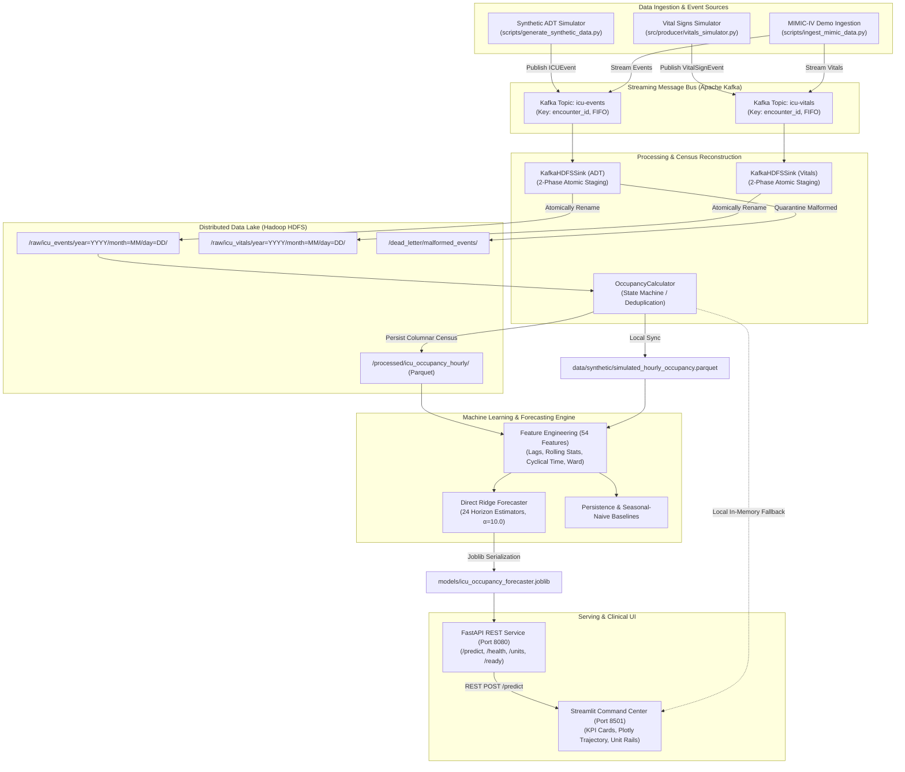

# PulseGrid
### ICU Bed Demand Forecasting & Capacity Intelligence Platform

[](file:///tests)
[](file:///pyproject.toml)
[](file:///docker-compose.yml)
[](#22-license)

---

## 1. Introduction

**PulseGrid** is an end-to-end Big Data Analytics and machine learning platform engineered to address one of the most critical operational bottlenecks in modern hospital administration: **Intensive Care Unit (ICU) bed capacity planning and demand forecasting**.

In acute healthcare facilities, intensive care beds represent a scarce, life-critical, and capital-intensive resource. Unexpected census surges, delayed discharges, or uncoordinated patient transfers often lead to emergency department boarding, delayed elective surgeries, and compromised patient care.

PulseGrid ingests real-time patient Admission, Transfer, and Discharge (ADT) event streams alongside high-frequency bedside vital signs telemetry, persists raw event logs into a distributed Hadoop HDFS data lake, reconstructs instantaneous hourly census time series without double-counting, and generates **1-to-24 hour forward-looking occupancy forecasts** across five specialized ICU wards using direct regularized multi-horizon regression.

---

## 2. Project Overview

The core objective of PulseGrid is to transition hospital operations from reactive crisis management to proactive, data-driven capacity allocation. The platform delivers:

1. **Stateful Event Processing:** Reconstructs continuous census timelines from discrete, asynchronous patient transitions across five critical care wards:
   - **MICU:** Medical Intensive Care Unit (24 beds)
   - **SICU:** Surgical Intensive Care Unit (20 beds)
   - **CSRU:** Cardiac Surgery Recovery Unit (18 beds)
   - **CCU:** Coronary Care Unit (16 beds)
   - **TSICU:** Trauma-Surgical Intensive Care Unit (16 beds)
2. **Big Data Infrastructure:** Connects Apache Kafka event brokers with Hadoop Distributed File System (HDFS) storage using micro-batching, atomic staging renames, and dead-letter quarantine handling.
3. **Multi-Horizon Machine Learning:** Direct Ridge Regression forecasting ($h = 1 \dots 24$ hours ahead) built strictly on chronological, past-only features (autoregressive lags, rolling statistics, calendar harmonics, and ward indicators) with zero future data leakage.
4. **Clinical Command Center:** A restrained, high-contrast operations dashboard delivering real-time census tracking, interactive forecast trajectory charts, ward comparison progress bars, and early capacity exceedance alerts.

---

## 3. Key Features

- **24-Hour Multi-Horizon Forecasting:** Generates independent, direct hourly bed demand predictions for the next 24 hours per ward.
- **Instantaneous Census Reconstruction:** A deterministic state machine that tracks patient locations across transitions, preventing double-counting or orphaned stays.
- **Capacity Exceedance Early Warning:** Computes projected surge exceedances ($\hat{y}_{t+h} > \text{Capacity}$) and triggers automated alerts before capacity ceilings are breached.
- **Distributed ADT Streaming Pipeline:** High-throughput Kafka ingestion (`icu-events`) with encounter-level partition keying ensuring strict FIFO order per patient encounter.
- **Bedside Vital Signs Telemetry Pipeline:** Dedicated Kafka streaming (`icu-vitals`) capturing multi-channel physiological telemetry (Heart Rate, Blood Pressure, Respiratory Rate, Temperature, $\text{SpO}_2$).
- **Two-Phase HDFS Sink & Dead-Letter Quarantine:** Micro-batch consumer landing raw events into partitioned HDFS lake storage with atomic staging renames and dead-letter queue routing for malformed payloads.
- **Columnar Lake Storage:** Processed census time series stored in Snappy-compressed Apache Parquet format with atomic metadata manifest tracking.
- **Deterministic 90-Day Simulation:** Non-homogeneous Poisson arrival simulation with diurnal modulation, weekend dampening, and configurable TSICU surge injection.
- **MIMIC-IV Clinical Database Demo Integration:** Automated download, SHA-256 cryptographic verification, clinical careunit mapping, and comparative model evaluation against real-world PhysioNet records.
- **Production REST API:** High-performance FastAPI backend with lifespan-cached models, comprehensive input validation, and Swagger documentation.
- **Clinical Command Center Dashboard:** Polished Streamlit UI with Plotly charts, 4 KPI metric cards, multi-ward side rails, and collapsible diagnostics.
- **123 Automated Tests:** Rigorous test suite covering schema validation, pipeline reliability, cold-restart recovery, ML feature safety, and API endpoints.

---

## 4. Technology Stack

| Layer | Technologies | Role in PulseGrid |
| :--- | :--- | :--- |
| **Language & Core** | Python 3.12+, Pydantic v2 | Object schemas, domain validation, configuration management via BaseSettings. |
| **Data Processing** | Pandas, NumPy, PyArrow | Data cleaning, rolling aggregations, stateful census reconstruction, Parquet I/O. |
| **Streaming Broker** | Apache Kafka (Confluent cp-kafka 7.5.0), ZooKeeper | Distributed pub/sub streaming for ADT transitions and bedside vital signs. |
| **Data Lake Storage**| Hadoop HDFS 3.2.1 (bde2020), WebHDFS | Distributed lake storage for raw event JSONL archives and processed Parquet census. |
| **Machine Learning** | Scikit-Learn, Joblib | Direct multi-horizon Ridge regression, pipeline scaling, evaluation metrics. |
| **Inference API** | FastAPI, Uvicorn, Starlette | RESTful inference endpoints (`/predict`, `/health`, `/ready`, `/units`, `/model/info`). |
| **Presentation Layer**| Streamlit, Plotly Graph Objects | Clinical operations command center dashboard with interactive time-series plots. |
| **Containerization** | Docker, Docker Compose | Multi-container cluster orchestration for ZooKeeper, Kafka, NameNode, and DataNode. |
| **Testing & Quality**| Pytest, Pytest-Asyncio, HTTPX | Automated unit and integration testing across 123 test cases. |

---

## 5. System Architecture



### Architectural Separation Note
* **Occupancy Forecasting Pipeline:** Operates on patient ADT lifecycle events (`ADMISSION`, `TRANSFER`, `DISCHARGE`), reconstructed into instantaneous hourly census time series for machine learning model training and inference.
* **Vital-Sign Streaming Pipeline:** Runs concurrently through topic `icu-vitals` to ingest and archive multi-parameter bedside physiological telemetry directly into partitioned HDFS lake storage (`/raw/icu_vitals`). Vital signs are archived for clinical telemetry governance and are **not** currently used as input features for the bed demand forecaster.

---

## 6. Repository Structure

```text
PulseGrid/
├── .gitignore                               # Clean exclusion of caches, secrets, and local venvs
├── .streamlit/
│   └── config.toml                          # Native light clinical theme configuration
├── docker-compose.yml                       # Multi-container Kafka, ZooKeeper, and HDFS cluster
├── pyproject.toml                           # Package dependencies, build system, and pytest configuration
├── README.md                                # Master project documentation
├── docker/
│   └── hadoop/
│       └── hadoop.env                       # NameNode and DataNode environment variables
├── data/
│   ├── synthetic/
│   │   ├── simulated_hourly_occupancy.parquet # Reconstructed 90-day hourly census (5 units)
│   │   └── simulated_icu_events.jsonl       # Pre-generated raw synthetic ADT event logs
│   └── mimic_demo/                          # Excluded from Git (PhysioNet download target)
├── documentation/                           # In-depth technical architecture documentation
│   ├── DATA_PIPELINE.md                     # Data pipeline deep-dive
│   ├── SYSTEM_ARCHITECTURE.md               # Detailed architectural specs
│   ├── TECHNICAL_DOCUMENTATION.md           # Engineering reference manual
│   └── PROJECT_REPORT.md                    # Academic project report
├── models/
│   ├── icu_occupancy_forecaster.joblib      # Production 24-horizon Direct Ridge model (Synthetic)
│   ├── feature_metadata.json                # Production feature schema (54 features) and split bounds
│   ├── evaluation_report.json               # Full evaluation metrics across all horizons and units
│   ├── EVALUATION_REPORT.md                 # Production validation report markdown summary
│   ├── mimic_occupancy_forecaster.joblib    # Isolated comparative forecaster (MIMIC cohort)
│   ├── mimic_evaluation_report.json         # Numerical results for MIMIC comparative benchmark
│   └── MIMIC_EVALUATION_REPORT.md           # Comparative MIMIC benchmark report markdown summary
├── scripts/
│   ├── generate_synthetic_data.py           # Generates 90-day synthetic ADT events & Parquet census
│   ├── ingest_mimic_data.py                 # Downloads PhysioNet MIMIC-IV Demo, verifies SHA-256
│   ├── run_streaming_pipeline.py            # Executes Kafka ADT streaming -> HDFS lake sink
│   ├── run_vitals_streaming_pipeline.py     # Executes Kafka bedside vitals streaming -> HDFS lake sink
│   ├── train_eval_forecaster.py             # Trains multi-horizon regression models & exports reports
│   ├── verify_e2e_pipeline.py               # Automated end-to-end integration verification probe
│   └── check_ports.py                       # Diagnostic script verifying required cluster ports
├── src/
│   ├── config.py                            # Pydantic Settings class loading .env configuration
│   ├── api/
│   │   ├── main.py                          # FastAPI application factory, lifespan, CORS, endpoints
│   │   ├── schemas.py                       # Request/Response schemas (PredictionRequest/Response)
│   │   └── service.py                       # ForecastingService singleton: model validation & inference
│   ├── dashboard/
│   │   └── app.py                           # Streamlit Command Center UI (Plotly trajectory, KPI cards)
│   ├── ml/
│   │   ├── features.py                      # Leakage-safe feature extraction (54 features)
│   │   ├── models.py                        # DirectRidgeForecaster, Persistence, Seasonal-Naive
│   │   ├── pipeline.py                      # Chronological splitting (24h buffer gap) & training
│   │   └── metrics.py                       # MAE, RMSE, and zero-denominator-safe WAPE
│   ├── processing/
│   │   └── occupancy_calculator.py          # State-machine hourly occupancy reconstructor
│   ├── producer/
│   │   ├── simulator.py                     # ICUSimulator (Poisson arrivals, log-normal LOS)
│   │   ├── kafka_producer.py                # ICUKafkaProducer (Kafka ADT publisher)
│   │   ├── vitals_simulator.py              # VitalSignSimulator (telemetry generator)
│   │   └── vitals_producer.py               # ICUVitalsProducer (Kafka vitals publisher)
│   ├── schema/
│   │   ├── events.py                        # Pydantic schemas: ICUEvent, VitalSignEvent
│   │   └── occupancy.py                     # Pydantic schema: HourlyOccupancy
│   └── storage/
│       ├── hdfs_client.py                   # WebHDFS client with Docker Desktop redirect remapping
│       └── kafka_sink.py                    # KafkaHDFSSink (micro-batching & atomic rename)
└── tests/
    ├── conftest.py                          # Pytest fixtures and mock factories
    ├── unit/                                # 93 Unit tests
    └── integration/                         # 30 Integration tests
```

---

## 7. Prerequisites

Before installing PulseGrid, ensure your system meets these requirements:

- **Operating System:** macOS (Apple Silicon or Intel) or Linux (Ubuntu 20.04+ recommended).
- **Python:** Python `3.12` or higher (verified on Python 3.12 and 3.13).
- **Docker & Docker Compose:** Docker Desktop with at least 4 GB of allocated RAM.
- **Port Availability:** The following ports must be free:
  - `2181`: Apache ZooKeeper
  - `9092`: Apache Kafka Broker
  - `9870`: Hadoop HDFS NameNode WebHDFS
  - `9000`: Hadoop HDFS NameNode RPC
  - `9864`: Hadoop HDFS DataNode WebHDFS
  - `8080`: FastAPI Prediction Service
  - `8501`: Streamlit Dashboard

You can verify port availability with:
```bash
python scripts/check_ports.py
```

---

## 8. Installation

### 1. Clone the Repository
```bash
git clone https://github.com/anaghahallur/PulseGrid.git
cd PulseGrid
```

### 2. Create and Activate Virtual Environment
```bash
python3.12 -m venv .venv
source .venv/bin/activate
```

### 3. Install Project Dependencies
PulseGrid organizes dependencies into modular groups inside [`pyproject.toml`](file:///pyproject.toml):

```bash
# Core dependencies + ML training + Serving (FastAPI/Streamlit) + Test suite
pip install --upgrade pip
pip install -e ".[ml,serving,test]"
```

---

## 9. Environment Configuration

PulseGrid uses Pydantic Settings to load environment variables safely without hardcoding secrets. An environment template is provided in `.env.example`:

```bash
cp .env.example .env
```

### Documented Configuration Variables

| Variable | Default Value | Description |
| :--- | :--- | :--- |
| `KAFKA_BOOTSTRAP_SERVERS` | `localhost:9092` | Kafka broker address. |
| `KAFKA_TOPIC_ICU_EVENTS` | `icu-events` | Kafka topic for patient ADT events. |
| `KAFKA_TOPIC_ICU_VITALS` | `icu-vitals` | Kafka topic for bedside vital sign telemetry. |
| `KAFKA_CONSUMER_GROUP_ID` | `icu-hdfs-sink-group` | Consumer group ID for ADT HDFS sink. |
| `KAFKA_VITALS_CONSUMER_GROUP_ID` | `icu-vitals-hdfs-sink-group` | Consumer group ID for vitals HDFS sink. |
| `KAFKA_AUTO_OFFSET_RESET` | `earliest` | Offset reset policy for consumers. |
| `HDFS_NAMENODE_URL` | `http://localhost:9870` | WebHDFS REST API endpoint for NameNode. |
| `HDFS_NAMENODE_RPC` | `hdfs://localhost:9000` | HDFS IPC connection URI. |
| `HDFS_USER` | `root` | HDFS username for WebHDFS operations. |
| `HDFS_RAW_PATH` | `/raw/icu_events` | HDFS directory for raw ingested ADT event batches. |
| `HDFS_VITALS_RAW_PATH` | `/raw/icu_vitals` | HDFS directory for raw ingested vital sign batches. |
| `HDFS_PROCESSED_PATH` | `/processed/icu_occupancy_hourly` | HDFS directory for processed hourly census Parquet. |
| `FASTAPI_HOST` | `0.0.0.0` | Host binding for FastAPI. |
| `FASTAPI_PORT` | `8080` | Port for FastAPI prediction service. |
| `STREAMLIT_PORT` | `8501` | Port for Streamlit dashboard. |
| `SIMULATION_RANDOM_SEED` | `42` | Random seed for deterministic data generation. |
| `SIMULATION_DEFAULT_DAYS`| `90` | Default historical simulation span in days. |

*Security Warning: Never commit real `.env` files containing credentials to version control.*

---

## 10. Starting the Infrastructure

Start the local Big Data container cluster using Docker Compose:

```bash
docker compose up -d
```

### Verify Service Health
```bash
docker compose ps
```
Confirm all 4 containers display `healthy`:
- `icu-zookeeper` (port 2181)
- `icu-kafka` (port 9092)
- `icu-namenode` (ports 9870, 9000)
- `icu-datanode` (port 9864)

Verify NameNode WebHDFS access:
```bash
curl -s http://localhost:9870/webhdfs/v1/?op=LISTSTATUS&user.name=root | grep FileStatuses
```

---

## 11. Running the Application

### 1. Launch the FastAPI Prediction Service
```bash
uvicorn src.api.main:app --host 0.0.0.0 --port 8080 --reload
```
- **REST API Base URL:** `http://localhost:8080`
- **Interactive Swagger Documentation:** `http://localhost:8080/docs`
- **Health Check Endpoint:** `http://localhost:8080/health`
- **Readiness Probe:** `http://localhost:8080/ready`

### 2. Launch the Streamlit Clinical Command Center
In a separate terminal (with `.venv` activated):
```bash
streamlit run src/dashboard/app.py --server.port 8501
```
- **Dashboard URL:** `http://localhost:8501`

---

## 12. Running the Streaming Pipelines

### A. ADT Event Streaming Pipeline
Streams patient admission, transfer, and discharge events into Kafka and sinks them to HDFS:
```bash
python scripts/run_streaming_pipeline.py --events-file data/synthetic/simulated_icu_events.jsonl --batch-size 200
```
- **Kafka Topic:** `icu-events`
- **HDFS Target:** `/raw/icu_events/year=YYYY/month=MM/day=DD/events_<uuid>.jsonl`
- **Dead-Letter Target:** `/dead_letter/malformed_events/`

### B. Bedside Vital-Sign Telemetry Streaming Pipeline
Streams continuous physiological vital sign events into Kafka and lands them in HDFS:
```bash
python scripts/run_vitals_streaming_pipeline.py --records 500 --batch-size 100
```
- **Kafka Topic:** `icu-vitals`
- **HDFS Target:** `/raw/icu_vitals/year=YYYY/month=MM/day=DD/vitals_<uuid>.jsonl`

---

## 13. Data Ingestion

### A. Synthetic Simulation Workflow
Generates 90 days of reproducible synthetic patient flow with a controlled TSICU surge scenario:
```bash
python scripts/generate_synthetic_data.py --days 90 --seed 42 --surge
```
Outputs:
- `data/synthetic/simulated_icu_events.jsonl` (Raw ADT event stream)
- `data/synthetic/simulated_hourly_occupancy.parquet` (Hourly census ground truth)

### B. MIMIC-IV Clinical Database Demo Workflow
The MIMIC-IV Demo dataset is an open-access clinical subset provided by PhysioNet (100 patients, ODbL).

Download, verify SHA-256 cryptographic checksums, extract ADT events, and construct the synchronized comparative cohort:
```bash
python scripts/ingest_mimic_data.py --demo
```
- **Data Compliance Notice:** Raw PhysioNet files (`chartevents.csv.gz`, `transfers.csv.gz`, `icustays.csv.gz`) are excluded from Git to comply with PhysioNet data-use agreements. Running the ingestion script automatically downloads them to `data/mimic_demo/` and validates their integrity against `SHA256SUMS.txt`.
- **Temporal Synchronization Rationale:** In raw MIMIC-IV records, patient dates are randomly shifted across 2100–2200 for de-identification. Stays are spread sparsely across decades, resulting in concurrent occupancy of 0–2 beds. The synchronized demonstration cohort aligns stay start times into September–October 2026 while **strictly preserving** exact stay duration to the second, event order, and vital sign offsets.

---

## 14. Forecasting Methodology

### A. Direct Multi-Horizon Ridge Regression
Instead of recursive 1-step forecasting (which feeds predicted values back as inputs and compounds errors exponentially), PulseGrid implements a **Direct Multi-Horizon architecture**:
$$\hat{y}_{t+h} = \mathbf{w}_h^T \phi(\mathbf{x}_t) + b_h \quad \text{for } h \in \{1, 2, \dots, 24\}$$

- Fits **24 independent regularized linear estimators** ($\alpha = 10.0$).
- Features are scaled via `StandardScaler` inside a dedicated `Pipeline` per horizon.
- Outputs are bounded via $\hat{y} = \max(0.0, \hat{y})$ (physically non-negative bed counts), without capping at capacity, allowing exceedance detection.

### B. 54 Past-Only Features (Zero Future Leakage)
1. **Flow Counts at Origin $t$ (4 features):** `admissions_count`, `discharges_count`, `transfers_in_count`, `transfers_out_count`.
2. **Autoregressive Lags (28 features):** Current census `occ_current` ($t$), hourly lags `lag_1` through `lag_24`, multi-day lags `lag_48`, `lag_72`, and weekly lag `lag_168`.
3. **Past Rolling Statistics (6 features):** Rolling mean and standard deviation over 6-hour, 24-hour, and 168-hour windows (`roll_mean_6`, `roll_std_6`, `roll_mean_24`, etc.) with `closed='right'` on past values ($y \le t$).
4. **Calendar Harmonics (5 features):** $\sin/\cos$ diurnal cycles, $\sin/\cos$ day-of-week cycles, and `is_weekend` indicator.
5. **Cumulative 24-Hour Patient Flow (4 features):** 24-hour rolling sums of admissions, discharges, transfers in, and transfers out.
6. **Capacity Context (2 features):** Staffed capacity ceiling `capacity_val` and current utilization ratio `occ_rate_current`.
7. **Ward One-Hot Indicators (5 features):** `unit_CCU`, `unit_CSRU`, `unit_MICU`, `unit_SICU`, `unit_TSICU`.

### C. Baseline Benchmark Models
- **Persistence Baseline:** $\hat{y}_{t+h} = y_t$ (assumes occupancy remains constant at the latest observed value).
- **Seasonal-Naive Baseline (24h):** $\hat{y}_{t+h} = y_{t+h-24}$ (projects the exact observation from the same hour on the previous day).

---

## 15. Evaluation

### A. Evaluation Metrics
- **Mean Absolute Error (MAE):** Average absolute deviation in occupied beds:
  $$\text{MAE} = \frac{1}{N \cdot H} \sum_{i=1}^N \sum_{h=1}^H |y_{i,h} - \hat{y}_{i,h}|$$
- **Root Mean Squared Error (RMSE):** Penalizes large forecast misses:
  $$\text{RMSE} = \sqrt{\frac{1}{N \cdot H} \sum_{i=1}^N \sum_{h=1}^H (y_{i,h} - \hat{y}_{i,h})^2}$$
- **Weighted Absolute Percentage Error (WAPE):** Normalized percentage error with explicit zero-denominator protection:
  $$\text{WAPE} = \frac{\sum |y - \hat{y}|}{\sum y}$$

### B. Verified Evaluation Results

The evaluation results are reported separately across the two distinct evaluation tracks:

#### Track 1: Synthetic Dataset (90-Day Continuous Census, 1,480 Test Samples)
Evaluated across a held-out test split (70% Train, 15% Val, 15% Test with a 24-hour buffer gap):

| Model | Overall MAE (Beds) | Overall RMSE (Beds) | Overall WAPE (%) | Verdict |
| :--- | :---: | :---: | :---: | :--- |
| **Direct Ridge Regression (Production)** | **1.69** | **2.25** | **16.0%** | **Best overall multi-horizon performance.** |
| **Persistence Baseline** | 1.73 | 2.36 | 16.4% | Strong at $h=1$, degrades at $h=24$. |
| **HistGradientBoosting** | 1.91 | 2.52 | 18.1% | Captures non-linearities but slightly overfits. |
| **Seasonal-Naive Baseline (24h)** | 2.31 | 2.98 | 23.8% | Captures diurnal wave, misses autoregressive trend. |

*Horizon Dynamics:* At $h=1$, Persistence achieves an MAE of $0.35$ beds vs. Ridge's $0.42$ beds. However, by $h=24$, Persistence error climbs to $2.44$ beds, whereas Direct Ridge stabilizes at $2.15$ beds, confirming the value of multi-horizon feature learning over long planning horizons.

#### Track 2: MIMIC-IV Demo Cohort (139 ICU Stays, 903 Hours per Ward)
Evaluated independently on the synchronized demonstration cohort:

| Model | Overall MAE (Beds) | Overall RMSE (Beds) | Overall WAPE (%) | Verdict |
| :--- | :---: | :---: | :---: | :--- |
| **Persistence Baseline** | **0.08** | **0.34** | **6.5%** | **Best performance on sparse data.** |
| **Seasonal-Naive Baseline** | 0.16 | 0.50 | 13.0% | Captures daily baseline. |
| **HistGradientBoosting** | 0.44 | 0.69 | 35.4% | Tree ensemble overfits sparse occupancy. |
| **Direct Ridge Regression** | 0.64 | 0.81 | 52.3% | Linear regression shrinks toward mean on low census. |

*Technical Analysis:* In the small 100-patient MIMIC-IV Demo, mean census is very low ($1 - 2$ beds per unit). On sparse, near-zero step functions, statistical regression models regress toward sample means, inflating percentage errors (WAPE 52.3%), while the simple Persistence baseline excels (WAPE 6.5%). This comparative finding demonstrates the importance of matching model complexity to data scale.

---

## 16. API Documentation

FastAPI runs on `http://localhost:8080`. Interactive OpenAPI documentation is available at `http://localhost:8080/docs`.

### Implemented Endpoints

#### 1. `GET /health`
Liveness probe.
```json
{
  "status": "ok",
  "service": "icu-bed-demand-forecasting",
  "version": "0.1.0",
  "timestamp": "2026-10-14T15:40:00Z"
}
```

#### 2. `GET /ready`
Readiness probe confirming model artifact deserialization and 54-feature schema parity. Returns HTTP 503 if unready.
```json
{
  "ready": true,
  "model_loaded": true,
  "model_name": "Direct Ridge Regression",
  "horizons": 24,
  "features_count": 54,
  "timestamp": "2026-10-14T15:40:00Z",
  "details": "Model and metadata verified. Ready for multi-horizon inference."
}
```

#### 3. `GET /units`
Returns configured ICU wards and licensed staffed bed capacities (`MICU: 24`, `SICU: 20`, `CSRU: 18`, `CCU: 16`, `TSICU: 16`).

#### 4. `GET /model/info`
Returns active model parameters, input feature list, training split boundaries, and evaluation benchmarks.

#### 5. `POST /predict`
Generates 1-to-24 hour occupancy projections for a specified ward.

**Request Payload (`PredictionRequest`):**
```json
{
  "unit_id": "MICU",
  "model_name": "direct_ridge",
  "horizons": 24,
  "allow_persistence_fallback": true,
  "scenario_capacity": 24
}
```

**Response Payload (`PredictionResponse`):**
```json
{
  "unit_id": "MICU",
  "forecast_origin": "2026-10-14T10:00:00Z",
  "model_used": "Direct Ridge Regression",
  "is_baseline": false,
  "staffed_capacity": 24,
  "current_occupancy": 9.0,
  "data_source": "LOCAL_SYNTHETIC_STORE",
  "is_live_stream": false,
  "predictions": [
    {
      "horizon": 1,
      "forecast_timestamp": "2026-10-14T11:00:00Z",
      "predicted_occupancy": 9.2,
      "staffed_capacity": 24,
      "is_capacity_exceeded": false,
      "exceedance_beds": 0.0
    },
    {
      "horizon": 22,
      "forecast_timestamp": "2026-10-15T08:00:00Z",
      "predicted_occupancy": 10.5,
      "staffed_capacity": 24,
      "is_capacity_exceeded": false,
      "exceedance_beds": 0.0
    }
  ]
}
```

---

## 17. Dashboard User Guide

The Streamlit dashboard (`http://localhost:8501`) provides an operational interface designed for hospital nursing supervisors and bed-placement coordinators:

1. **Sidebar Controls:**
   - **Target ICU Ward Selection:** Switch between `CCU`, `CSRU`, `MICU`, `SICU`, and `TSICU`.
   - **Inference Model Selection:** Choose between `Direct Ridge Regression (Production)`, `Persistence Baseline`, or `Seasonal-Naive Baseline`.
   - **Forecast Horizon Slider:** Select forward projection window ($1 - 24$ hours).
   - **Historical Context Slider:** Adjust observed historical window ($12 - 168$ hours).
2. **Telemetry Header:** Real-time badges for API connectivity (`API Live :8080`), active data source (`LOCAL_SYNTHETIC_STORE`), data freshness age, and UTC forecast origin.
3. **KPI Metric Row:**
   - **Current Census:** Real-time active occupied bed count.
   - **Staffed Capacity:** Licensed capacity and immediately available staffed beds.
   - **Unit Utilization:** Percentage with dynamic threshold coloring (Green $<80\%$, Amber $80-95\%$, Red $>95\%$).
   - **Peak Projected Demand:** Maximum predicted occupancy over the next 24 hours with exact lead time (`+Xh`) and UTC timestamp.
4. **Main Forecast Chart (~65% width):** Plotly interactive figure showing historical census observations (`#334155`), red dashed staffed capacity ceiling (`#DC2626`), subtle shaded forecast window (`rgba(13, 148, 136, 0.04)`), clinical teal forecast trajectory (`#0D9488`), dotted forecast origin marker, and on-chart peak demand callouts.
5. **ICU Unit Comparison Panel (~35% width):** Multi-ward overview displaying census vs. capacity, utilization percentages, and colored progress bars for all 5 wards. The active ward is highlighted with an `ACTIVE` teal badge and border.
6. **Operational Capacity Summary:** Briefing card displaying peak demand, minimum buffer headroom, and operational posture (`STABLE OPERATING POSTURE`, `ELEVATED CENSUS`, or `SURGE RISK DETECTED`).
7. **System Diagnostics Expander:** Collapsible panel with live status cards for FastAPI, Kafka, HDFS, and Bedside Vitals alongside the 24-hour tabular breakdown.

---

## 18. Testing & Quality Assurance

PulseGrid maintains an automated test suite executed via `pytest`:

```bash
pytest tests/ -v
```

### Verified Test Suite Result
```text
======================= 123 passed, 4 warnings in 22.13s =======================
```

### Test Suite Structure (123 Tests)
- **Unit Tests (93 tests):**
  - `test_api_schemas_and_service.py` (27 tests): Pydantic validation, non-contiguous history rejection, off-hour checks, persistence fallback, feature parity.
  - `test_occupancy_calculator.py` (16 tests): Double-counting prevention, transfer state tracking, out-of-order events, correction supersession, cold-restart reconstruction.
  - `test_vitals_pipeline.py` (16 tests): VitalSignEvent validation, physical ranges, $\text{SBP} \ge \text{DBP}$ checks, simulator determinism.
  - `test_ml_pipeline.py` (10 tests): Multi-horizon target construction, zero future leakage, chronological split buffer validation, model serialization.
  - `test_schemas.py` (9 tests): `ICUEvent` transitions, UUID idempotency, validation errors.
  - `test_mimic_ingestion.py` (8 tests): PhysioNet SHA-256 checks, careunit mapping, multiple stays per admission, temperature conversion.
  - `test_dashboard.py` (4 tests): API health check downtime handling, local fallback forecast generation, history loading.
  - `test_simulator.py` (3 tests): Simulation determinism via fixed seed, timeline continuity, surge scenario multipliers.
- **Integration Tests (30 tests):**
  - `test_api_endpoints.py` (14 tests): Live FastAPI endpoints (`/health`, `/ready`, `/units`, `/model/info`, `/predict`).
  - `test_pipeline_reliability_audit.py` (5 tests): Multi-date partition failure offset rollback, post-finalization crash replay deduplication, dead-letter quarantine.
  - `test_vitals_streaming.py` (3 tests): End-to-end vitals streaming cycle (`icu-vitals` $\to$ HDFS `/raw/icu_vitals`), dead-letter quarantine.
  - `test_end_to_end_pipeline.py` (3 tests): End-to-end flow from event generation through HDFS Parquet to API inference.
  - `test_storage_streaming.py` (2 tests): Live WebHDFS read/write connectivity and Kafka publishing.
  - `test_failure_recovery.py` (2 tests): HDFS write failure aborts Kafka offset commit; consumer restart prevents duplicate ingestion.
  - `test_mimic_streaming.py` (1 test): End-to-end Kafka-to-HDFS streaming of parsed MIMIC ADT and vitals events.

*Notice: Passing software tests verifies pipeline correctness and data integrity; it does not establish clinical validity.*

---

## 19. Limitations & Clinical Boundaries

1. **Small MIMIC-IV Demo Cohort:** The open-access MIMIC-IV Demo contains only 100 patients and 139 ICU stays. Statistical machine learning models require larger sample sizes to generalize effectively.
2. **Artificial Cohort Synchronization:** Raw PhysioNet dates are shifted across 2100–2200 for de-identification. The synchronized demonstration cohort aligns these stays into a September–October 2026 window for census calculation. While stay durations are strictly preserved, the concurrent arrival patterns are artificially synchronized.
3. **Decoupled Telemetry:** Bedside vital signs are ingested and archived in HDFS (`/raw/icu_vitals`), but the occupancy forecasting model currently uses ADT flow and census lag features. Telemetry is not yet joined into patient-level acuity scores for census prediction.
4. **Static Capacity Assumption:** Staffed bed capacity is modeled as fixed per ward (`MICU: 24`, etc.) rather than dynamically fluctuating with daily nurse-to-patient staffing ratios.
5. **No Medical Device Certification:** PulseGrid is an educational and research prototype. It does not constitute a certified medical device and must not be used for direct clinical diagnosis or patient triage.

---

## 20. Future Improvements

- **Acuity-Informed Forecasting:** Extract aggregate patient severity scores (e.g., SOFA scores derived from bedside telemetry) and incorporate them as dynamic lag features for discharge likelihood estimation.
- **Apache Spark Streaming:** Integrate PySpark Structured Streaming for real-time sliding-window census aggregations directly from Kafka.
- **Probabilistic Forecast Corridors:** Implement Quantile Gradient Boosting or Conformal Prediction to produce calibrated $80\%$ and $95\%$ prediction intervals alongside point estimates.
- **Dynamic Nurse Staffing Constraints:** Model bed capacity as a function of scheduled nursing shifts and nurse-to-patient acuity ratios.

---

## 21. Responsible Data Use and Security

- **De-Identification & Compliance:** This project strictly uses either synthetic data or the officially de-identified MIMIC-IV Clinical Database Demo 2.2 under PhysioNet's Open Data Commons Open Database License (ODbL).
- **No Protected Health Information (PHI):** Never commit real patient medical records, un-anonymized clinical logs, or restricted access credentials to version control.
- **Credential Protection:** Secrets, passwords, and local cluster tokens must remain in untracked `.env` files.

---

## 22. License

This repository currently has **no declared open-source license**. All rights are reserved by the authors for academic evaluation and project demonstration.

---

## 23. Acknowledgments and References

- **MIMIC-IV Clinical Database:** Johnson, A., Bulgarelli, L., Pollard, T., Horng, S., Celi, L. A., & Mark, R. (2023). *MIMIC-IV* (version 2.2). PhysioNet. [https://doi.org/10.13026/6mm1-ek67](https://doi.org/10.13026/6mm1-ek67).
- **Apache Kafka:** The Apache Software Foundation. [https://kafka.apache.org/](https://kafka.apache.org/)
- **Apache Hadoop HDFS:** The Apache Software Foundation. [https://hadoop.apache.org/](https://hadoop.apache.org/)
- **Scikit-Learn:** Pedregosa et al. (2011). *Scikit-learn: Machine Learning in Python*. JMLR 12, pp. 2825-2830.
- **FastAPI:** Sebastián Ramírez. [https://fastapi.tiangolo.com/](https://fastapi.tiangolo.com/)
- **Streamlit:** Snowflake Inc. [https://streamlit.io/](https://streamlit.io/)

---

## 24. Academic Project Disclaimer

This software platform was developed strictly for academic demonstration and research purposes as part of a final-year **Big Data Analytics (BDA)** curriculum. It demonstrates data engineering pipelines, distributed lake architectures, and multi-horizon time-series regression. It **does not** constitute a medical device, has not been validated in clinical trials, and should never be used for real-time patient diagnosis, triage, or clinical decision-making.
