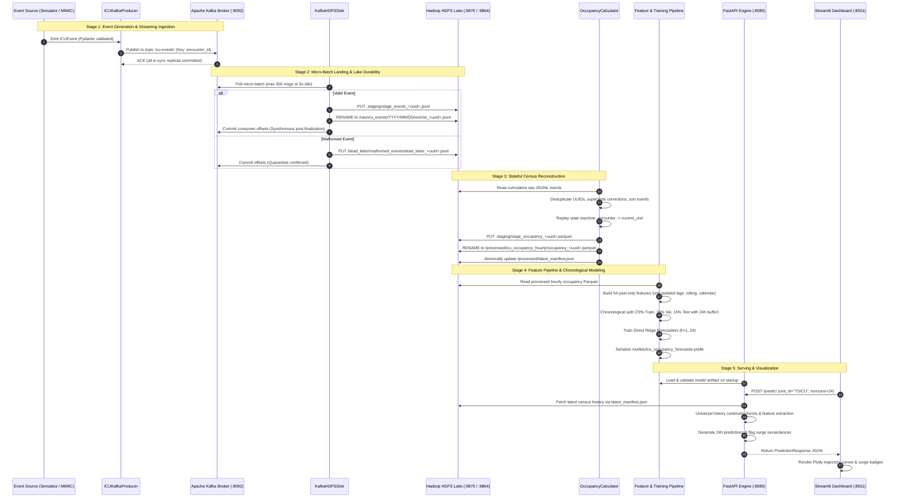
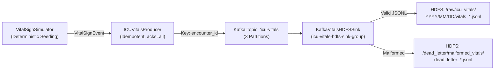
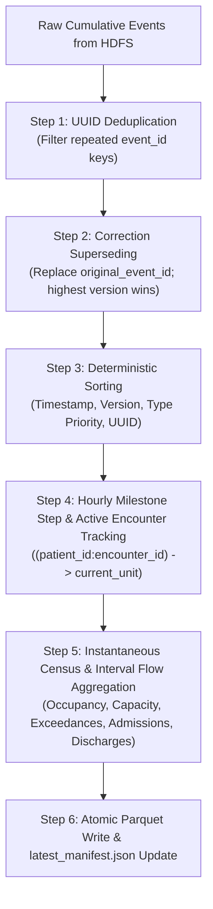

# Big Data Pipeline Specification — ICU Bed Demand Forecasting

A Comprehensive Lifecycle Analysis of Streaming Ingestion, Lake Storage, Stateful Reconstruction, and Machine Learning Features.

---

## 1. End-to-End Data Lifecycle Architecture

The project manages an immutable, verifiable, and stateful Big Data pipeline that transforms raw clinical transitions into 24-hour predictive operational forecasts:



---

## 2. Stage 1: Data Sources & Provenance

The system enforces strict distinction between two primary data sources:

| Property | Synthetic Event Stream (`SYNTHETIC`) | PhysioNet MIMIC-IV Demo (`MIMIC_DEMO`) |
| :--- | :--- | :--- |
| **Origin** | `src/producer/simulator.py` | PhysioNet Clinical Database Demo 2.2 |
| **License / Terms** | Open-source MIT / Academic Internal | Open Data Commons Open Database License (ODbL) |
| **Patient Volume** | 90 days continuous ($\approx 12,000$ events) | 100 patient stays ($\approx 250$ events) |
| **Hospital Scope** | 5 units: MICU, SICU, CCU, TSICU, CSRU | Beth Israel Deaconess Medical Center careunits |
| **Primary Role** | Continuous Kafka streaming, ML training, surge tests | CSV ingestion validation & clinical transfer verification |
| **PHI Status** | **Zero PHI** (100% mathematically synthesized) | Anonymized de-identified public clinical demo |

### 2.1 Synthetic Non-Homogeneous Poisson Generation
Hospital admissions are generated using stochastic mathematical distributions:
- **Arrival Process:** Non-homogeneous Poisson process where hourly arrival parameter $\lambda(t, u)$ is modulated by diurnal and weekday factors:
  $$\lambda(t, u) = \frac{\lambda_{\text{base}}(u)}{24} \cdot \mu_{\text{diurnal}}(t) \cdot \mu_{\text{weekend}}(t, u) \cdot \mu_{\text{surge}}(t, u)$$
- **Diurnal Modulation:** Admissions peak during afternoon hours (10:00–18:00) and fall overnight:
  $$\mu_{\text{diurnal}}(t) = 1.0 + 0.45 \cdot \sin\left(\frac{\pi (\text{hour} - 8)}{12}\right) \quad \text{for } 8 \le \text{hour} \le 20, \quad 0.55 \text{ otherwise}$$
- **Length of Stay (LOS):** Sampled from a right-skewed lognormal distribution parameterized by mean stay (48 hours) and shape parameter $\sigma = 0.75$, clipped to $[4, 720]$ hours.
- **Inter-Unit Transfers:** 12% of admitted encounters undergo clinical transfers between ICUs.

### 2.2 MIMIC-IV Clinical Demo Parsing & Ingestion
The system integrates the publicly accessible PhysioNet MIMIC-IV Clinical Database Demo (v2.2) via `scripts/ingest_mimic_data.py`:
- **Open-Access Acquisition:** Downloads public demo tables (`transfers.csv.gz`, `icustays.csv.gz`, `d_items.csv.gz`, `chartevents.csv.gz`) directly from PhysioNet (`https://physionet.org/files/mimic-iv-demo/2.2/`). Does not require or solicit credentials or human subject protection DUA.
- **Cryptographic Integrity:** Validates SHA-256 cryptographic hashes against PhysioNet's published `SHA256SUMS.txt` before parsing.
- **ADT Event Extraction:**
  - Isolates individual ICU stays using `stay_id` (`encounter_id = f"MIMIC-ENC-{hadm_id}-STAY-{stay_id}"`) to prevent collisions and improper state closure across multiple ICU admissions within a single hospital admission (`hadm_id`).
  - Standardizes hospital care units into the 5 canonical ICU units (`MICU`, `SICU`, `CCU`, `TSICU`, `CSRU`).
  - Emits valid, ordered `ICUEvent` records (`ADMISSION`, `TRANSFER`, `DISCHARGE`) preserving source timestamps.
- **Vital-Sign Telemetry Extraction:**
  - Extracts bedside physiological observations from `chartevents.csv.gz` mapped to `VitalSignEvent`.
  - Item ID mappings: Heart Rate (`220045`), Non-Invasive Blood Pressure (`220179`/`220180`), Invasive Arterial Pressure (`220050`/`220051`), Respiratory Rate (`220210`), Pulse Oximetry SpO2 (`220277`), Temperature Fahrenheit (`223762`, converted to Celsius via $(F-32)\times 5/9$), Temperature Celsius (`223761`).
  - Applies clinical plausibility ranges and discards null or corrupted records.
- **Dual-Stream Temporal Architecture:**
  - **Source-Timeline Data:** Preserves unadulterated source timestamps in the 22nd century (`mimic_demo_events.jsonl`, `mimic_demo_vitals.jsonl`) for faithful provenance and schema validation.
  - **Synchronized Demonstration Cohort:** Because each patient in MIMIC-IV is assigned an independent HIPAA date-shift offset across 100 years, an unshifted raw census is >99.99% empty. An opt-in synchronized cohort (`mimic_cohort_events.jsonl`, `mimic_cohort_vitals.jsonl`) rigidly aligns patient admissions into a 25-day demonstration epoch while strictly preserving every patient's internal length of stay down to the second, all inter-unit transfer delays, and all vital sign measurement intervals.
- **Reconstructed Hourly Census:** Replayed through `OccupancyCalculator` to produce `data/mimic_demo/mimic_hourly_occupancy.parquet`.


---

## 3. Stage 2: Streaming Ingestion & Kafka-to-HDFS Sink

### 3.1 Encounter-Keyed Partitioning
To prevent race conditions during distributed consumption, `ICUKafkaProducer` routes messages using `encounter_id` as the message key:
- **FIFO Ordering Guarantee:** All transitions for a single patient stay (`ADMISSION` $\to$ `TRANSFER` $\to$ `DISCHARGE`) hash to the **exact same Kafka partition**.
- This guarantees downstream consumers receive events in strict chronological order per encounter.

### 3.2 Micro-Batch HDFS Ingestion Semantics (ADT Events)
The `KafkaHDFSSink` in `src/storage/kafka_sink.py` consumes messages from `icu-events`:
1. **Batch Accumulation:** Accumulates up to 500 messages or waits for a 5.0-second idle timeout.
2. **Schema Segregation:** Inspects payloads using `ICUEvent.model_validate()`. Malformed or unparseable messages are segregated.
3. **Dead-Letter Quarantine (DLQ):** Malformed records are written to `/dead_letter/malformed_events/dead_letter_<uuid>.jsonl`. The write is verified; if DLQ landing fails, the batch aborts before committing offsets.
4. **Date Partitioning:** Valid events are partitioned by event timestamp:
   ```text
   /raw/icu_events/year=2026/month=10/day=14/events_7a8b9c.jsonl
   ```
5. **Atomic Two-Step Finalization:**
   - Write batch to `/raw/icu_events/.staging/stage_events_<uuid>.jsonl`.
   - Execute WebHDFS atomic rename to target date-partitioned file.
6. **Synchronous Offset Commitment:** Consumer offsets are committed to Kafka **strictly after** verified HDFS rename, establishing durable **at-least-once delivery**.

### 3.3 Patient Vital-Sign Streaming & HDFS Persistence (`icu-vitals`)
To fulfill the multi-stream assignment requirement while preserving pipeline stability, a parallel streaming path is implemented:



1. **Vital Sign Payload (`VitalSignEvent`):** Validated clinical observation records containing `heart_rate`, `temperature_c`, `systolic_bp`, `diastolic_bp`, `respiratory_rate`, and `spo2`.
2. **Dedicated Kafka Topic:** Messages stream exclusively through topic `icu-vitals`, completely isolating high-frequency physiological telemetry from discrete ward transitions (`icu-events`).
3. **Dedicated HDFS Landing Zone:** Ingested via `KafkaVitalsHDFSSink` into `/raw/icu_vitals/year=YYYY/month=MM/day=DD/vitals_<uuid>.jsonl` with atomic staging renames.
4. **Isolated DLQ:** Unparseable records are quarantined under `/dead_letter/malformed_vitals/`.

> [!IMPORTANT]
> **Decoupling Notice:** Patient vital signs are fully ingested and persisted to Hadoop HDFS for downstream clinical analytics. However, **vital signs are NOT used by the hourly occupancy census reconstruction or the 24-hour ward demand forecasting model**, which operate exclusively on census transitions. Integrating physiological severity scores (e.g., SOFA/APACHE) into bed occupancy forecasting remains a future extension.

---

## 4. Stage 3: Data Cleaning, Deduplication & Census Reconstruction

The stateful reconstruction engine (`OccupancyCalculator` in `src/processing/occupancy_calculator.py`) replays raw event streams into clean hourly censuses.



### 4.1 Cleaning Operations & Edge-Case Handling

| Cleaning Operation | Clinical & Technical Cause | Implementation Mechanism | Code Reference |
| :--- | :--- | :--- | :--- |
| **UUID Deduplication** | Network retries, Kafka replay, producer re-sends | Set tracking `seen_event_ids`; duplicates skipped | `occupancy_calculator.py:51-58` |
| **Correction Superseding** | Clerical data entry errors amended by EHR | Records with `is_correction=True` supersede `original_event_id`; version tie-breaking | `occupancy_calculator.py:60-77` |
| **Deterministic Tie-Breaking** | Simultaneous timestamps within same microsecond | Sorted by `(event_timestamp, version, type_priority, event_id)` where Admit < Transfer < Discharge | `occupancy_calculator.py:88-96` |
| **Transfer Origin Mismatch** | Unregistered inter-ward bed movement | If transfer `from_unit` differs from internal tracked state, patient is moved from tracked unit to `to_unit` | `occupancy_calculator.py:165-177` |
| **Unmatched Discharges** | Historical events admitted prior to available lake logs | Safe dictionary pop; flow counted without crashing state machine | `occupancy_calculator.py:156-164` |
| **Double-Counting Elimination** | Fast transfers or simultaneous bed moves | Key `(patient_id:encounter_id)` occupies at most one bed at milestone $t$ | `occupancy_calculator.py:150-155` |

### 4.2 Cumulative Replay Justification
- **The Boundary Crossing Problem:** Hospital ICU length of stay is long (mean: 48 hours; max: 720 hours). If processing is partitioned into isolated hourly or daily windows, patients admitted prior to window start are invisible unless prior state is carried forward.
- **Solution:** `OccupancyCalculator` performs cumulative replay of raw events from the HDFS raw zone, ensuring 100% census ground truth.

---

## 5. Stage 4: Feature Engineering & Leakage Safeguards

`src/ml/features.py` transforms hourly census time series into a supervised machine learning feature matrix.

### 5.1 The 54 Feature Set Inventory

```text
54 Total Input Features:
├── 28 Lag Features (Past Occupancy)
│   ├── occ_current (Lag 0: Census at forecast origin t)
│   ├── lag_1 through lag_24 (All 24 hourly lags over past day)
│   └── lag_48, lag_72, lag_168 (Multi-day and 1-week historical lags)
├── 6 Rolling Summary Statistics
│   ├── roll_mean_6, roll_std_6 (6-hour tactical trend and volatility)
│   ├── roll_mean_24, roll_std_24 (24-hour daily average and volatility)
│   └── roll_mean_168, roll_std_168 (7-day weekly baseline and volatility)
├── 5 Calendar & Diurnal Harmonics
│   ├── hour_sin, hour_cos (sin(2π·hour/24), cos(2π·hour/24))
│   ├── dow_sin, dow_cos (sin(2π·dow/7), cos(2π·dow/7))
│   └── is_weekend (Binary indicator for Saturday/Sunday)
├── 4 Flow Volume Aggregations
│   └── {admissions, discharges, transfers_in, transfers_out}_past_24h
├── 2 Capacity & Utilization Context
│   ├── capacity_val (Staffed bed ceiling)
│   └── occ_rate_current (occ_current / capacity_val)
└── 5 Unit One-Hot Indicators
    └── unit_CCU, unit_CSRU, unit_MICU, unit_SICU, unit_TSICU
```

### 5.2 Strict Leakage Safeguards
1. **Unit Boundary Isolation:** Feature extraction groups strictly by `unit_id`. Time-series shifts and rolling windows operate exclusively within that unit's history, eliminating cross-ward data bleed.
2. **Zero Future Lookahead:** Features only utilize past observations ($L_0 \dots L_{168}$) and left-closed rolling windows (`closed='right'`). Negative shifts are never introduced into features.
3. **24-Hour Target Buffer Gap:** In `src/ml/pipeline.py`, a 24-hour buffer gap separates training from validation, and validation from testing:
   $$\text{Train Cutoff} = \text{Val Start} - 24\text{ hours}$$
   $$\text{Val Cutoff} = \text{Test Start} - 24\text{ hours}$$
   This ensures future targets $y_{t+h}$ ($h=1\dots 24$) from training origins do not overlap with validation observations.

---

## 6. Stage 5: Machine Learning Modeling & Multi-Horizon Inference

### 6.1 Multi-Horizon Regression Formulation
For each forecast origin $t$, the system predicts a vector of future occupancies:
$$\mathbf{y}_{t} = \begin{bmatrix} y_{t+1} & y_{t+2} & \dots & y_{t+24} \end{bmatrix}^T \in \mathbb{R}^{24}$$

The **Direct Ridge Forecaster** trains 24 independent Ridge regressors ($\alpha=10.0$):
$$\hat{y}_{t+h} = \mathbf{w}_h^T \tilde{\mathbf{x}}_t + b_h \quad \text{for } h \in [1..24]$$
where $\tilde{\mathbf{x}}_t$ is the standardized 54-feature vector. Predictions are clipped at $\ge 0$ beds.

### 6.2 Operational Baselines
- **Persistence Baseline ($y_{t+h} = y_t$):** Carries the current origin occupancy forward across all 24 horizons. Acts as the primary operational benchmark.
- **Seasonal-Naive Baseline ($24\text{h}$):** Uses the observed occupancy from the corresponding hour yesterday ($t+h-24$).

---

## 7. Stage 6: Serving & Operational Visualization

1. **FastAPI Inference Service (`src/api/service.py`):**
   - Startup lifespan loads model artifact and validates 54 feature dimensions and 24 horizons.
   - universal history checks enforce `:00:00` alignment, chronological order, and continuous hourly steps.
   - Reads latest data from HDFS `/processed/icu_occupancy_hourly/` via `latest_manifest.json` with local Parquet fallback.
2. **Streamlit Operations Dashboard (`src/dashboard/app.py`):**
   - Queries FastAPI `POST /predict`.
   - Displays real-time KPIs (current census, staffed capacity, 24h peak, exceedance badges).
   - Renders 72-hour historical trajectory and 24-hour forward fan projections via Plotly.
   - Provides what-if capacity sliders for operational surge planning.
