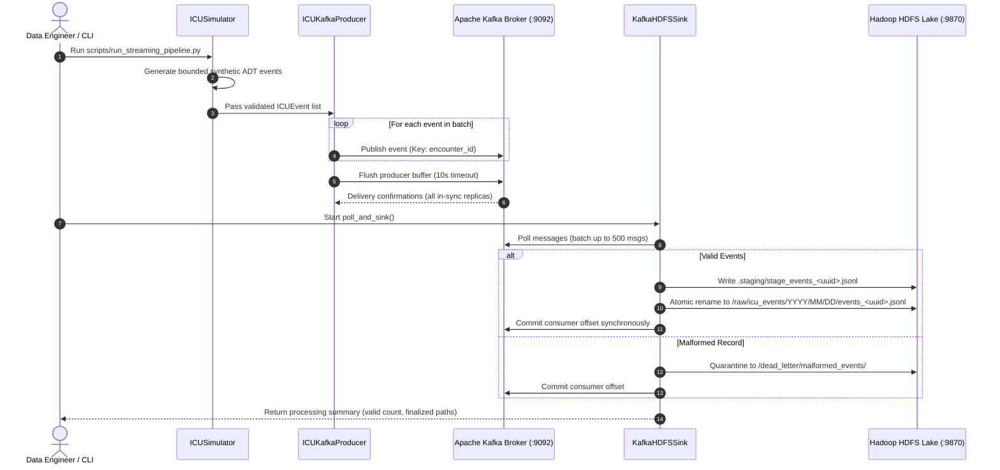
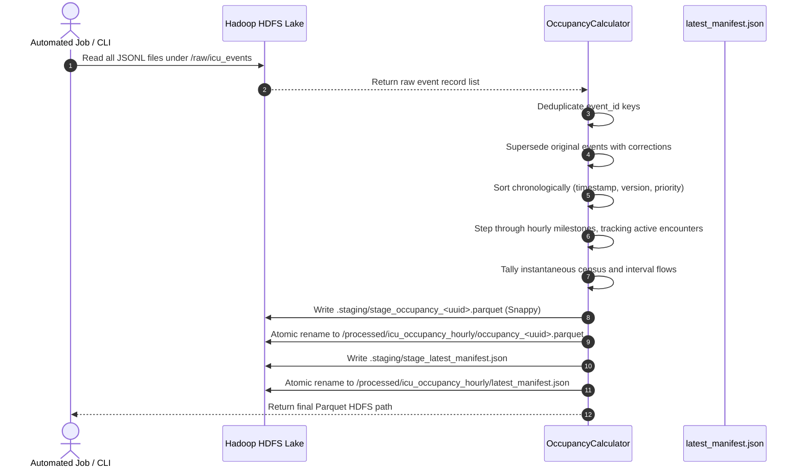
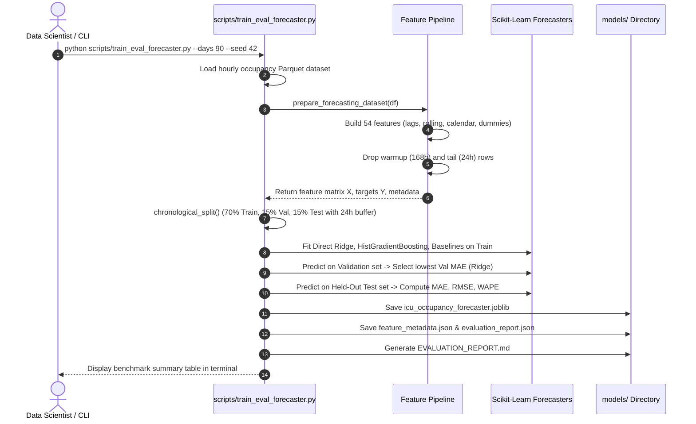
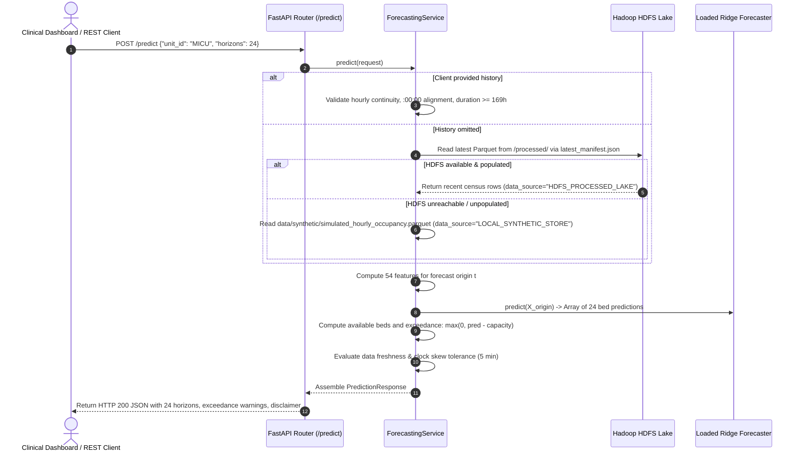
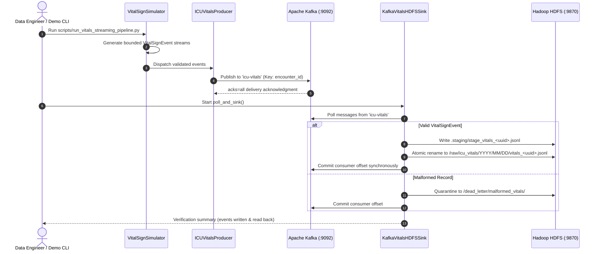
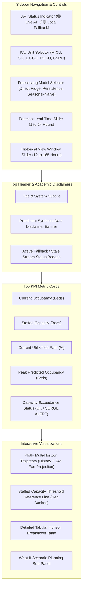
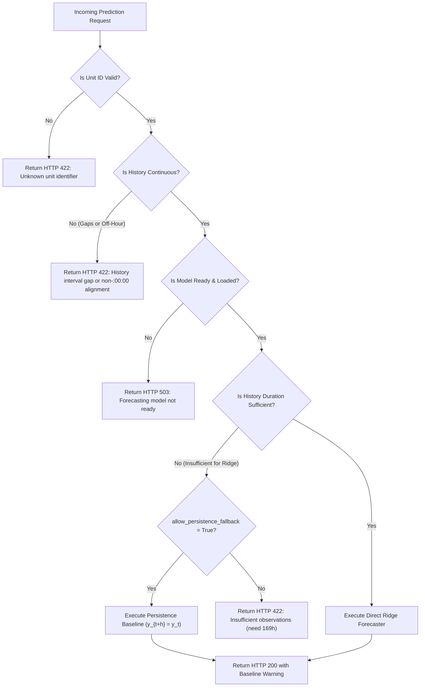

# Features & Operational Workflows — ICU Bed Demand Forecasting

A Complete Functional Inventory, User Interaction Guide, UI Control Reference, and Operational Workflows.

---

## 1. Master Feature Inventory

| Feature ID | Feature Name | Purpose | Input | Internal Processing | Output | Relevant Code Files | Status |
| :---: | :--- | :--- | :--- | :--- | :--- | :--- | :---: |
| **FEAT-01** | **Deterministic ADT Simulation** | Generates high-fidelity clinical patient transitions | Simulation params (start date, days, seed, units, surge) | Non-homogeneous Poisson arrival sampling, diurnal modulation, lognormal LOS sampling, transfer generation | List of validated `ICUEvent` objects and JSONL file | `src/producer/simulator.py`, `scripts/generate_synthetic_data.py` | **Complete** |
| **FEAT-02** | **MIMIC-IV Clinical Demo Parsing** | Ingests PhysioNet clinical demo data for schema testing | PhysioNet demo URL / downloaded CSVs | SHA-256 verification, careunit mapping, event transformation, duplicate removal | Standardized `ICUEvent` stream | `scripts/ingest_mimic_data.py` | **Complete** |
| **FEAT-03** | **Encounter-Keyed Kafka Publishing** | Streams ADT events into Kafka broker | `ICUEvent` instances, Kafka server config | Serializes to JSON, computes partition key from `encounter_id`, handles delivery callbacks | Messages published to Kafka topic `icu-events` | `src/producer/kafka_producer.py` | **Complete** |
| **FEAT-04** | **Micro-Batch HDFS Ingestion** | Lands streaming events into data lake | Kafka topic messages | Consumes micro-batches, validates schemas, date partitions, stages files, renames, manual offset commit | Raw JSONL batches in `/raw/icu_events/` | `src/storage/kafka_sink.py` | **Complete** |
| **FEAT-05** | **Dead-Letter Quarantine (DLQ)** | Isolates corrupt or invalid event payloads | Malformed Kafka messages | Captures exceptions, logs payload, writes to `/dead_letter/`, aborts if write fails | Verified DLQ JSONL files in HDFS | `src/storage/kafka_sink.py` | **Complete** |
| **FEAT-06** | **Idempotent Census Reconstruction** | Computes hourly unit occupancy without double counting | Cumulative raw event records from HDFS | UUID deduplication, correction superseding, deterministic sorting, active encounter tracking | Hourly census DataFrame | `src/processing/occupancy_calculator.py` | **Complete** |
| **FEAT-07** | **Atomic Parquet Lake Persistence** | Persists clean census time series to HDFS | Census DataFrame, target directory | PyArrow Snappy Parquet write to staging, atomic rename, `latest_manifest.json` generation | Processed Parquet file & latest manifest | `src/processing/occupancy_calculator.py` | **Complete** |
| **FEAT-08** | **Leakage-Safe Feature Generation** | Creates 54 past-only features per unit | Hourly census series | 28 lags, 6 rolling stats, 5 calendar harmonics, 4 flow sums, 2 capacity, 5 unit dummies | Feature matrix $X$ and target matrix $Y$ | `src/ml/features.py` | **Complete** |
| **FEAT-09** | **Chronological Model Training** | Trains direct multi-horizon forecasters | Feature matrix $X$, targets $Y$ | 70/15/15 chronological split with 24h buffer gap, Direct Ridge and GB training, Val MAE selection | Persisted model artifact and evaluation report | `src/ml/pipeline.py`, `scripts/train_eval_forecaster.py` | **Complete** |
| **FEAT-10** | **Operational Baseline Benchmarking** | Measures candidate models against baselines | Train/Val/Test partitions | Persistence ($y_{t+h}=y_t$) and 24h Seasonal-Naive evaluation | Benchmark metrics in Markdown and JSON | `src/ml/models.py`, `src/ml/metrics.py` | **Complete** |
| **FEAT-11** | **FastAPI Lifespan Inference Engine** | Serves 24h predictions via REST | `PredictionRequest` JSON payload | Lifespan model caching, universal history validation, feature reconstruction, model inference | `PredictionResponse` JSON | `src/api/main.py`, `src/api/service.py`, `src/api/schemas.py` | **Complete** |
| **FEAT-12** | **Decoupled Data Provenance** | Tracks data origin and streaming freshness | Forecast origin timestamp | Source age calculation, clock skew tolerance (5 min), status labeling | Provenance & freshness metadata | `src/api/service.py`, `src/api/schemas.py` | **Complete** |
| **FEAT-13** | **Streamlit Capacity Dashboard** | Visualizes historical census and predictions | User selections (unit, model, horizon) | Queries FastAPI, parses predictions, renders Plotly charts and capacity alerts | Interactive browser application | `src/dashboard/app.py` | **Complete** |
| **FEAT-14** | **What-If Surge Capacity Planning** | Simulates operational capacity adjustments | Scenario capacity integer | Recomputes available beds and exceedance flags under modified capacity | Real-time exceedance warning badges | `src/api/service.py`, `src/dashboard/app.py` | **Complete** |
| **FEAT-15** | **Socket Port Audit Utility** | Audits port assignments across containers | Target host IP (127.0.0.1) | Socket connection probes on ports 2181, 9092, 9870, 9000, 9864, 8000, 8501 | Terminal diagnostic status matrix | `scripts/check_ports.py` | **Complete** |
| **FEAT-16** | **Vital-Sign Streaming & Lake Persistence** | Streams high-frequency bedside vitals to Kafka & lands on HDFS | Vital sign generation config (hours, interval, seed) | Validates `VitalSignEvent`, serializes to Kafka topic `icu-vitals`, micro-batches to `/raw/icu_vitals/`, DLQ quarantine | Partitioned JSONL files in HDFS `/raw/icu_vitals/` | `src/schema/events.py`, `src/producer/vitals_producer.py`, `src/producer/vitals_simulator.py`, `src/storage/kafka_sink.py`, `scripts/run_vitals_streaming_pipeline.py` | **Complete** |

---

## 2. Detailed User & Operational Workflows

### 2.1 Workflow 1: Continuous Event Streaming & Data Lake Ingestion

- **Trigger:** Terminal execution of `python scripts/run_streaming_pipeline.py --num-events 100 --rate 25.0` or automated streaming runner.
- **Internal Mechanism:**
  1. `ICUSimulator` generates 100 chronologically ordered ADT transitions.
  2. `ICUKafkaProducer` serializes events to JSON, assigns partition key by `encounter_id`, and dispatches messages to topic `icu-events`.
  3. `KafkaHDFSSink` polls Kafka, segregates valid messages, writes staging file to HDFS, executes atomic rename to `/raw/icu_events/year=2026/month=10/day=14/events_<uuid>.jsonl`, and commits offsets.
- **Output:** New date-partitioned JSONL file in HDFS raw zone and zero dropped messages.

---

### 2.2 Workflow 2: On-Demand Lake Census Reconstruction & Manifest Publishing

- **Trigger:** Invoked via `OccupancyCalculator.persist_occupancy_to_hdfs()` or automated cron job.
- **Internal Mechanism:** Replays raw events, eliminates double counting, creates clean Parquet file, and updates `latest_manifest.json` with `min_timestamp`, `max_timestamp`, and `row_count`.
- **Output:** Clean, queryable Parquet snapshot in HDFS processed zone.

---

### 2.3 Workflow 3: Multi-Horizon Model Training & Artifact Freezing

- **Trigger:** `python scripts/train_eval_forecaster.py --data-path data/synthetic/simulated_hourly_occupancy.parquet --output-dir models --seed 42`.
- **Internal Mechanism:** Enforces temporal split boundaries and 24h buffer gap, fits models, selects optimal candidate on validation MAE, evaluates held-out test data, and persists serialized joblib artifact and metadata.
- **Output:** `models/icu_occupancy_forecaster.joblib`, `models/feature_metadata.json`, `models/evaluation_report.json`, and `models/EVALUATION_REPORT.md`.

---

### 2.4 Workflow 4: Real-Time Operational Prediction & Capacity Alerts

- **Trigger:** Frontend or external service sending an HTTP POST request to `http://localhost:8000/predict`.
- **Internal Mechanism:** Universal history validation, feature reconstruction, direct multi-output inference, capacity exceedance detection, and metadata compilation.
- **Output:** Structured JSON containing 24 hourly predictions, exceedance flags, and provenance tags.

---

### 2.5 Workflow 5: Patient Vital Signs Streaming & Lake Persistence

- **Trigger:** Execution of demonstration script `python scripts/run_vitals_streaming_pipeline.py --num-events 50`.
- **Internal Mechanism:**
  1. `VitalSignSimulator` creates deterministic multi-channel physiological streams for active encounters.
  2. `ICUVitalsProducer` streams records to dedicated Kafka topic `icu-vitals` with idempotent delivery.
  3. `KafkaVitalsHDFSSink` consumes from `icu-vitals-hdfs-sink-group`, validates `VitalSignEvent` schema, and atomically commits records to `/raw/icu_vitals/` while routing malformed payloads to `/dead_letter/malformed_vitals/`.
- **Output:** Date-partitioned raw JSONL files in HDFS `/raw/icu_vitals/`.
- **Forecasting Decoupling:** Ingested vital signs provide clinical telemetry persistence. They are archived independently and **are not ingested by the bed occupancy forecasting model**, ensuring the core ADT census and forecasting pipeline remains stable and unburdened by high-frequency telemetry.

---

## 3. Interactive Streamlit Dashboard Reference

The Streamlit dashboard (`src/dashboard/app.py`) provides an operational interface for hospital staff.

### 3.1 UI Elements & Controls Reference

| Control Name | Location | Control Type | Default Value | Clinical Operational Purpose |
| :--- | :--- | :--- | :--- | :--- |
| **API Health Indicator** | Sidebar (Top) | Status Badge | Dynamic | Displays green when FastAPI engine is connected; switches to yellow warning when operating in local offline fallback. |
| **Select ICU Unit** | Sidebar | Dropdown (`selectbox`) | `"MICU"` | Selects target clinical ward (`MICU`, `SICU`, `CCU`, `TSICU`, `CSRU`). Updates KPIs and charts. |
| **Forecasting Model** | Sidebar | Radio Buttons | `"Direct Ridge Regression"` | Toggles between ML model (`Direct Ridge`), Primary Benchmark (`Persistence`), and Secondary (`Seasonal-Naive`). |
| **Forecast Lead Time** | Sidebar | Slider | `24` hours | Adjusts number of projection horizons ($1 \dots 24$ hours). |
| **Historical View Window** | Sidebar | Slider | `72` hours | Adjusts lookback duration plotted on the trajectory chart ($12 \dots 168$ hours). |
| **Synthetic Disclaimer** | Main Page (Top) | Info Callout (`st.info`) | Static Banner | Explicitly informs users that data is synthetically generated and does not constitute a clinical medical device. |
| **Fallback Warning** | Main Page (Banner) | Alert (`st.warning`) | Conditional | Appears when a baseline fallback model is active rather than the primary Ridge regression forecaster. |
| **Provenance Badge** | Main Page (Banner) | Status Callout | Dynamic | Indicates physical source (`HDFS_PROCESSED_LAKE`, `LOCAL_SYNTHETIC_STORE`) and data age (`Fresh`, `Stale`, `Future-Dated`). |
| **Current Occupancy Card** | Top KPI Row | Metric Card | Dynamic | Shows bed occupancy at forecast origin $t$. |
| **Staffed Capacity Card** | Top KPI Row | Metric Card | Dynamic | Shows total operational beds configured for the selected unit. |
| **Utilization Rate Card** | Top KPI Row | Metric Card | Dynamic | Shows occupancy rate ($\%$). Color-coded if exceeding 90%. |
| **Peak Predicted Card** | Top KPI Row | Metric Card | Dynamic | Identifies the highest predicted bed demand across the forward projection window. |
| **Surge Status Card** | Top KPI Row | Metric Card | Dynamic | Displays green `"NORMAL"` if under capacity; flashes yellow/red `"SURGE WARNING"` if capacity is exceeded. |
| **Trajectory Chart** | Main Area | Plotly Time Series | Dynamic | Visualizes historical censuses (blue line), 24h predictions (orange dashed line), and capacity ceiling (red dashed line). |
| **Hourly Forecast Table** | Lower Section | Data Table (`dataframe`) | Dynamic | Displays tabular breakdown of forecast timestamps, predicted beds, available beds, and exceedance beds. |
| **What-If Surge Planner** | Lower Section | Number Input / Slider | Configured Bed Count | Allows clinical coordinators to simulate bed increases/decreases to test surge absorption. |

---

## 4. Error Handling & Edge-Case States

### Summary of Edge-Case Behaviors
- **Off-Hour Timestamps:** If client submits timestamps at `:15:00` or `:30:00`, the system strictly rejects with `HTTP 422: Timestamp must be top-of-hour (:00:00)`.
- **Time Gaps:** If an observation is missing (e.g. jumping from 04:00 to 06:00), the system strictly rejects with HTTP 422. It **never silently zero-fills** missing hours.
- **FastAPI Downtime:** If the backend container is stopped, Streamlit switches to local fallback execution and displays a yellow status banner.
- **Unexpected Exceptions:** Caught by global exception handlers returning a sanitized generic message (`"An internal server error occurred while processing the request."`), preventing stack trace leaks.
