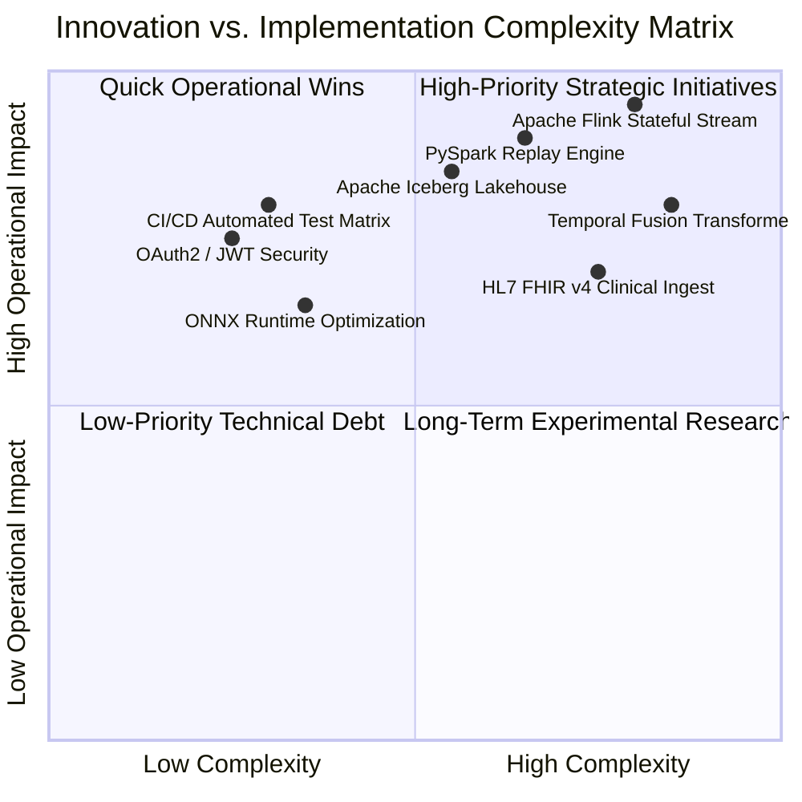

# Future Enhancements & Development Roadmap — ICU Bed Demand Forecasting

A Strategic Engineering Roadmap Outlining Distributed Scaling, Lakehouse Modernization, Deep Learning Horizons, and Enterprise Clinical Integrations.

---

## 1. Prioritized Development Roadmap Matrix



| Phase | Enhancement Initiative | Target Layer | Primary Objective | Complexity | Operational Impact |
| :---: | :--- | :--- | :--- | :---: | :---: |
| **Phase 1** | **Security & Runtime Hardening** | Serving / Infrastructure | Implement OAuth2 JWT authentication, ONNX export, and automated CI/CD | Medium | High |
| **Phase 2** | **Distributed Lakehouse Modernization** | Storage / Processing | Migrate to Apache Iceberg table format and PySpark stateful reconstruction | High | Very High |
| **Phase 3** | **Continuous Stateful Streaming** | Ingestion / Processing | Deploy Apache Flink with RocksDB state backend for sub-second event updates | High | Very High |
| **Phase 4** | **Deep Learning & Clinical FHIR** | ML / Ingestion | Train Temporal Fusion Transformers (TFT) and integrate HL7 FHIR v4 streaming | High | High |

---

## 2. Detailed Technical Proposals

### 2.1 Enhancement 1: Distributed Processing via PySpark
1. **Current Limitation:** `OccupancyCalculator` performs cumulative replay of raw events sequentially in Python using Pandas. Memory consumption scales linearly with event count ($\mathcal{O}(N)$), limiting execution to a single machine's RAM.
2. **Proposed Improvement:** Re-implement the state machine as a distributed **PySpark** batch job running on an Apache Spark cluster managed by YARN or Kubernetes:
   ```python
   # Illustrative PySpark Transformation Pattern
   events_df = spark.read.json("hdfs:///raw/icu_events/*/*/*/*.jsonl")
   deduped_df = events_df.dropDuplicates(["event_id"])
   # Stateful mapping across encounters partitioned by encounter_id hash
   ```
3. **Why It Is Useful:** Allows processing hundreds of millions of historical events spanning years across dozens of healthcare systems simultaneously.
4. **Components That Would Change:** `src/processing/occupancy_calculator.py` replaced by PySpark batch jobs; Docker Compose updated to add Spark Master and Worker containers.
5. **Expected Benefit:** Near-linear horizontal scaling; distributed sorting and aggregations.
6. **Implementation Complexity:** **Medium-High** (requires Spark cluster orchestration, shuffle tuning, and PySpark testing).

---

### 2.2 Enhancement 2: Continuous Stateful Stream Processing with Apache Flink
1. **Current Limitation:** Reconstructing census currently requires on-demand cumulative replay of the raw lake. While accurate, it is a micro-batch process rather than a continuous event-driven stream.
2. **Proposed Improvement:** Deploy **Apache Flink** with a **RocksDB StateBackend**:
   - As Kafka messages arrive in real time, Flink updates an active encounter state map maintained in embedded RocksDB.
   - Outputs top-of-hour census records directly to a Kafka output topic (`icu-census-hourly`) and lake storage.
3. **Why It Is Useful:** Eliminates batch replay entirely; census updates are computed in sub-second streaming latency as transitions occur.
4. **Components That Would Change:** Replaces `KafkaHDFSSink` and `OccupancyCalculator` with a unified Flink streaming pipeline.
5. **Expected Benefit:** Sub-second streaming census availability and instant capacity exceedance detection.
6. **Implementation Complexity:** **High** (requires Java/Scala or PyFlink runtime, checkpointing configuration, and high-availability state storage).

---

### 2.3 Enhancement 3: Modern Lakehouse Table Format (Apache Iceberg)
1. **Current Limitation:** Storage relies on raw directory paths and a custom `latest_manifest.json` file. Updating manifests requires custom staging and atomic rename logic.
2. **Proposed Improvement:** Transition storage from raw files to **Apache Iceberg** tables running over MinIO (S3-compatible) or HDFS:
   - Tables: `lake.raw_icu_events` and `lake.processed_icu_occupancy`.
   - Native ACID transactions, snapshot isolation, time-travel queries, and automatic schema evolution.
3. **Why It Is Useful:** Eliminates file-level manifest parsing; enables analytical SQL queries via Trino or Presto; automates file compaction and metadata pruning.
4. **Components That Would Change:** `src/storage/hdfs_client.py` and `OccupancyCalculator.persist_occupancy_to_hdfs()`.
5. **Expected Benefit:** Eliminates manifest race conditions; provides auditable time-travel to reproduce historical forecasts at any historical timestamp.
6. **Implementation Complexity:** **Medium** (PyIceberg library integration and catalog configuration).

---

### 2.4 Enhancement 4: Advanced Deep Learning Time Series Models (TFT & PatchTST)
1. **Current Limitation:** Models are linear (Direct Ridge) or gradient-boosted trees (HistGradientBoosting). While fast and robust, they cannot dynamically learn multi-scale cross-horizon temporal attention weights.
2. **Proposed Improvement:** Train modern deep learning architectures:
   - **Temporal Fusion Transformer (TFT):** Learns self-attention across historical lookbacks, static unit embeddings, and future known inputs (scheduled surgical cases).
   - **PatchTST / N-BEATS:** State-of-the-art patch-based time series transformers for long-horizon hospital census forecasting.
3. **Why It Is Useful:** Captures complex non-linear cross-unit patient flow dynamics and multi-day holiday/seasonal interactions.
4. **Components That Would Change:** `src/ml/models.py` updated with PyTorch / PyTorch Forecasting modules; GPU acceleration configured in container environment.
5. **Expected Benefit:** Improved multi-step accuracy for long horizons ($h_{12} \dots h_{24}$).
6. **Implementation Complexity:** **High** (requires GPU runtime, PyTorch dependencies, hyperparameter tuning, and inference export).

---

### 2.5 Enhancement 5: HL7 FHIR v4 Clinical EHR Ingestion
1. **Current Limitation:** Data sources are synthetic Poisson simulations and static PhysioNet MIMIC-IV demo CSVs.
2. **Proposed Improvement:** Implement an **HL7 FHIR v4 (Fast Healthcare Interoperability Resources)** REST and WebSocket ingestion connector:
   - Ingests `Encounter`, `Location`, and `Patient` FHIR resources directly from hospital EHR systems (Epic, Cerner).
   - Maps FHIR Encounter status updates (`in-progress`, `finished`, `transferred`) into canonical `ICUEvent` streams.
3. **Why It Is Useful:** Enables real-time hospital deployment by natively integrating with standard hospital EHR interoperability interfaces.
4. **Components That Would Change:** New ingestion module `src/producer/fhir_ingester.py`.
5. **Expected Benefit:** Seamless enterprise adoption across major hospital EHR platforms.
6. **Implementation Complexity:** **Medium-High** (requires SMART on FHIR OAuth2 integration, clinical code mapping, and HL7 validation).

---

### 2.6 Enhancement 6: Enterprise Security Hardening & Zero-Trust
1. **Current Limitation:** Unauthenticated REST API, plaintext Kafka transport, disabled HDFS permissions, and pickle/joblib deserialization risks.
2. **Proposed Improvement:**
   - **Safe Model Serialization:** Export models to **ONNX (Open Neural Network Exchange)**, eliminating Python pickle arbitrary code execution vulnerabilities.
   - **API Authentication:** Add OAuth2 Bearer token authentication with Role-Based Access Control (RBAC) in FastAPI.
   - **mTLS Kafka & Kerberos HDFS:** Enable TLS encryption in transit and Kerberos cluster authentication.
3. **Why It Is Useful:** Satisfies enterprise healthcare information security audits (SOC 2, ISO 27001).
4. **Components That Would Change:** `src/api/main.py`, `src/config.py`, `docker-compose.yml`, `src/ml/pipeline.py`.
5. **Expected Benefit:** Hardened enterprise-ready platform compliant with hospital IT security standards.
6. **Implementation Complexity:** **Medium**.
