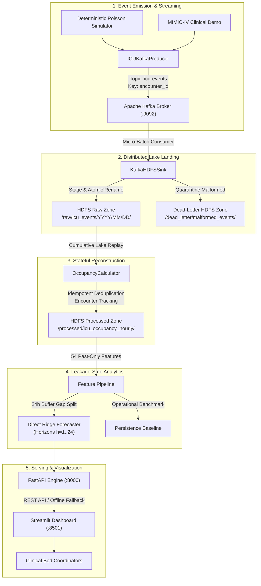
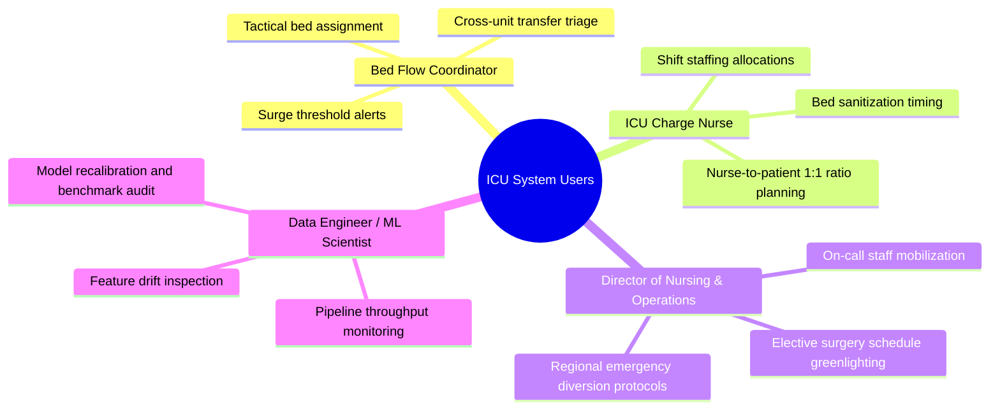
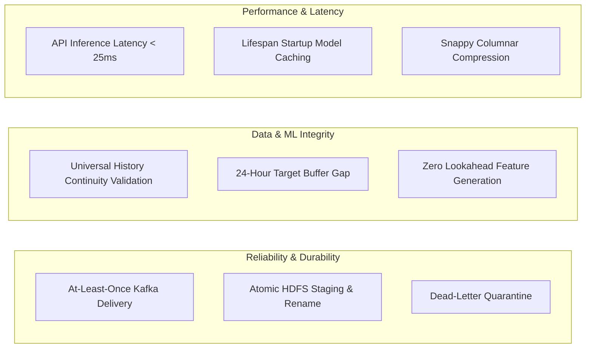

# Project Overview — ICU Bed Demand Forecasting

A Comprehensive Specification of Problem Domain, Architectural Scope, Clinical Context, and Functional Requirements.

---

## 1. Executive Summary & Project Identification

- **Project Title:** ICU Bed Demand Forecasting: Real-Time Big Data Streaming, Distributed Lake Storage, and Multi-Horizon Capacity Planning
- **Project Category:** Big Data Analytics (BDA) / Healthcare Operational Informatics / Distributed Systems
- **System Version:** 0.1.0
- **Academic Context:** 8th Semester / Final Year BDA Capstone Project, Department of Computer Science & Engineering
- **Target Repository:** `bda_icuBedForcasting`

---

## 2. Problem Statement

Intensive Care Units (ICUs) represent the most resource-intensive, operationally constrained, and clinically vulnerable environments within modern acute-care hospitals. Operating specialized critical beds requires not only physical equipment (mechanical ventilators, hemodynamic monitoring arrays, dialysis units) but also dedicated, state-mandated 1:1 or 1:2 nurse-to-patient staffing ratios.

In contemporary hospital environments, bed allocation is overwhelmingly managed through **reactive, manual, and uncoordinated processes**:
1. **The Capacity Threshold Trap:** Hospital operations typically do not trigger escalation protocols until occupancy crosses 90% or 100%. By the time an ICU is physically full, staffing call-ins take between 4 to 8 hours to mobilize.
2. **Emergency Department (ED) Boarding:** When ICUs reach full capacity, critically ill patients presenting to the emergency room are boarded in ED hallways or non-critical bays, increasing mortality and length of stay.
3. **Elective Surgery Deferrals:** Complex cardiothoracic, neurosurgical, and orthopedic surgeries requiring postoperative ICU recovery are abruptly cancelled at high financial and emotional cost because no beds are available upon procedure conclusion.
4. **Premature Patient Discharges:** Under sudden bed scarcity, physicians are forced into subjective "forced step-downs" to lower-acuity units, directly inflating 48-hour ICU readmission rates.

The core data engineering deficiency is that acute-care hospitals produce massive volumes of **Admission, Discharge, and Transfer (ADT)** events, yet these streams remain trapped in legacy Electronic Health Record (EHR) transactional silos without being leveraged for predictive operational forecasting.

---

## 3. Background & Motivation

### Clinical & Operational Context
Hospital bed flow behaves as a complex stochastic queuing network with non-homogeneous arrivals, heavy right-skewed lengths of stay, and diurnal periodicity. Standard operational workflows operate on isolated static spreadsheets or retrospective census tallies generated once every 8 or 12 hours. 

To bridge this operational gap, clinical bed managers require a **1-to-24 hour forward-looking projection window**:
- **+1 to +3 Hours:** Immediate tactical triage (holding beds for incoming emergency transfers, bed sanitization scheduling).
- **+4 to +8 Hours:** Shift-level nurse staffing adjustments and on-call mobilization.
- **+12 to +24 Hours:** Next-day elective surgery schedule confirmation and cross-department bed reallocation.

### Big Data & Machine Learning Motivation
Traditional time series techniques (such as ARIMA or Holt-Winters) fail in modern hospital environments because:
- They assume regular, evenly-spaced univariate historical observations, whereas hospital ADT events arrive as high-velocity, irregular, asynchronous JSON event streams.
- They cannot incorporate cross-unit transfer networks, capacity ceilings, or multi-horizon interdependencies.
- They cannot survive network partition events, duplicate event submissions, or clinical data amendments.

This project was conceived to demonstrate how a modern Big Data architecture — combining **Apache Kafka**, **Apache Hadoop HDFS**, **Pydantic contracts**, and **Direct Multi-Output Machine Learning** — solves these challenges while maintaining strict temporal isolation and high operational resilience.

---

## 4. Proposed Solution

The proposed system establishes an automated, end-to-end data engineering and forecasting pipeline structured into five distinct operational stages:

1. **Streaming Ingestion:** Real-time patient ADT transitions are captured as strongly typed `ICUEvent` JSON payloads and published to Kafka with encounter-level partitioning, guaranteeing FIFO order per encounter.
2. **Durable Data Lake:** A Kafka-to-HDFS micro-batch sink writes events into date-partitioned HDFS directories using an atomic two-step staging and rename pattern. Kafka consumer offsets are committed strictly post-finalization to guarantee **at-least-once delivery**. Malformed payloads are quarantined to a verified Dead-Letter Queue.
3. **Stateful Census Reconstruction:** An `OccupancyCalculator` replays cumulative lake events to calculate exact top-of-hour unit censuses. It eliminates double-counting by ensuring an encounter key can only occupy one bed at any given timestamp milestone, while resolving corrections and out-of-order transfers.
4. **Leakage-Safe Machine Learning:** A 54-feature pipeline derives past-only historical lags ($L_0 \dots L_{168}$), rolling statistics, and cyclical harmonics with strict unit boundary isolation. Direct Multi-Output Ridge Regression predicts bed demands across 24 horizons, separated by a 24-hour target buffer gap.
5. **Operational Serving & Visuals:** A production-grade FastAPI service validates inputs and serves cached model forecasts, feeding an interactive Streamlit and Plotly dashboard with real-time surge warnings.

---

## 5. Project Objectives

### Primary Objectives
1. **Real-Time Big Data Ingestion:** Establish a resilient streaming pipeline capable of ingesting clinical ADT events with sub-second latency and at-least-once persistence.
2. **Double-Counting Prevention:** Reconstruct exact hourly hospital unit occupancy from asynchronous, out-of-order event streams without ever placing a patient in multiple beds simultaneously.
3. **Multi-Horizon Forecasting:** Deliver continuous, direct multi-horizon bed occupancy predictions for the next 24 hours ($h=1 \dots 24$) across 5 distinct ICU wards.
4. **Early Capacity Exceedance Warnings:** Automatically compute available beds and flag predicted bed shortages before they occur.
5. **Operational Visual Interface:** Provide an interactive, clinical-grade dashboard that visualizes historical trajectories, forward-looking predictions, and surge scenarios with offline resilience.

### Secondary Objectives
1. **Clinical Data Provenance:** Support validation against real-world PhysioNet MIMIC-IV Clinical Demo datasets to confirm schema compatibility.
2. **Temporal Leakage Safeguards:** Implement strict chronological split boundaries with a 24-hour buffer gap to eliminate future lookahead bias in machine learning evaluation.
3. **Baseline Operational Benchmarking:** Maintain and report operational performance against a strict Persistence Baseline ($y_{t+h} = y_t$).
4. **Containerized Portability:** Fully containerize distributed components (ZooKeeper, Kafka, Hadoop NameNode, DataNode) using Docker Compose for cross-platform execution.

---

## 6. Target Users & Operational Personas

- **Hospital Bed Flow Coordinators:** Need 1-to-6 hour projections to triage incoming emergency admissions and schedule sanitization.
- **ICU Nurse Managers / Charge Nurses:** Need 4-to-12 hour projections to align nursing shift rosters with projected patient counts.
- **Hospital Operations Directors:** Need 12-to-24 hour projections to confirm elective surgical schedules and evaluate diversion protocols.
- **Big Data Engineers / Researchers:** Need auditable pipelines, cryptographic checksum verification, and reproducible training benchmarks.

---

## 7. Scope, Boundaries, and Limitations

### In-Scope
- Ingestion of synthetic ADT events and PhysioNet MIMIC-IV demo tables.
- Distributed event streaming via Apache Kafka and lake landing in Hadoop HDFS.
- Hourly stateful census calculation across 5 monitored units: MICU, SICU, CCU, TSICU, and CSRU.
- Feature extraction spanning 168-hour lookbacks, rolling statistics, and calendar harmonics.
- Multi-horizon direct regression modeling for lead times $h \in [1..24]$.
- REST API inference engine with input validation, health/readiness probes, and offline fallback.
- Streamlit interactive dashboard with surge warnings and what-if capacity controls.

### Out-of-Scope (Explicit Architectural Boundaries)
- Direct bedside physiologic monitoring (vital signs, heart rates, ventilator waveforms, arterial blood gases).
- Electronic Health Record (EHR) database writes or HL7 clinical transaction generation.
- Individual patient mortality prediction, disease diagnosis, or clinical outcome modeling.
- Direct automated nursing scheduling or EHR patient discharge execution.

---

## 8. Functional Requirements Matrix

| Req ID | Feature Name | Description | Inputs | Processing Logic | Outputs | Implementation Status |
| :--- | :--- | :--- | :--- | :--- | :--- | :---: |
| **FR-01** | **Synthetic ADT Event Generation** | Generates non-homogeneous Poisson arrivals with diurnal curves and lognormal LOS | Start date, days, seed, units, surge overrides | Poisson arrival sampling, diurnal modulation, transfer probabilities | Validated `ICUEvent` JSONL stream | **Complete** |
| **FR-02** | **MIMIC-IV Demo Ingestion** | Ingests PhysioNet demo CSVs and maps clinical careunits | PhysioNet demo URL / local CSVs | SHA-256 verification, careunit mapping, event transformation | Canonical `ICUEvent` records | **Complete** |
| **FR-03** | **Kafka Event Streaming** | Publishes ADT events to Kafka broker with FIFO keying | `ICUEvent` stream, bootstrap server | Serializes to JSON, routes by `encounter_id` key, handles ACKs | Messages in Kafka topic `icu-events` | **Complete** |
| **FR-04** | **Kafka-to-HDFS Sink** | Consumes micro-batches and commits to HDFS data lake | Kafka messages | Micro-batching, date partitioning, atomic rename, manual commit | Raw HDFS JSONL files (`/raw/icu_events`) | **Complete** |
| **FR-05** | **Dead-Letter Quarantine** | Isolates malformed or corrupted payloads in HDFS | Malformed Kafka message | Exception capture, quarantine path routing, verified write | HDFS records in `/dead_letter/` | **Complete** |
| **FR-06** | **Stateful Census Reconstruction** | Calculates hourly bed occupancy without double-counting | Cumulative raw events | Deduplication, correction superseding, active encounter tracking | Hourly census DataFrame | **Complete** |
| **FR-07** | **Atomic Parquet Persistence** | Writes processed occupancy to HDFS with latest manifest | Census DataFrame, HDFS target | PyArrow Snappy Parquet write, atomic rename, manifest update | Parquet file & `latest_manifest.json` | **Complete** |
| **FR-08** | **Leakage-Safe Feature Generation** | Generates 54 past-only features per unit | Hourly census series | Lags 0..24, 48, 72, 168; rolling 6, 24, 168; harmonics | Clean feature matrix $X$ and targets $Y$ | **Complete** |
| **FR-09** | **Chronological Model Training** | Fits direct multi-horizon models with 24h buffer gap | Feature matrix $X$, targets $Y$ | 70/15/15 chronological split, Ridge/GB fitting, Val MAE selection | Serialized `.joblib` & evaluation JSON | **Complete** |
| **FR-10** | **Operational Baseline Evaluation** | Benchmarks candidate models against Persistence & Seasonal | Training/validation partitions | Persistence ($y_{t+h}=y_t$) and 24h Seasonal-Naive evaluation | Benchmark metrics table | **Complete** |
| **FR-11** | **FastAPI Lifespan Inference** | Serves 24h forecasts via REST with cached model artifact | `PredictionRequest` JSON | Input continuity validation, feature extraction, model inference | `PredictionResponse` JSON | **Complete** |
| **FR-12** | **Decoupled Data Provenance** | Distinguishes physical source from streaming freshness | Forecast origin timestamp | Source age calculation, clock skew tolerance (5 min), status label | Provenance & freshness metadata | **Complete** |
| **FR-13** | **Interactive Streamlit UI** | Visualizes historical censuses, trajectories, and alerts | User controls (unit, model, horizon) | REST API query, local fallback execution, Plotly rendering | Interactive browser dashboard | **Complete** |
| **FR-14** | **What-If Capacity Surge Analysis** | Evaluates surge scenarios under reallocated unit beds | Scenario capacity input | Exceedance re-calculation against custom staffed threshold | Dynamic exceedance badges | **Complete** |

---

## 9. Non-Functional Requirements (NFRs)

### 9.1 Performance & Latency
- **Inference Latency:** The FastAPI service must return 24-horizon predictions in $< 50\text{ ms}$ for warm requests (actual observed latency is $< 25\text{ ms}$).
- **Lifespan Startup:** Model artifacts must be deserialized and validated once during service startup, eliminating per-request I/O bottlenecks.
- **Storage Footprint:** Processed census data must utilize columnar Snappy Parquet compression, achieving $> 90\%$ compression relative to raw text.

### 9.2 Reliability, Availability & Fault Tolerance
- **At-Least-Once Ingestion:** Micro-batch consumers must commit Kafka offsets **strictly post-finalization** in HDFS to prevent data loss across container restarts.
- **Atomic File Staging:** HDFS writes must write to `.staging/stage_*.jsonl` before an atomic rename, ensuring downstream readers never encounter partial writes.
- **Dead-Letter Safety:** Corrupted payloads must be written and confirmed in `/dead_letter/` before committing offsets. If DLQ write fails, the micro-batch must abort.
- **Offline Dashboard Resilience:** If the FastAPI backend is offline, the Streamlit dashboard must automatically fall back to an internal forecasting service.

### 9.3 Data Integrity & Leakage Prevention
- **Top-of-Hour Alignment:** Timestamps must be strictly aligned to `:00:00` UTC; non-aligned or out-of-sequence timestamps must be rejected with HTTP 422.
- **Zero Lookahead:** All features must strictly use past observations ($L_0 \dots L_{168}$) and left-closed rolling windows.
- **Target Isolation:** A 24-hour buffer gap must separate train, validation, and test chronological partitions.

### 9.4 Security & Governance
- **Zero Protected Health Information (PHI):** The primary streaming pipeline operates strictly on synthetic data to prevent HIPAA compliance violations.
- **500 Response Sanitization:** Internal exceptions must return sanitized error messages without exposing stack traces or connection strings.
- **CORS Restriction:** API cross-origin requests are restricted to authorized local ports (`8501`, `8000`).

---

## 10. Assumptions & Constraints

1. **Top-of-Hour Granularity:** The operational forecasting model operates at hourly census intervals. Sub-hourly patient movements are grouped into the preceding hourly interval.
2. **Cumulative Replay Architecture:** Reconstructing exact census requires cumulative replay of raw events. Slicing raw events into isolated time windows without pre-window history would omit stays crossing window boundaries.
3. **Synthetic Data Provenance:** Performance metrics validate data engineering and forecasting architecture, but do not imply clinical safety on live patients.
4. **Local Single-Node Cluster:** The Docker Compose environment represents a single-node demonstration cluster. Production deployment requires distributed multi-node topologies.
