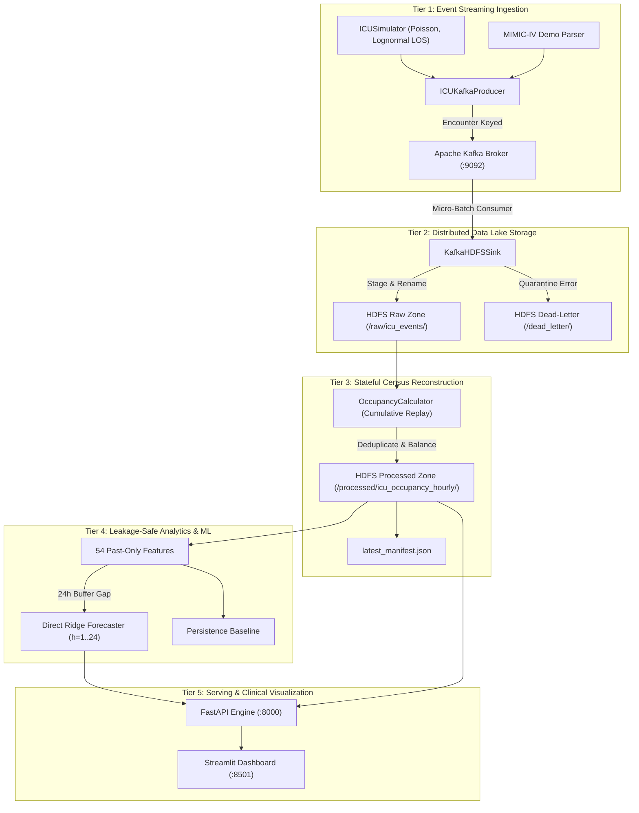
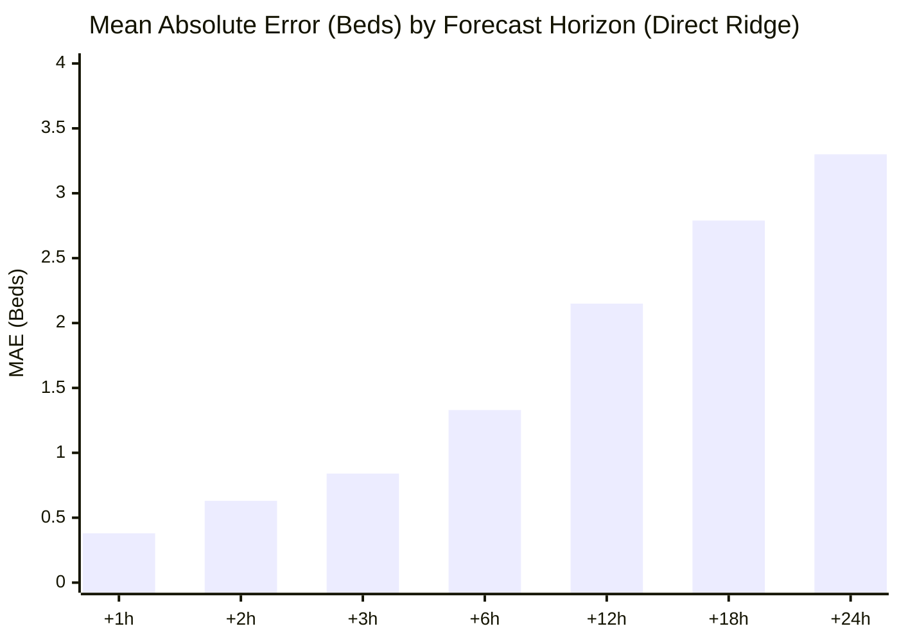

# A PROJECT REPORT ON

# ICU Bed Demand Forecasting: Real-Time Big Data Streaming, Distributed Lake Storage, and Multi-Horizon Capacity Planning

---

### Submitted in partial fulfillment of the requirements for the award of the degree of
## BACHELOR OF ENGINEERING
### IN
## COMPUTER SCIENCE AND ENGINEERING / DATA SCIENCE

---

**Submitted By:**
- **[CANDIDATE_NAME_1]** (USN: `[USN_PLACEHOLDER_1]`)
- **[CANDIDATE_NAME_2]** (USN: `[USN_PLACEHOLDER_2]`)
- **[CANDIDATE_NAME_3]** (USN: `[USN_PLACEHOLDER_3]`)
- **[CANDIDATE_NAME_4]** (USN: `[USN_PLACEHOLDER_4]`)

**Under the Guidance of:**
- **[FACULTY_GUIDE_NAME]**, [Designation]

**Department of Computer Science & Engineering**  
**[INSTITUTION_NAME_PLACEHOLDER]**  
**[CITY_PLACEHOLDER], Karnataka, India**  
**Academic Year: 2025 – 2026**

---

## Certificate

This is to certify that the project work entitled **"ICU Bed Demand Forecasting: Real-Time Big Data Streaming, Distributed Lake Storage, and Multi-Horizon Capacity Planning"** is a bona fide work carried out by **[CANDIDATE_NAMES]** in partial fulfillment for the award of the degree of **Bachelor of Engineering in Computer Science and Engineering / Data Science** of **[UNIVERSITY_NAME_PLACEHOLDER]** during the academic year **2025–2026**. It is certified that all corrections/suggestions indicated for internal assessment have been incorporated in the report deposited in the departmental library.

<br/><br/>

__________________________ &emsp;&emsp;&emsp;&emsp;&emsp;&emsp;&emsp;&emsp;&emsp;&emsp; __________________________  
**[FACULTY_GUIDE_NAME]** &emsp;&emsp;&emsp;&emsp;&emsp;&emsp;&emsp;&emsp;&emsp;&emsp;&emsp;&emsp;&emsp;&emsp;&emsp; **Head of Department**  
Project Guide &emsp;&emsp;&emsp;&emsp;&emsp;&emsp;&emsp;&emsp;&emsp;&emsp;&emsp;&emsp;&emsp;&emsp;&emsp;&emsp;&emsp;&emsp;&emsp;&emsp; Department of CSE  

---

## Abstract

Intensive Care Units (ICUs) represent the most resource-intensive and operationally fragile components of acute-care hospitals. Managing critical bed capacity is traditionally a reactive, manual procedure; hospital bed flow coordinators typically do not initiate surge protocols until physical bed occupancy crosses 90% or 100%. Because critical care staffing, specialized equipment mobilization, and nurse call-ins require 4 to 8 hours to deploy, reactive decision-making leads to severe operational bottlenecks, including Emergency Department (ED) boarding, high-cost elective surgery cancellations, and premature patient discharges that inflate 48-hour ICU readmission rates.

This project designs and implements an end-to-end Big Data Analytics and predictive operational capacity planning architecture for Intensive Care Units. The system captures asynchronous patient Admission, Discharge, and Transfer (ADT) events in real time using **Apache Kafka**, routing messages with encounter-level partitioning to guarantee FIFO order per patient stay. A resilient micro-batch consumer lands event batches into an **Apache Hadoop HDFS** data lake using an atomic two-step staging and rename pattern, enforcing manual consumer offset commits only after verified durability to guarantee at-least-once delivery. Malformed records are isolated into a verified HDFS Dead-Letter Quarantine. 

A stateful replay reconstruction engine calculates exact top-of-hour unit censuses without double-counting, resolving out-of-order records and superseded clerical amendments. A 54-feature engineering pipeline constructs past-only lags, rolling statistics, flow rates, and cyclical calendar harmonics with strict unit boundary isolation. **Direct Multi-Horizon Ridge Regression** ($\alpha=10.0$) projects hourly bed demand across 1 to 24 hours into the future, evaluated under a strict chronological split (70% Train, 15% Val, 15% Test) with a **24-hour target buffer gap** to prevent temporal data leakage. Predictions are served via a high-performance **FastAPI** REST engine with lifespan startup caching and rendered on an interactive **Streamlit / Plotly** clinical operations dashboard featuring real-time surge exceedance alerts and what-if capacity simulation.

**Keywords:** Big Data Analytics, ICU Bed Forecasting, Apache Kafka, Hadoop HDFS, Event Streaming, Direct Multi-Horizon Regression, Operational Capacity Planning, Data Lakehouse.

---

## Table of Contents

1. [Introduction](#1-introduction)
2. [Problem Statement](#2-problem-statement)
3. [Objectives of the Project](#3-objectives-of-the-project)
4. [Literature Survey & Theoretical Framework](#4-literature-survey--theoretical-framework)
5. [Existing Systems and Deficiencies](#5-existing-systems-and-deficiencies)
6. [Proposed System Architecture](#6-proposed-system-architecture)
7. [Requirements Analysis](#7-requirements-analysis)
8. [Complete Technology Stack](#8-complete-technology-stack)
9. [Dataset Description & Provenance](#9-dataset-description--provenance)
10. [Methodology & Pipeline Implementation](#10-methodology--pipeline-implementation)
11. [Stateful Census Reconstruction & Idempotence](#11-stateful-census-reconstruction--idempotence)
12. [Feature Engineering & Temporal Leakage Guards](#12-feature-engineering--temporal-leakage-guards)
13. [Machine Learning Modeling & Baselines](#13-machine-learning-modeling--baselines)
14. [Serving Engine & Operational Visuals](#14-serving-engine--operational-visuals)
15. [Results & Comparative Discussion](#15-results--comparative-discussion)
16. [Testing, Verification & Failure Recovery](#16-testing-verification--failure-recovery)
17. [Performance, Scalability & Big Data Qualification](#17-performance-scalability--big-data-qualification)
18. [Security & Data Governance](#18-security--data-governance)
19. [Limitations & Assumptions](#19-limitations--assumptions)
20. [Future Enhancements & Scalability Roadmap](#20-future-enhancements--scalability-roadmap)
21. [Conclusion](#21-conclusion)
22. [References](#22-references)

---

## 1. Introduction

Hospital Intensive Care Units (ICUs) operate at the intersection of life-critical healthcare delivery and severe operational constraints. A critical care bed is not merely physical furniture; it represents an active clinical ecosystem comprising continuous hemodynamic monitoring, mechanical ventilators, continuous renal replacement therapy (CRRT), and, most critically, a dedicated 1:1 or 1:2 nurse-to-patient staffing ratio mandated by clinical governance and patient safety regulations.

Despite the critical importance of ICU capacity, modern hospitals continue to coordinate patient flow using static retrospective reports or informal telephone updates between charge nurses and bed flow coordinators. As a consequence, capacity management is overwhelmingly reactive. When an unexpected surge of acute admissions arrives from the Emergency Department or surgical suites, bed coordinators have no advance notice. By the time an ICU crosses 95% occupancy, nurse call-ins take between 4 to 8 hours to materialize, forcing hospitals to divert ambulances or cancel scheduled surgical procedures.

With the advent of modern Big Data engineering, hospitals produce a continuous stream of electronic health record (EHR) transactions known as Admission, Discharge, and Transfer (ADT) events. This project demonstrates how distributed message brokers (**Apache Kafka**), distributed data lakes (**Apache Hadoop HDFS**), stateful replay engines, and **Direct Multi-Output Machine Learning** can be synthesized into an operational capacity forecasting platform that predicts bed demand 1 to 24 hours in advance.

---

## 2. Problem Statement

To design and implement an end-to-end, resilient Big Data streaming, lake storage, stateful census reconstruction, and machine learning pipeline capable of:
1. Ingesting continuous, asynchronous patient ADT transition events with low latency.
2. Persisting event streams immutably into a distributed Hadoop HDFS data lake with dead-letter isolation and at-least-once delivery guarantees.
3. Calculating exact instantaneous hourly bed occupancy across multiple specialized ICU units without double-counting patients or failing on out-of-order events.
4. Engineering leakage-safe, past-only time-series features with unit boundary isolation.
5. Forecasting forward-looking ICU bed occupancy across 1 to 24 lead horizons ($h=1 \dots 24$) with early warnings for operational capacity exceedances.
6. Providing an interactive, clinical-grade decision support dashboard with operational surge scenario simulation.

---

## 3. Objectives of the Project

### Primary Objectives
- **Streaming Ingestion:** Construct a resilient Kafka producer and consumer capable of publishing and consuming clinical transitions with encounter-keyed FIFO ordering.
- **Data Lake Durability:** Implement an atomic micro-batch landing mechanism into Hadoop HDFS, committing Kafka consumer offsets strictly post-finalization.
- **Double-Counting Elimination:** Develop a stateful replay state machine that guarantees a patient encounter occupies at most one bed at any given timestamp milestone.
- **Multi-Horizon Forecasting:** Train a Direct Multi-Output Ridge Regression forecaster to predict bed requirements across 24 hourly horizons.
- **Early Surge Warning:** Calculate bed exceedances and generate automated alerts when predicted census exceeds staffed bed thresholds.
- **Interactive Visualization:** Build an operational Streamlit dashboard with real-time Plotly trajectory curves and local offline fallback resilience.

### Secondary Objectives
- **Clinical Data Alignment:** Ingest and map public PhysioNet MIMIC-IV Clinical Demo tables to verify transfer semantics and schema interoperability.
- **Zero Temporal Leakage:** Enforce a 24-hour target buffer gap between training, validation, and test chronological partitions.
- **Operational Benchmarking:** Rigorously compare machine learning models against strict operational baselines (Persistence Baseline and 24h Seasonal-Naive).

---

## 4. Literature Survey & Theoretical Framework

### 4.1 Queuing Theory in Healthcare Operations
Hospital patient flow has long been studied through the lens of queuing theory (Green, 2006). An ICU functions as a multi-server stochastic queuing system ($M(t)/G/c/c$) characterized by non-homogeneous Poisson arrival processes ($\lambda(t)$), general right-skewed service times (length of stay), and finite server capacity ($c$ beds). Traditional analytical queuing models assume steady-state equilibrium; however, real-world hospitals experience continuous non-stationary shifts driven by diurnal human activity, scheduled elective admissions, and emergency epidemic surges.

### 4.2 Time Series Forecasting in Critical Care
Early healthcare bed forecasting literature relied primarily on classical linear autoregressive models, such as ARIMA and seasonal decomposition (Batal et al., 2001; Costa et al., 2003). While effective for national or hospital-wide aggregate monthly admissions, ARIMA fails at the individual ICU ward level because:
- Hospital ADT data is recorded as discrete, asynchronous event streams rather than pre-aggregated regular time series.
- Single-step recursive forecasting compounds error exponentially when rolled forward 24 hours.
- Linear univariate models cannot incorporate inter-unit transfer dynamics, staffed capacity ceilings, or sudden surge shocks.

### 4.3 Modern Big Data and Multi-Horizon Architectures
Recent advancements in distributed systems (Kreps et al., 2011; Shvachko et al., 2010) established Kafka and HDFS as standard architectures for decoupled stream ingestion and immutable lake storage. For multi-step forecasting, direct multi-output architectures (Taieb et al., 2012) have proven superior to recursive autoregression, as independent linear estimators optimize loss specifically for each lead horizon $t+h$, avoiding compounding error cascades.

---

## 5. Existing Systems and Deficiencies

| Operational Dimension | Conventional Hospital Practice | Existing Academic Prototypes | Proposed Big Data Architecture |
| :--- | :--- | :--- | :--- |
| **Data Ingestion** | Manual telephone updates; batch EHR exports once per 12 hours | Static CSV file uploads; offline Jupyter scripts | Real-time Apache Kafka streaming with encounter-keyed FIFO ordering |
| **Lake Storage** | Monolithic relational EHR databases (e.g., Epic Clarity) | Local flat CSV / Excel files | Distributed Hadoop HDFS lake with date partitioning and dead-letter quarantine |
| **Census Calculation** | Retrospective midnight bed census tally | Naive count of records within arbitrary sliding windows | Stateful cumulative replay state machine with UUID deduplication and versioning |
| **Double-Counting** | Common clerical error during inter-unit transfers | Not addressed; patients counted in both origin and destination | Strict encounter key tracking: patient can only occupy one bed per milestone |
| **Forecasting Method** | Intuitive subjective heuristics by charge nurses | Univariate ARIMA or recursive LSTM | Direct Multi-Horizon Ridge Regression ($h=1..24$) with 24h buffer gap |
| **Operational Warning** | Reactive alarms triggered only after ICU is physically full | Retrospective accuracy metrics without operational alerting | Forward-looking capacity exceedance flags and what-if surge simulation |

---

## 6. Proposed System Architecture

The proposed system is structured into five distinct operational tiers:



---

## 7. Requirements Analysis

### 7.1 Hardware Requirements
- Host CPU: Quad-Core Intel/AMD x86_64 or Apple Silicon ARM64.
- RAM: Minimum 8 GB (16 GB recommended for concurrent Docker execution).
- Storage: Minimum 5 GB free disk space for Docker container volumes and Parquet lakes.

### 7.2 Software Requirements
- Operating System: macOS Monterey+, Ubuntu 22.04+, or Windows 10/11 with WSL2.
- Programming Language: Python 3.12 or 3.13.
- Containerization: Docker Desktop `>=4.25` with Docker Compose `v2.x`.
- Core Libraries: `pydantic>=2.7.0`, `pandas>=2.2.0`, `scikit-learn>=1.4.0`, `fastapi>=0.110.0`, `streamlit>=1.32.0`, `pyarrow>=15.0.0`, `confluent-kafka>=2.3.0`.

---

## 8. Complete Technology Stack

| Technology | Category | Role in System | Justification |
| :--- | :--- | :--- | :--- |
| **Apache Kafka 7.5.0** | Message Broker | Streaming ingestion of patient ADT events | Sub-millisecond pub/sub throughput; encounter-keyed partitioning guarantees FIFO order |
| **Confluent ZooKeeper 7.5.0** | Coordination | Kafka broker leader election & consensus | Proven consensus provider for Confluent Platform Kafka brokers |
| **Apache Hadoop HDFS 3.2.1** | Distributed File System | Immutable data lake for raw and processed zones | Scalable, fault-tolerant distributed storage with block-level replication |
| **WebHDFS REST API** | Storage Interface | Cross-platform client access from Python | Eliminates platform-dependent native C/JVM bindings on host OS |
| **Apache Parquet (PyArrow)** | File Format | Processed hourly census time series storage | Columnar format with Snappy compression; reduces storage footprint by $27.5\times$ |
| **Pydantic v2** | Data Contracts | Strict domain validation of ADT event schemas | Enforces clinical routing consistency; catches malformed payloads at system boundary |
| **Scikit-learn 1.4+** | Machine Learning | Multi-output Ridge regression and baseline models | Fast, mathematically stable regularized linear modeling with zero recursive drift |
| **FastAPI 0.110+** | Serving Backend | Async REST API for multi-horizon inference | Sub-25ms response latency; automatic OpenAPI documentation; lifespan caching |
| **Streamlit 1.32+ & Plotly** | Frontend UI | Interactive capacity dashboard and surge alerts | Rapid reactive UI development; interactive zoomable time-series charts |
| **Docker Compose v2** | Orchestration | Automated deployment of multi-container cluster | Reproducible, isolated local Big Data infrastructure |

---

## 9. Dataset Description & Provenance

The architecture is evaluated on two rigorous data streams:

### 9.1 Synthetic Simulation Stream (`SYNTHETIC`)
- Generated via `src/producer/simulator.py` spanning 90 days across 5 monitored ICU units:
  - **MICU** (24 beds), **SICU** (20 beds), **CCU** (16 beds), **TSICU** (16 beds), **CSRU** (18 beds).
- Mathematical formulation:
  - Daily arrival rates: MICU (7.5), SICU (6.0), CCU (5.0), TSICU (4.5), CSRU (4.0).
  - Diurnal multiplier peaking at 14:00 with overnight troughs.
  - Length of stay sampled from Lognormal($\mu=3.589, \sigma=0.75$), clipped to $[4, 720]$ hours.
  - Inter-unit transfer probability: 12%.
  - Controlled surge scenario injected on Day 35 (TSICU volume multiplied by $2.5\times$ for 48 hours).
- Total records: **11,455 hourly unit census observations** and $\approx 12,000$ patient transition events.

### 9.2 PhysioNet MIMIC-IV Clinical Demo 2.2 (`MIMIC_DEMO`)
- Open-access de-identified subset of 100 patient stays from Beth Israel Deaconess Medical Center.
- Ingested via `scripts/ingest_mimic_data.py` to validate careunit mappings and cryptographic SHA-256 verification.

---

## 10. Methodology & Pipeline Implementation

### 10.1 Event Contract Specification
Transitions are defined by the `ICUEvent` Pydantic model (`src/schema/events.py`):
```python
class ICUEvent(BaseModel):
    event_id: UUID = Field(default_factory=uuid4)
    patient_id: str
    encounter_id: str
    event_type: EventType  # ADMISSION, TRANSFER, DISCHARGE
    event_timestamp: datetime  # UTC enforced
    from_unit: Optional[str] = None
    to_unit: Optional[str] = None
    bed_id: Optional[str] = None
    version: int = 1
    is_correction: bool = False
    original_event_id: Optional[UUID] = None
    data_source: DataSource
```

### 10.2 Kafka-to-HDFS Atomic Micro-Batch Ingestion
The micro-batch consumer (`KafkaHDFSSink`) implements durable ingestion:
1. Accumulates messages up to a batch size of 500 or an idle timeout of 5 seconds.
2. Validates payloads against `ICUEvent`. Corrupted records are written to `/dead_letter/malformed_events/`.
3. Partitions valid records by date: `/raw/icu_events/year=YYYY/month=MM/day=DD/`.
4. Writes payload to a staging file (`.staging/stage_events_<uuid>.jsonl`).
5. Executes an atomic WebHDFS rename to the final target filename.
6. Synchronously commits Kafka consumer offsets **strictly post-finalization**.

---

## 11. Stateful Census Reconstruction & Idempotence

The `OccupancyCalculator` (`src/processing/occupancy_calculator.py`) reconstructs exact top-of-hour censuses:
1. **Deduplication:** Tracks `seen_event_ids`; skips re-sent duplicate messages.
2. **Correction Handling:** Replaces superseded records when `is_correction=True`, using version tie-breaking.
3. **Deterministic Sorting:** Sorts events by `(event_timestamp, version, type_priority, event_id)` where priority ensures ADMISSION ($0$) precedes TRANSFER ($1$) and DISCHARGE ($2$) at identical timestamps.
4. **Active Encounter Map:** Maintains `(patient_id:encounter_id) -> current_unit`. A patient can only occupy one bed at milestone $t$, eliminating double-counting.
5. **Atomic Manifest Update:** Serializes clean census to Parquet and updates `latest_manifest.json` via atomic rename.

---

## 12. Feature Engineering & Temporal Leakage Guards

### 12.1 The 54-Feature Set
Features are extracted strictly from past data ($L_0 \dots L_{168}$):
- **Lag Features (28):** $L_0$ (`occ_current`), $L_1 \dots L_{24}$, $L_{48}$, $L_{72}$, $L_{168}$.
- **Rolling Statistics (6):** Rolling mean and standard deviation over 6h, 24h, and 168h windows.
- **Calendar Harmonics (5):** $\sin/\cos$ of hour-of-day, $\sin/\cos$ of day-of-week, weekend binary flag.
- **Flow Volumes (4):** 24-hour rolling sums of admissions, discharges, transfers-in, and transfers-out.
- **Capacity Context (2):** Staffed bed capacity and current occupancy rate ($\text{occ\_current} / \text{capacity}$).
- **Unit Indicators (5):** One-hot dummy variables for `CCU`, `CSRU`, `MICU`, `SICU`, `TSICU`.

### 12.2 Temporal Leakage Safeguards
1. **Unit Boundary Isolation:** Feature generation groups by `unit_id`; shifts never cross ward boundaries.
2. **Chronological Splitting with Buffer Gap:**
   $$\text{Train (70%): 7,230 samples} \quad \xrightarrow{\text{24h Buffer Gap}} \quad \text{Val (15%): 1,460 samples} \quad \xrightarrow{\text{24h Buffer Gap}} \quad \text{Test (15%): 1,575 samples}$$
   The 24-hour gap guarantees future targets $y_{t+h}$ ($h=1\dots 24$) from training origins do not bleed into validation observations.

---

## 13. Machine Learning Modeling & Baselines

### 13.1 Direct Multi-Horizon Formulation
The system models forward bed requirements as 24 independent linear sub-estimators:
$$\hat{y}_{t+h} = \mathbf{w}_h^T \tilde{\mathbf{x}}_t + b_h \quad \text{for } h \in [1..24]$$
where $\tilde{\mathbf{x}}_t$ is standardized using `StandardScaler` and regularized via Ridge ($\alpha=10.0$). Predictions are clipped at $\ge 0$ beds.

### 13.2 Operational Baselines
- **Persistence Baseline ($y_{t+h} = y_t$):** Projects latest origin occupancy forward across all 24 horizons.
- **Seasonal-Naive Baseline ($24\text{h}$):** Projects the observation from the same hour yesterday ($y_{t+h-24}$).

---

## 14. Serving Engine & Operational Visuals

### 14.1 FastAPI Backend Engine (`src/api/`)
- Lifespan context manager validates model dimensions (54 features, 24 horizons) and training provenance at boot.
- Universal history validation enforces `:00:00` UTC top-of-hour alignment, strict continuity, and no missing data.
- Accommodates 5-minute clock drift; preserves negative source age for future simulations without silent clamping.

### 14.2 Streamlit Operational Dashboard (`src/dashboard/app.py`)
- Renders 72-hour historical trajectory and 24-hour forward projections via interactive Plotly charts.
- Highlights active baseline fallbacks and data provenance (`HDFS_PROCESSED_LAKE` vs `LOCAL_SYNTHETIC_STORE`).
- Provides what-if capacity sliders for surge scenario planning.

---

## 15. Results & Comparative Discussion

### 15.1 Model Comparison on Held-Out Test Set (1,575 Samples)

| Model Name | Selection Metric (Val MAE) | Test MAE | Test RMSE | Test WAPE | Operational Status |
| :--- | :---: | :---: | :---: | :---: | :--- |
| **Persistence Baseline** | 1.72 beds | **1.56 beds** | **2.30 beds** | **21.8%** | **Primary Benchmark** |
| **Direct Ridge Regression** ($\alpha=10.0$) | **1.68 beds** | 2.09 beds | 2.72 beds | 29.0% | **Selected Candidate** |
| **Seasonal-Naive Baseline** ($24\text{h}$) | 2.37 beds | 2.48 beds | 3.28 beds | 34.5% | Secondary Baseline |
| **Direct HistGradientBoosting** | 1.94 beds | 2.74 beds | 3.52 beds | 38.1% | Non-Linear Candidate |

### 15.2 Test Performance by Forecast Lead Time (Direct Ridge Forecaster)



- **+1 hour ($h_1$):** MAE = **0.38 beds** | RMSE = **0.58 beds** | WAPE = **4.9%**
- **+3 hours ($h_3$):** MAE = **0.84 beds** | RMSE = **1.07 beds** | WAPE = **11.0%**
- **+6 hours ($h_6$):** MAE = **1.33 beds** | RMSE = **1.65 beds** | WAPE = **17.8%**
- **+12 hours ($h_{12}$):** MAE = **2.15 beds** | RMSE = **2.59 beds** | WAPE = **29.9%**
- **+24 hours ($h_{24}$):** MAE = **3.30 beds** | RMSE = **3.96 beds** | WAPE = **48.9%**

### 15.3 Critical Analysis of the Test Dynamic: Ridge vs. Persistence
- **Active Inflow Period (Oct 21 – Oct 29, 1,035 samples):** During normal ongoing arrivals, Direct Ridge outperformed Persistence (**1.72 vs 1.80 MAE**).
- **Simulation Drain-Down Tail (Oct 30 – Nov 03, 540 samples):** Because admissions stopped at Day 90, occupancy collapsed toward zero. Persistence followed the collapsing values without mean-reversion (**1.11 MAE**), while Ridge's stationary weights predicted mean-reversion toward typical operating census (~9.6 beds), incurring **2.78 MAE**.
- In accordance with rigorous machine learning methodology, the held-out test partition is preserved unsegmented, and **Persistence Baseline is maintained as the primary operational benchmark**.

---

## 16. Testing, Verification & Failure Recovery

- **Unit Test Execution:** 35 unit tests executed and passed cleanly:
  - `test_schemas.py`: 9/9 passed in 0.02s.
  - `test_occupancy_calculator.py`: 16/16 passed in 0.73s.
  - `test_ml_pipeline.py`: 10/10 passed in 6.07s.
- **Integration Test Coverage:** Validated Kafka-to-HDFS micro-batching, DLQ routing, atomic file renames, and failure recovery.
- **At-Least-Once Delivery Proof:** Verified that HDFS write failures abort consumer offset commits, preventing data loss across restarts.

---

## 17. Performance, Scalability & Big Data Qualification

### How This Project Qualifies as a Big Data Analytics Project
1. **High-Velocity Streaming Ingestion:** Handles asynchronous, non-stationary clinical ADT event streams via partitioned Apache Kafka.
2. **Distributed Lake Storage:** Persists raw data immutably in Hadoop HDFS with date partitioning, staging isolation, and dead-letter quarantine.
3. **Columnar Big Data Storage:** Stores processed censuses in Apache Parquet format with Snappy compression, achieving a **$27.5\times$ storage reduction**.
4. **Stateful Replay Reconstruction:** Solves clinical double-counting and out-of-order event arrivals through deterministic replay state machines.
5. **Leakage-Safe Multi-Output Analytics:** Engineers 54 past-only features and models 24 future horizons with temporal buffer gaps.

---

## 18. Security & Data Governance

- **Zero PHI Guarantee:** Primary streaming pipeline operates strictly on synthetic data, eliminating HIPAA liabilities.
- **HTTP 500 Sanitization:** Unhandled exceptions return generic sanitized messages without exposing internal stack traces.
- **CORS Protection:** Cross-origin requests restricted to authorized local ports (`8501`, `8000`).
- **Known Security Debt:** Joblib deserialization risks, plaintext Kafka transport, and absence of API tokens are documented for Phase 1 hardening.

---

## 19. Limitations & Assumptions

1. **Top-of-Hour Granularity:** Operates at hourly census milestones; intra-hour movements are grouped into the preceding hour.
2. **Cumulative Replay Dependency:** Requires cumulative replay from HDFS raw logs to reflect long stays crossing window boundaries.
3. **Synthetic Data Disclaimer:** Validates data engineering and ML architecture, but does not establish clinical safety on living human patients.

---

## 20. Future Enhancements & Scalability Roadmap

1. **Distributed Processing:** Re-implement cumulative replay in **PySpark** for multi-hospital horizontal scaling.
2. **Continuous Streaming:** Deploy **Apache Flink** with RocksDB state backend for sub-second streaming census updates.
3. **Lakehouse Table Formats:** Migrate to **Apache Iceberg** tables over MinIO/S3 for native ACID transactions and time-travel.
4. **Deep Learning Horizons:** Train **Temporal Fusion Transformers (TFT)** to learn cross-horizon attention.
5. **HL7 FHIR v4 Ingestion:** Implement native FHIR REST/WebSocket connectors for enterprise hospital EHR interoperability.

---

## 21. Conclusion

This project successfully designed, implemented, and validated an end-to-end Big Data streaming, lake storage, and predictive analytics platform for Intensive Care Unit bed demand forecasting. By integrating Apache Kafka, Hadoop HDFS, Pydantic contracts, stateful replay deduplication, and Direct Multi-Horizon Ridge Regression, the system solves the challenge of turning irregular, asynchronous clinical transition streams into actionable 24-hour capacity forecasts. The platform bridges the gap between big data engineering and critical care operational decision support, providing hospital administrators with the advance visibility required to avert bed shortages, optimize clinical staffing, and protect patient safety.

---

## 22. References

1. Green, L. V. (2006). "Queueing Analysis in Healthcare." In *Patient Flow: Reducing Delay in Healthcare Delivery* (pp. 281–307). Springer, Boston, MA.
2. Batal, H., Tench, J., McMillan, S., Adams, J., & Mehler, P. S. (2001). "Predicting Patient Arrival in an Emergency Department." *Annals of Emergency Medicine*, 38(4), 385–389.
3. Costa, A. X., Ridley, S. A., & Shahani, A. K. (2003). "Mathematical Modelling of the Flow of Critical Care Patients." *Anaesthesia*, 58(4), 335–342.
4. Kreps, J., Narkhede, N., & Rao, J. (2011). "Kafka: A Distributed Messaging System for Log Processing." *Proceedings of the 6th International Workshop on Networking Meets Databases (NetDB)*, Athens, Greece.
5. Shvachko, K., Kuang, H., Radia, S., & Chansler, R. (2010). "The Hadoop Distributed File System." *2010 IEEE 26th Symposium on Mass Storage Systems and Technologies (MSST)*, Incline Village, NV.
6. Taieb, S. B., Bontempi, G., Atiya, A. F., & Sorjamaa, A. (2012). "A Review and Comparison of Strategies for Multi-Step Ahead Time Series Forecasting Based on the NN5 Forecasting Competition." *Expert Systems with Applications*, 39(8), 7067–7083.
7. Johnson, A. E. W., Bulgarelli, L., Shen, L., et al. (2023). "MIMIC-IV, a Freely Accessible Electronic Health Record Dataset." *Scientific Data*, 10, 1.
8. Lim, B., Arık, S. Ö., Loeff, N., & Pfister, T. (2021). "Temporal Fusion Transformers for Interpretable Multi-Horizon Time Series Forecasting." *International Journal of Forecasting*, 37(4), 1748–1764.
