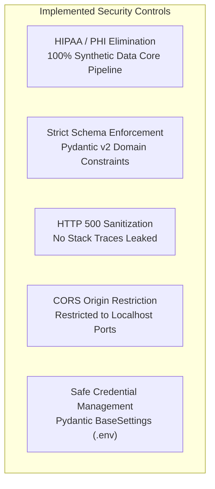

# Security, Governance, and Limitations — ICU Bed Demand Forecasting

A Critical Evaluation of Existing Security Controls, Identified Vulnerabilities, Data Privacy, and Known Architectural Limitations.

---

## 1. Security Architecture & Controls Implemented

The current system implements multiple defense-in-depth security and data integrity controls:



### 1.1 Zero Protected Health Information (PHI) & HIPAA Compliance
- **Core Security Guarantee:** The primary continuous data streaming pipeline, machine learning models, and interactive dashboards operate **strictly on mathematically synthesized patient events**.
- Real patient identities, medical record numbers (MRNs), social security numbers, and protected health information (PHI) are **never ingested, stored, or processed** in the streaming pipeline.
- This architectural decision eliminates HIPAA compliance liabilities and data breach risks during development, evaluation, and academic project defense.

### 1.2 Strict Input Validation & Domain Constraints
- All data entering the system via REST API (`PredictionRequest`, `HourlyCensusRecord`) or streaming Kafka topics (`ICUEvent`) passes through strict Pydantic v2 validation models.
- **Top-of-Hour Enforcement:** Non-aligned timestamps (e.g. `:14:32`) or chronological inversions are caught at the API boundary and rejected with `HTTP 422 Unprocessable Entity`.
- **Negative Bed Rejection:** Bed occupancies $< 0$ and capacities $\le 0$ are blocked by schema validation rules (`ge=0.0`, `gt=0`).

### 1.3 HTTP 500 Error Sanitization
- In `src/api/main.py`, unhandled internal exceptions are intercepted by a global FastAPI exception handler:
```python
@app.exception_handler(Exception)
async def unhandled_exception_handler(request: Request, exc: Exception):
    logger.exception("Internal server error: %s", str(exc))
    return JSONResponse(
        status_code=500,
        content={
            "detail": "An internal server error occurred while processing the request.",
            "error_type": "InternalServerError",
        },
    )
```
- Internal stack traces, database URIs, HDFS hostnames, and file paths are logged server-side but **never leaked to the client**.

### 1.4 CORS Origin Restriction
- The FastAPI application restricts Cross-Origin Resource Sharing (CORS) strictly to authorized local endpoints:
  - `http://localhost:8501` and `http://127.0.0.1:8501` (Streamlit Dashboard)
  - `http://localhost:8000` and `http://127.0.0.1:8000` (FastAPI Swagger Docs)
- Wildcard CORS (`allow_origins=["*"]`) is explicitly disabled.

### 1.5 Safe Configuration & Secret Isolation
- All sensitive variables, network endpoints, and credentials are abstracted via `src/config.py` using `pydantic-settings`.
- Secrets are loaded from local `.env` files which are explicitly excluded in `.gitignore`. No hardcoded passwords, tokens, or private keys exist in version control.

---

## 2. Identified Security Gaps & Vulnerabilities

In accordance with technical documentation ethics, the following security gaps exist in the current development configuration:

| Vulnerability ID | Vulnerability Description | Risk Level | Threat Scenario | Remediation Required |
| :---: | :--- | :---: | :--- | :--- |
| **SEC-01** | **Joblib / Pickle Deserialization Risk** | **High** | `joblib.load()` can execute arbitrary Python bytecode if an attacker substitutes a malicious `icu_occupancy_forecaster.joblib` file. | Migrate model artifact serialization to safe formats like **ONNX** or **Safetensors**; sign artifacts with HMAC. |
| **SEC-02** | **Lack of API Authentication & Authorization** | **Medium** | FastAPI endpoints (`/predict`, `/model/info`) have no authentication (no API tokens, OAuth2, or JWT). Anyone on the local network can query the API. | Implement **OAuth2 with Bearer Tokens (JWT)** or API Key headers via FastAPI security dependencies. |
| **SEC-03** | **Unauthenticated WebHDFS & HDFS Permissions Disabled** | **Medium** | Hadoop is configured with `HDFS_CONF_dfs_permissions_enabled: "false"`. WebHDFS accepts arbitrary user queries (`user.name=root`). | Enable HDFS permissions and implement **Kerberos (SPNEGO)** authentication for Hadoop cluster. |
| **SEC-04** | **Unencrypted Kafka Transport (PLAINTEXT)** | **Low / Medium** | Kafka broker communicates over unencrypted TCP `PLAINTEXT://localhost:9092`. Payloads are readable via network sniffing. | Configure Kafka listeners with **TLS / SSL encryption** and mutual TLS (mTLS) client certificates. |
| **SEC-05** | **No Rate Limiting on Prediction Endpoints** | **Low** | Absence of request throttling allows malicious clients to flood `POST /predict`, inducing CPU exhaustion. | Implement token-bucket rate limiting using `slowapi` or an API gateway (e.g. Traefik/Kong). |

---

## 3. Data Governance & Licensing

### 3.1 PhysioNet MIMIC-IV Clinical Demo Licensing
- The PhysioNet MIMIC-IV Clinical Demo 2.2 dataset is used strictly for offline schema validation and transfer logic verification.
- **License:** Open Data Commons Open Database License (ODbL) v1.0.
- **Compliance Rules:**
  - Demo files are de-identified under HIPAA Safe Harbor standards.
  - Raw downloaded CSVs and uncompressed tables are placed in `data/mimic/` and strictly excluded from Git.
  - No credential-protected full MIMIC-IV 3.1 files are accessed or committed.

### 3.2 Data Retention & Lake Partitioning Policy
- **Raw Lake Partitioning:** Events are partitioned by event year, month, and day (`/raw/icu_events/year=YYYY/month=MM/day=DD/`).
- **Idempotent Retention:** Because raw event files use unique UUIDs, historical raw batches remain immutable and can be archived to cold cloud storage (e.g., AWS S3 Glacier) without modifying downstream replay logic.

---

## 4. Known Technical & Operational Limitations

### 4.1 The Simulation Runout Drain-Down Tail Effect
During Phase 3 model evaluation, an empirical dynamic was discovered:
- **Active Inflow Period (Oct 21 – Oct 29, 1,035 samples):** Direct Ridge Regression achieved **1.72 MAE**, outperforming the Persistence Baseline (**1.80 MAE**).
- **Simulation Drain-Down Tail (Oct 30 – Nov 03, 540 samples):** Because synthetic admissions intentionally terminated at Day 90, patient occupancy collapsed toward zero as remaining patients discharged.
- **The Divergence:** The Persistence Baseline ($y_{t+h} = y_t$) dynamically followed the collapsing census to zero without bias (**1.11 MAE**). However, Direct Ridge's stationary regression weights predicted mean-reversion toward typical operating census (~9.6 beds), resulting in **2.78 MAE** (+1.10 beds positive bias).
- **Integrity Decision:** Rather than artificially truncating the test set to inflate machine learning scores, the entire held-out test partition is preserved unsegmented, and **Persistence Baseline is maintained as the primary operational benchmark**.

### 4.2 Cumulative Replay Dependency
- Reconstructing exact census requires replaying historical event logs from the HDFS raw zone.
- If raw events are sliced into isolated time windows without pre-window history, stays crossing window boundaries (patients admitted prior to window start) would not be reflected. Cumulative lake replay is the chosen architectural model.

### 4.3 Single-Node Resource Constraints
- The Docker Compose environment represents a single-node demonstration cluster. It demonstrates distributed Big Data architecture patterns, but does not provide multi-node high-availability clustering.
