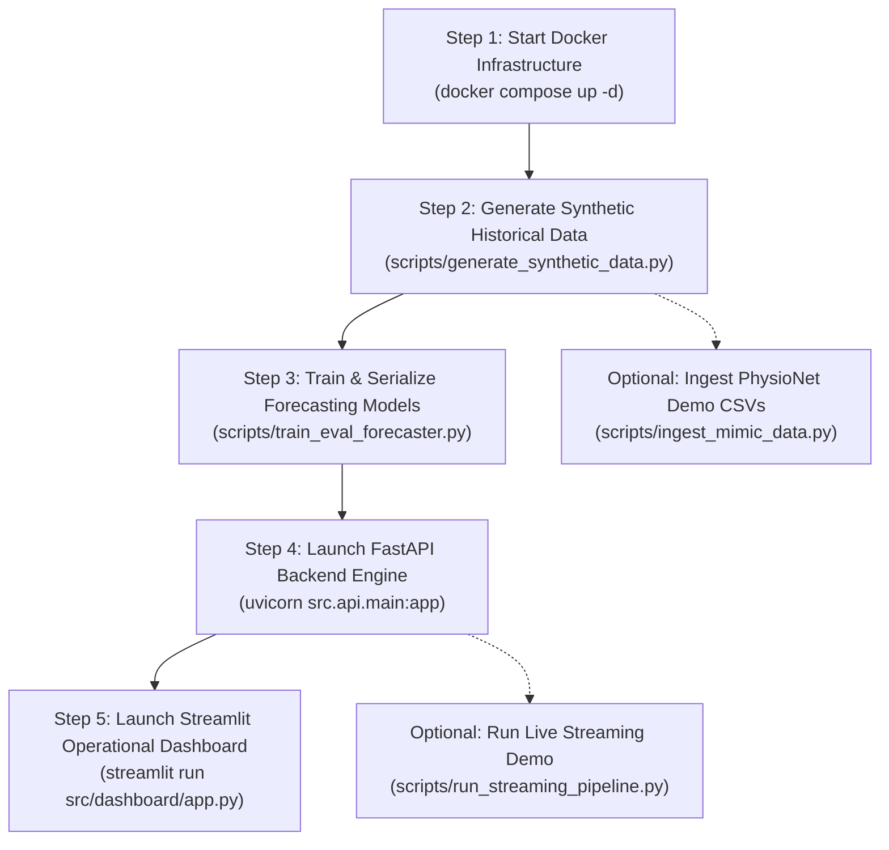

# Setup and Execution Runbook — ICU Bed Demand Forecasting

A Step-by-Step Developer and Evaluator Guide for Installing, Configuring, Running, Testing, and Maintaining the Platform.

---

## 1. System Requirements & Prerequisites

### 1.1 Hardware Specifications
- **Processor:** Modern x86_64 or ARM64 (Apple Silicon M1/M2/M3/M4 or Intel/AMD 4+ cores).
- **RAM:** Minimum 8 GB (16 GB recommended to support local Docker Hadoop, Kafka, and Python runtimes concurrently).
- **Disk Space:** Minimum 5 GB free disk space for Docker container images and synthetic Parquet lakes.

### 1.2 Operating System Compatibility
- **macOS:** macOS Monterey (12.x), Ventura (13.x), Sonoma (14.x), or Sequoia (15.x).
- **Linux:** Ubuntu 22.04/24.04 LTS, Debian 12, RHEL 9, Fedora 39+.
- **Windows:** Windows 10/11 Pro or Enterprise with WSL2 (Windows Subsystem for Linux) and Docker Desktop.

### 1.3 Required Base Software
- **Python:** Python `>=3.12` (Python 3.12 or 3.13 supported).
- **Docker Engine & Docker Compose:** Docker Desktop `>=4.25` or Docker Engine `>=24.0` with Docker Compose `v2.x`.
- **Git:** Git `>=2.30`.
- **Package Manager:** Standard `pip` or modern fast `uv` (recommended).

---

## 2. Environment Setup & Dependency Installation

### 2.1 Repository Setup & Virtual Environment
Open a terminal in the project directory:

```bash
# Verify current working directory
pwd
# Expected: .../Project (containing pyproject.toml, docker-compose.yml, src/)

# Create Python 3.12 virtual environment using standard venv
python -m venv .venv

# Activate Virtual Environment:
# On macOS / Linux:
source .venv/bin/activate

# On Windows PowerShell:
# .\.venv\Scripts\Activate.ps1

# On Windows Command Prompt:
# .\.venv\Scripts\activate.bat
```

### 2.2 Dependency Installation Options
The project configures dependency groups in `pyproject.toml` using `hatchling`:

```bash
# Option A: Complete Installation (Recommended for full end-to-end evaluation)
pip install -e ".[test,ml,serving]"

# Option B: Core Pipeline & Testing Suite Only
pip install -e ".[test]"

# Option C: Machine Learning Training & Evaluation Only
pip install -e ".[ml,test]"

# Option D: Prediction Serving & Dashboard Only (Self-contained for inference)
pip install -e ".[serving]"
```

*Note for fast installation using `uv`:*
```bash
uv pip install -e ".[test,ml,serving]"
```

---

## 3. Environment Variable Configuration

Copy the template environment file `.env.example` to `.env`:

```bash
cp .env.example .env
```

### 3.1 Environment Variable Reference (`.env`)

```dotenv
# ==============================================================================
# ICU Bed Demand Forecasting — Environment Configuration
# ==============================================================================

# Apache Kafka Configuration
KAFKA_BOOTSTRAP_SERVERS=localhost:9092
KAFKA_TOPIC_ICU_EVENTS=icu-events
KAFKA_TOPIC_ICU_VITALS=icu-vitals
KAFKA_CONSUMER_GROUP_ID=icu-hdfs-sink-group
KAFKA_VITALS_CONSUMER_GROUP_ID=icu-vitals-hdfs-sink-group
KAFKA_AUTO_OFFSET_RESET=earliest

# Hadoop HDFS Configuration
HDFS_NAMENODE_URL=http://localhost:9870
HDFS_NAMENODE_RPC=hdfs://localhost:9000
HDFS_USER=root
HDFS_RAW_PATH=/raw/icu_events
HDFS_VITALS_RAW_PATH=/raw/icu_vitals
HDFS_PROCESSED_PATH=/processed/icu_occupancy_hourly

# Application Service Ports
FASTAPI_HOST=0.0.0.0
FASTAPI_PORT=8080
STREAMLIT_PORT=8501


# Simulation & Spool Settings
SIMULATION_RANDOM_SEED=42
SIMULATION_DEFAULT_DAYS=90
DATA_SPOOL_DIR=data/spool
```

---

## 4. Launching Distributed Big Data Infrastructure

Ensure Docker Desktop or Docker daemon is running on your host machine before starting containers.

### 4.1 Start Containers via Docker Compose

```bash
# 1. Validate Docker Compose syntax and variable substitution
docker compose config

# 2. Launch ZooKeeper, Kafka, Hadoop NameNode, and DataNode in background
docker compose up -d

# 3. Verify running container status and healthchecks
docker compose ps
```

Expected healthy container status:
- `icu-zookeeper`: `Up (healthy)` on port `2181`
- `icu-kafka`: `Up (healthy)` on port `9092`
- `icu-namenode`: `Up (healthy)` on ports `9870`, `9000`
- `icu-datanode`: `Up (healthy)` on port `9864`

### 4.2 Audit Assigned Ports
Run the automated socket port auditor to confirm all ports are open and accessible:

```bash
python scripts/check_ports.py
```

Expected output:
```text
==========================================================================
ICU Bed Demand Forecasting — Port Management & Audit Utility
==========================================================================
Service / Component       Port     State        Status / Recommendation
--------------------------------------------------------------------------
ZooKeeper                 2181     [ACTIVE]     OK — Container is listening (Cluster coordination)
Apache Kafka              9092     [ACTIVE]     OK — Container is listening (ADT event streaming broker)
HDFS NameNode RPC         9000     [ACTIVE]     OK — Container is listening (Hadoop IPC RPC filesystem protocol)
HDFS NameNode WebHDFS     9870     [ACTIVE]     OK — Container is listening (WebHDFS REST API & NameNode UI)
HDFS DataNode             9864     [ACTIVE]     OK — Container is listening (Hadoop DataNode block transfer & HTTP)
FastAPI Service           8000     [FREE]       Available to bind. (Configured in .env as 8000)
Streamlit Dashboard       8501     [FREE]       Available to bind. (Configured in .env as 8501)
==========================================================================
```

---

## 5. End-to-End Execution Sequence

Follow these steps sequentially to generate data, train models, and launch web applications:



### Step 1: Generate 90 Days of Synthetic Ground-Truth Data
Generates 90 days of synthetic ADT transitions across 5 ICU wards and precomputes hourly census ground truth with a Day 35 TSICU surge scenario:

```bash
python scripts/generate_synthetic_data.py --days 90 --seed 42 --surge
```
- Output events: `data/synthetic/simulated_icu_events.jsonl`
- Output census: `data/synthetic/simulated_hourly_occupancy.parquet`

### Step 2: Train and Evaluate Multi-Horizon Models
Executes chronological splitting (70% Train, 15% Val, 15% Test with 24h buffer gap), trains candidates, selects the best model on Validation MAE, and serializes artifacts:

```bash
python scripts/train_eval_forecaster.py \
    --data-path data/synthetic/simulated_hourly_occupancy.parquet \
    --output-dir models \
    --seed 42
```
- Saved artifacts:
  - `models/icu_occupancy_forecaster.joblib`
  - `models/feature_metadata.json`
  - `models/evaluation_report.json`
  - `models/EVALUATION_REPORT.md`

### Step 3: Launch FastAPI Prediction Service
Starts the REST API with lifespan model caching on port `8080` (configured in `.env` to avoid macOS port 8000 conflicts):

```bash
uvicorn src.api.main:app --host 0.0.0.0 --port 8080 --reload
```
- Interactive OpenAPI Swagger Docs: [http://localhost:8080/docs](http://localhost:8080/docs)
- Service Liveness Probe: `curl http://localhost:8080/health`
- Service Readiness Probe: `curl http://localhost:8080/ready`


### Step 4: Launch Streamlit Operational Dashboard
Open a new terminal, activate `.venv`, and start the dashboard on port `8501`:

```bash
streamlit run src/dashboard/app.py --server.port 8501
```
- Web Application URL: [http://localhost:8501](http://localhost:8501)

### Step 5 (Optional): Run ADT Streaming Ingestion Pipeline Demo
Demonstrates real-time streaming from generator $\to$ Kafka broker $\to$ HDFS micro-batch sink $\to$ lake census reconstruction:

```bash
python scripts/run_streaming_pipeline.py --num-events 50 --rate 25.0
```

### Step 5b (Optional): Run Patient Vital-Sign Streaming Pipeline Demo
Demonstrates multi-channel physiological streaming from synthetic generator $\to$ Kafka topic `icu-vitals` $\to$ `KafkaVitalsHDFSSink` $\to$ HDFS `/raw/icu_vitals/`:

```bash
python scripts/run_vitals_streaming_pipeline.py --num-events 50 --rate 25.0
```
*Note: Vital signs are safely ingested and archived on HDFS for clinical analysis, but are decoupled from the 24-hour occupancy forecaster.*

### Step 6 (Optional): Ingest MIMIC-IV Clinical Demo Data & Train Model
Downloads open-access demo tables from PhysioNet, validates SHA-256 checksums, extracts ADT and vital-sign telemetry, generates a synchronized demonstration cohort, reconstructs census in Parquet, streams to Kafka/HDFS, and evaluates a separate forecaster:

```bash
# Execute the complete end-to-end MIMIC-IV demo workflow
python scripts/ingest_mimic_data.py --all

# Or run individual stages:
python scripts/ingest_mimic_data.py --download            # Download demo CSVs & verify SHA-256
python scripts/ingest_mimic_data.py --extract-adt         # Extract ADT events (mimic_demo_events.jsonl)
python scripts/ingest_mimic_data.py --extract-vitals      # Extract vitals (mimic_demo_vitals.jsonl)
python scripts/ingest_mimic_data.py --synchronize-cohort  # Create synchronized demo cohort
python scripts/ingest_mimic_data.py --reconstruct-census  # Reconstruct hourly Parquet census
python scripts/ingest_mimic_data.py --publish-kafka       # Stream 50 events each to Kafka & HDFS
python scripts/ingest_mimic_data.py --train-forecaster    # Train & evaluate separate MIMIC forecaster
```

*Note: The canonical synthetic dataset and model remain untouched and continue to drive the live dashboard.*

---

## 6. Running Automated Tests

```bash
# Run the complete test suite (123 tests: unit and integration)
pytest tests/ -v

# Run unit tests only (103 tests including MIMIC ingestion and vitals):
pytest tests/unit/ -v
pytest tests/unit/test_mimic_ingestion.py -v
pytest tests/unit/test_schemas.py -v
pytest tests/unit/test_vitals_pipeline.py -v
pytest tests/unit/test_occupancy_calculator.py -v
pytest tests/unit/test_ml_pipeline.py -v

# Run live integration tests (20 tests requiring Docker Kafka & HDFS running):
pytest tests/integration/ -v
pytest tests/integration/test_mimic_streaming.py -v
pytest tests/integration/test_vitals_streaming.py -v
```


---

## 7. Troubleshooting & Common Issues

### 7.1 Docker Daemon Not Running
- **Symptom:** `dial unix /var/run/docker.sock: connect: no such file or directory` or connection refused.
- **Root Cause:** Docker Desktop is stopped or Docker service is inactive.
- **Fix:** Launch Docker Desktop from Applications (macOS) or run `sudo systemctl start docker` (Linux). Re-verify with `docker ps`.

### 7.2 Port Conflict (Port 8000 or 8501 Occupied)
- **Symptom:** `ERROR: [Errno 48] Address already in use` when starting FastAPI or Streamlit.
- **Fix:** Update port assignments in `.env`:
  ```dotenv
  FASTAPI_PORT=8080
  STREAMLIT_PORT=8502
  ```
  Run `python scripts/check_ports.py` to confirm the new ports are free.

### 7.3 `ModuleNotFoundError: No module named 'confluent_kafka'`
- **Symptom:** Test or script fails during import of `src.storage` or `src.producer`.
- **Root Cause:** Script executed in base Python environment instead of activated virtual environment where optional dependencies were installed.
- **Fix:** Ensure virtual environment is activated (`source .venv/bin/activate`) and run `pip install -e ".[test,ml,serving]"`.

### 7.4 WebHDFS DataNode Redirect Failure (`datanode:9864`)
- **Symptom:** `ConnectionError: Failed to establish a new connection: [Errno 8] nodename nor servname provided, or not known (datanode:9864)`.
- **Root Cause:** When running Python code directly on the host machine (outside Docker), the host cannot resolve internal Docker container hostnames like `datanode`.
- **Fix:** `src/storage/hdfs_client.py` includes automatic host redirect remapping (`_remap_redirect`). Ensure `host_remap=True` (enabled by default), which translates `datanode:9864` to `localhost:9864`.

### 7.5 Stopping and Cleaning Up Infrastructure
```bash
# Stop all Docker containers safely without deleting volumes
docker compose down

# Stop containers and remove persistent volumes (full data wipe)
docker compose down -v
```
