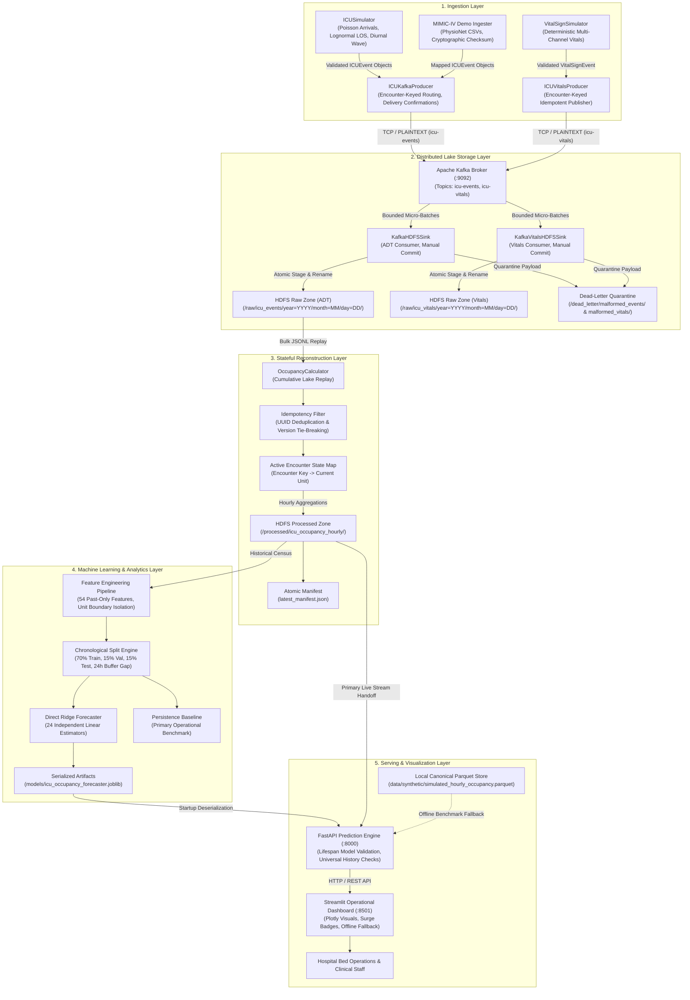
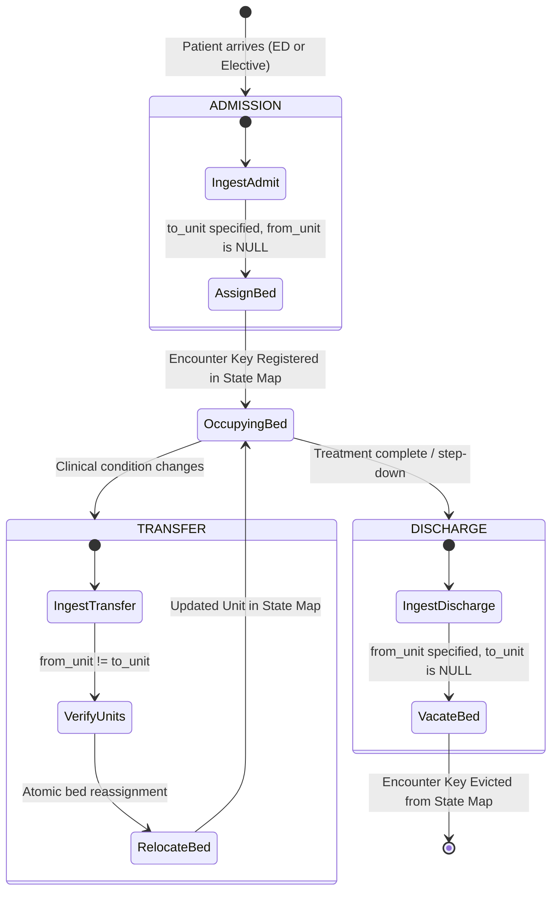
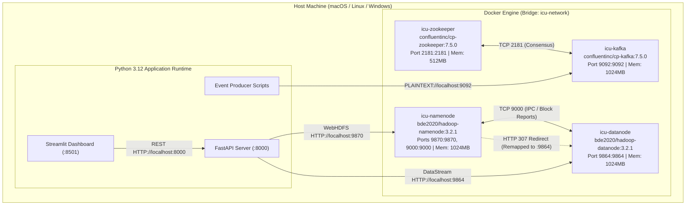

# System Architecture — ICU Bed Demand Forecasting

A Comprehensive Engineering Specification of Component Interactions, Container Topology, Communication Protocols, and Design Trade-Offs.

---

## 1. Architectural Philosophy & Layered Overview

The **ICU Bed Demand Forecasting** system is engineered around a decoupled, 5-tier architecture that addresses the challenges of streaming clinical transitions, immutable distributed storage, stateful census reconstruction, and leakage-safe operational forecasting.

---

## 2. Component Deep Dives Across Architectural Tiers

### 2.1 Ingestion Layer
- **`src/producer/simulator.py` (`ICUSimulator`):**
  - Synthesizes realistic hospital event streams using a non-homogeneous Poisson arrival process.
  - Implements a diurnal wave peaking at 14:00 with overnight troughs and weekend surgical dampening.
  - Samples length of stay (LOS) from a lognormal distribution ($\mu = \ln(48) - \sigma^2/2, \sigma = 0.75$, clipped to $[4, 720]$ hours).
  - Simulates inter-unit specialty transfers with probability $p=0.12$.
  - Injects controllable surge scenarios (e.g., TSICU $2.5\times$ volume for 48 hours on Day 35).
- **`scripts/ingest_mimic_data.py`:**
  - Ingests PhysioNet MIMIC-IV Clinical Database Demo 2.2 tables (`transfers.csv.gz`, `icustays.csv.gz`, `admissions.csv.gz`, `patients.csv.gz`).
  - Verifies cryptographic SHA-256 checksums from `SHA256SUMS.txt`.
  - Maps hospital careunit designations to standardized project units (e.g., `Trauma SICU (TSICU)` $\to$ `TSICU`).
- **`src/producer/kafka_producer.py` (`ICUKafkaProducer`):**
  - Wraps `confluent_kafka.Producer` with `enable.idempotence=True`, `acks=all`, and retry backoff.
  - Partitions events strictly by `encounter_id`, ensuring all transitions for a given patient stay are dispatched to the exact same Kafka partition in strict FIFO order.
- **`src/producer/vitals_simulator.py` (`VitalSignSimulator`):**
  - Generates deterministic, multi-channel physiological demonstration telemetry (`VitalSignEvent`).
  - Supports configurable random seeds, sampling frequencies, and realistic sensor dropouts.
- **`src/producer/vitals_producer.py` (`ICUVitalsProducer`):**
  - High-throughput dedicated producer publishing to topic `icu-vitals`.
  - Routes by `encounter_id` to maintain partition alignment with encounter ADT events.

### 2.2 Distributed Lake Storage Layer
- **Apache Kafka (`confluentinc/cp-kafka:7.5.0`):**
  - Single-node broker running on port `9092` managing dual topics: `icu-events` (ADT transitions) and `icu-vitals` (physiological telemetry), each provisioned with 3 partitions.
  - Coordinates metadata and leader election through Confluent ZooKeeper on port `2181`.
- **`src/storage/kafka_sink.py` (`KafkaHDFSSink` & `KafkaVitalsHDFSSink`):**
  - Consumes messages in bounded micro-batches (default: 500 messages or 5-second idle timeout).
  - Validates payload schemas against Pydantic models (`ICUEvent` and `VitalSignEvent`).
  - Implements **At-Least-Once Delivery**: Consumer offsets are manually and synchronously committed only **after** the batch is durably staged and atomically renamed in HDFS.
  - **Dead-Letter Quarantine (DLQ):** Malformed messages are routed to `/dead_letter/malformed_events/` or `/dead_letter/malformed_vitals/`. The DLQ write must succeed before continuing; otherwise, the micro-batch aborts.
- **Apache Hadoop HDFS (`bde2020/hadoop-namenode:2.0.0-hadoop3.2.1-java8` & DataNode):**
  - NameNode runs WebHDFS HTTP REST API on port `9870` and RPC IPC on port `9000`.
  - DataNode handles direct streaming block reads/writes on port `9864`.
  - Partitioning strategy:
    - ADT Events: `/raw/icu_events/year=YYYY/month=MM/day=DD/events_<uuid>.jsonl`.
    - Vital Signs: `/raw/icu_vitals/year=YYYY/month=MM/day=DD/vitals_<uuid>.jsonl`.
- **`src/storage/hdfs_client.py` (`HDFSClient`):**
  - Pure Python REST client for WebHDFS without requiring JVM native bindings.
  - Resolves internal Docker container redirect URLs (e.g., translating `datanode:9864` to `localhost:9864` for host execution).

> [!IMPORTANT]
> **Architectural Decoupling:** The vital-sign streaming pipeline (`icu-vitals` $\to$ `/raw/icu_vitals/`) is completely decoupled from the occupancy forecasting engine. The occupancy reconstruction layer consumes solely from `/raw/icu_events/`. Vital signs are captured and persisted for clinical auditability and future severity modeling (e.g. SOFA scoring).

### 2.3 Stateful Processing & Census Reconstruction Layer
- **`src/processing/occupancy_calculator.py` (`OccupancyCalculator`):**
  - Reconstructs exact instantaneous unit occupancy at top-of-hour milestones (`:00:00` UTC).
  - **Idempotent Deduplication:** Filters events by `event_id` UUID.
  - **Correction Superseding:** Identifies correction records (`is_correction=True`) and replaces superseded records (`original_event_id`), using version tie-breaking.
  - **Deterministic Sorting:** Orders events by `(event_timestamp, version, type_priority, event_id)` where priority ensures `ADMISSION` ($0$) precedes `TRANSFER` ($1$) and `DISCHARGE` ($2$) in the same microsecond.
  - **Double-Counting Elimination:** Maintains active encounter mapping `(patient_id:encounter_id) -> current_unit`. A patient can only occupy one bed at any given timestamp milestone.
  - **Atomic Parquet Persistence:** Writes output DataFrame to `/processed/icu_occupancy_hourly/` with Snappy compression, updating `latest_manifest.json` via atomic rename.

### 2.4 Machine Learning & Analytics Layer
- **`src/ml/features.py`:**
  - Extracts 54 past-only features per unit with strict boundary isolation:
    - 28 Lag features: $L_0$ (`occ_current`), $L_1 \dots L_{24}$, $L_{48}$, $L_{72}$, $L_{168}$.
    - 6 Rolling features: Mean and standard deviation over 6h, 24h, and 168h windows.
    - 5 Calendar harmonics: $\sin/\cos$ of hour-of-day, $\sin/\cos$ of day-of-week, weekend indicator.
    - 4 Interval flow aggregations: 24h rolling sums of admissions, discharges, transfers-in, and transfers-out.
    - 2 Capacity context features: Configured capacity and current utilization rate.
    - 5 Unit one-hot indicators: `unit_CCU`, `unit_CSRU`, `unit_MICU`, `unit_SICU`, `unit_TSICU`.
- **`src/ml/pipeline.py` & `src/ml/models.py`:**
  - Applies chronological split: 70% Train (7,230 samples), 15% Val (1,460 samples), 15% Test (1,575 samples).
  - Enforces a **24-hour target buffer gap** between partitions to prevent target overlap.
  - Implements **Direct Multi-Horizon Ridge Regression** ($\alpha=10.0$) using 24 independent sub-estimators.
  - Maintains `PersistenceBaseline` ($y_{t+h} = y_t$) as the primary operational benchmark.

### 2.5 Serving & Visualization Layer
- **`src/api/main.py` & `src/api/service.py` (`FastAPI`):**
  - Serves predictions via `POST /predict`, health checks via `GET /health` and `GET /ready`, and metadata via `GET /units` and `GET /model/info`.
  - **Lifespan Startup Caching:** Validates model artifact, dimensions (54 features, 24 horizons), and training provenance at server boot.
  - **Universal History Validation:** Validates top-of-hour alignment, strict continuity, and no missing data across all model paths.
  - **Clock Skew & Future-Dated Data:** Accommodates a 5-minute clock drift; preserves negative source age for future simulations without silent clamping.
- **`src/dashboard/app.py` (`Streamlit`):**
  - Interactive clinical operations dashboard rendering historical trajectories and 24-hour forward projections.
  - Highlights baseline fallback activation, data provenance (`HDFS_PROCESSED_LAKE` vs `LOCAL_SYNTHETIC_STORE`), and surge alerts.

---

## 3. Patient Encounter State Machine

Patient trajectories follow clinical transitions governed by explicit validation rules:

---

## 4. Container & Infrastructure Deployment Topology

The infrastructure runs inside an isolated Docker bridge network named `icu-network`:

---

## 5. Protocols, Transports, and Port Allocations

| Component | Port | Transport Protocol | Serialization | Authentication | Purpose |
| :--- | :---: | :--- | :--- | :--- | :--- |
| **Confluent ZooKeeper** | `2181` | TCP | Custom Binary | None (Local Dev) | Broker consensus, election, topic metadata |
| **Apache Kafka Broker** | `9092` | TCP (PLAINTEXT) | JSON `ICUEvent` | None (Local Dev) | High-throughput streaming ADT ingest |
| **Hadoop NameNode WebHDFS** | `9870` | HTTP / REST | JSON / Stream | Query param (`user.name=root`) | Filesystem metadata, file creation, listing |
| **Hadoop NameNode RPC** | `9000` | TCP (Hadoop IPC) | Java RPC | Hadoop user token | Inter-cluster DataNode block reporting |
| **Hadoop DataNode HTTP** | `9864` | HTTP / Stream | Octet-Stream / Parquet | WebHDFS token / redirect | Direct raw and Parquet block payload streaming |
| **FastAPI Prediction Engine** | `8000` | HTTP / ASGI | JSON (Pydantic v2) | CORS restricted | Multi-horizon inference & metadata API |
| **Streamlit Dashboard** | `8501` | HTTP / WebSockets | HTML / Plotly JSON | Localhost session | Real-time interactive capacity dashboard |

---

## 6. Architectural Decisions, Trade-Offs, and Justifications

### 6.1 Direct Multi-Output vs. Recursive Autoregressive Forecasting
- **Decision:** Implement **Direct Multi-Output Regression** (training 24 independent linear models, one for each horizon $h \in [1..24]$) instead of a single 1-step recursive autoregressive model.
- **Rationale:** In recursive forecasting, any prediction error at $t+1$ is fed back into features for $t+2$, leading to rapid compounding error divergence over 24 hours. Direct forecasting optimizes loss independently for each lead time, maintaining structural stability even at $h=24$.
- **Trade-Off:** Requires training and persisting 24 individual estimators (managed efficiently via `scikit-learn` `MultiOutputRegressor`), slightly increasing training time while eliminating recursive drift.

### 6.2 WebHDFS REST API vs. Native LibHDFS C-Bindings
- **Decision:** Communicate with Hadoop HDFS using the **WebHDFS REST API** via Python `requests` with custom redirect remapping.
- **Rationale:** Native HDFS Python libraries (`pyarrow.hdfs`, `hdfs3`) require JVM libhdfs C-bindings, specific `JAVA_HOME` configurations, and platform-specific shared objects (`libjvm.so` / `jvm.dll`). WebHDFS is platform-agnostic, works seamlessly across macOS, Linux, and Windows, and requires zero Java dependencies on the host Python runtime.
- **Trade-Off:** Slightly lower bulk I/O transfer throughput compared to native IPC, which is negligible for hourly micro-batches and Parquet files under 100MB.

### 6.3 Cumulative Lake Replay vs. Sliding Window Streaming Aggregation
- **Decision:** Reconstruct census by performing **cumulative replay** of raw events from the HDFS raw zone rather than maintaining an in-memory sliding window.
- **Rationale:** In an ICU, patient length of stay follows a heavy right-skewed lognormal distribution (stays often exceed 14 to 30 days). If streaming processing is sliced into isolated 24-hour windows, patients admitted prior to the window start would be completely invisible unless state is cumulatively carried forward. Cumulative lake replay guarantees 100% census ground truth.
- **Trade-Off:** As raw event volume grows into millions of records, full replay in memory becomes slow. For big data scale-out, this will transition to PySpark stateful streaming with rocksDB checkpointing (see [FUTURE_ENHANCEMENTS.md](./FUTURE_ENHANCEMENTS.md)).

### 6.4 Non-Clipping at Staffed Capacity
- **Decision:** Model predictions are clipped at zero ($\ge 0$ beds) to prevent negative bed counts, but **intentionally not clipped at staffed capacity**.
- **Rationale:** If an ICU has 24 staffed beds and patient demand surges to 28, clipping predictions at 24 would completely mask the impending overflow. Allowing the forecast to project 28 beds enables the dashboard to compute positive exceedance ($\text{exceedance\_beds} = 4$) and alert bed flow coordinators to open overflow bays or call in surge nurses.
