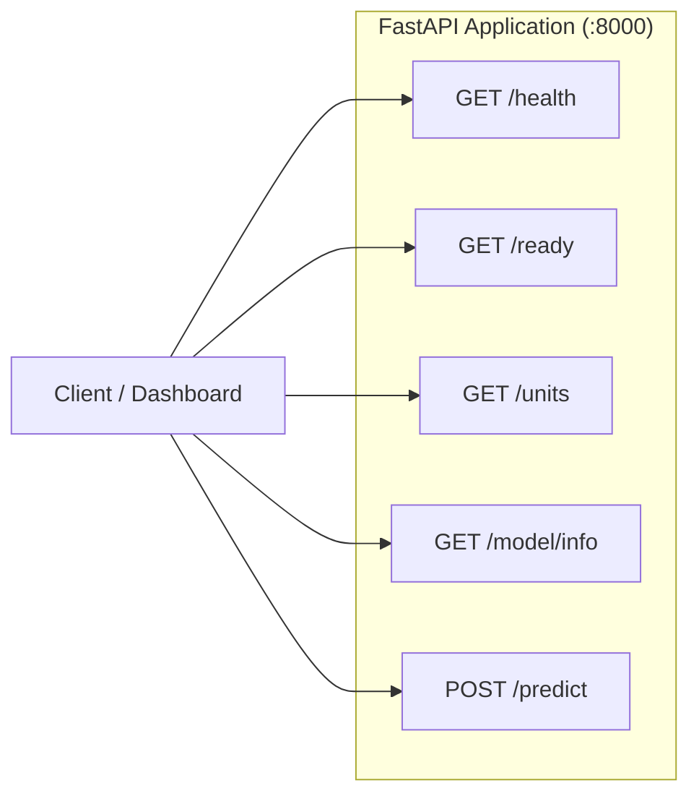

# Technical Documentation & Codebase Reference

A Detailed Engineering Inventory of Technologies, Modules, Classes, Functions, Schemas, and REST APIs.

---

## 1. Verified Technology Stack Inventory

This inventory documents all technologies verified through `pyproject.toml`, `docker-compose.yml`, and codebase imports.

| Technology | Category | Verified Version | Codebase Location | Architectural Role | Implementation Status |
| :--- | :--- | :--- | :--- | :--- | :---: |
| **Python** | Runtime | `>=3.12` | Root / `pyproject.toml` | Primary programming language | **Active** |
| **Apache Kafka** | Streaming Broker | `7.5.0` (Confluent) | `docker-compose.yml` | Real-time event broker for `icu-events` | **Active** |
| **Confluent ZooKeeper** | Coordination | `7.5.0` (Confluent) | `docker-compose.yml` | Kafka broker election and cluster metadata | **Active** |
| **confluent-kafka** | Kafka Client | `>=2.3.0` | `src/producer/`, `src/storage/` | High-throughput C-based Kafka client bindings | **Active** |
| **Apache Hadoop HDFS** | Data Lake | `3.2.1` (bde2020) | `docker-compose.yml` | Distributed lake for raw JSONL and Parquet | **Active** |
| **WebHDFS REST API** | Lake Transport | HTTP / REST | `src/storage/hdfs_client.py` | Cross-platform HDFS client without Java bindings | **Active** |
| **Apache Parquet (PyArrow)** | Columnar Storage | `>=15.0.0` | `src/storage/`, `src/processing/` | Compressed, typed columnar storage for census | **Active** |
| **Pandas** | Data Processing | `>=2.2.0` | `src/processing/`, `src/ml/` | In-memory time series manipulation & replay | **Active** |
| **NumPy** | Numerical Math | `>=1.26.0` | `src/ml/`, `src/producer/` | Array math, clipping, Poisson random sampling | **Active** |
| **Pydantic v2** | Data Contracts | `>=2.7.0` | `src/schema/`, `src/api/` | Strict schema validation and JSON serialization | **Active** |
| **Pydantic-Settings** | Configuration | `>=2.2.0` | `src/config.py` | Safe environment variable management | **Active** |
| **Scikit-learn** | Machine Learning | `>=1.4.0` | `src/ml/` | Multi-output Ridge, HistGradientBoosting, metrics | **Active** |
| **Joblib** | ML Serialization | `>=1.3.0` | `src/ml/`, `src/api/` | Pipeline and forecaster model persistence | **Active** |
| **FastAPI** | REST API Engine | `>=0.110.0` | `src/api/` | Multi-horizon inference REST API | **Active** |
| **Uvicorn** | ASGI Web Server | `>=0.28.0` | Serving runtime | High-concurrency async web server | **Active** |
| **Streamlit** | Visual UI | `>=1.32.0` | `src/dashboard/` | Interactive clinical operations dashboard | **Active** |
| **Plotly** | Charting Library | `>=5.20.0` | `src/dashboard/` | Interactive real-time trajectory curves | **Active** |
| **Docker Compose** | Containerization | `v2.x` | `docker-compose.yml` | Local orchestration of multi-container cluster | **Active** |
| **Pytest** | Testing Framework | `>=8.0.0` | `tests/` | Unit and integration test execution | **Active** |
| **Hatchling** | Build Backend | Modern PEP 517 | `pyproject.toml` | Build and packaging system | **Active** |

---

## 2. Complete Project Directory Tree

```text
/Users/Anagha/Documents/DSCE/4th year/BDA/Project
├── .env.example                       # Template for environment configuration
├── .gitignore                         # Git exclusion rules
├── README.md                          # Repository root README
├── docker-compose.yml                 # Multi-container Kafka & Hadoop cluster
├── pyproject.toml                     # Project dependencies and packaging metadata
│
├── agent/                             # AI Agent guidelines and architecture rules
│   ├── ARCHITECTURE.md                # System component interactions and data flows
│   ├── README.md                      # Onboarding and directory tree map
│   ├── RULES.md                       # Critical clinical, temporal, and test rules
│   └── WORKFLOWS.md                   # Terminal commands and execution runbooks
│
├── data/                              # Dataset storage (excluded from git where dynamic)
│   ├── mimic_demo/                    # PhysioNet MIMIC-IV Clinical Demo 2.2 assets
│   │   ├── SHA256SUMS.txt             # Published PhysioNet checksums
│   │   ├── transfers.csv.gz           # Inpatient bed transfers (23 KB)
│   │   ├── icustays.csv.gz            # ICU stays metadata (5.5 KB)
│   │   ├── d_items.csv.gz             # Clinical chart item definitions (56 KB)
│   │   ├── chartevents.csv.gz         # ICU bedside vital sign chartings (5.29 MB)
│   │   ├── mimic_demo_events.jsonl    # Raw source-timeline ADT events (299 events)
│   │   ├── mimic_demo_vitals.jsonl    # Raw source-timeline vital sign events (19,364 vitals)
│   │   ├── mimic_cohort_events.jsonl  # Synchronized demonstration cohort ADT events
│   │   ├── mimic_cohort_vitals.jsonl  # Synchronized demonstration cohort vital sign events
│   │   └── mimic_hourly_occupancy.parquet # Reconstructed hourly census (4,515 rows)
│   └── synthetic/                     # Canonical synthetic benchmarks
│       ├── simulated_hourly_occupancy.parquet  # Precomputed 90-day census ground truth
│       └── simulated_icu_events.jsonl          # 90-day synthetic ADT event stream
│
├── docker/                            # Container runtime configurations
│   └── hadoop/
│       └── hadoop.env                 # HDFS NameNode & DataNode environment configuration
│
├── documentation/                     # Authoritative project documentation suite
│   ├── DATA_PIPELINE.md
│   ├── DOCUMENTATION_AUDIT.md
│   ├── FEATURES_AND_WORKFLOWS.md
│   ├── FUTURE_ENHANCEMENTS.md
│   ├── PERFORMANCE_AND_SCALABILITY.md
│   ├── PROJECT_OVERVIEW.md
│   ├── PROJECT_REPORT.md
│   ├── README.md
│   ├── SECURITY_AND_LIMITATIONS.md
│   ├── SETUP_AND_EXECUTION.md
│   ├── SYSTEM_ARCHITECTURE.md
│   └── TESTING_AND_VALIDATION.md
│
├── graphify-out/                      # AST Knowledge graph metadata (structural graph)
│   ├── GRAPH_REPORT.md                # Community and node connectivity metrics
│   ├── graph.html                     # Visual knowledge graph viewer
│   ├── graph.json                     # Serialized AST knowledge graph
│   └── manifest.json                  # Graph build manifest
│
├── models/                            # Serialized model artifacts and evaluation logs
│   ├── EVALUATION_REPORT.md           # Markdown report comparing models on synthetic data
│   ├── evaluation_report.json         # Complete machine-readable metrics JSON
│   ├── feature_metadata.json          # 54 feature names and training split boundaries
│   ├── icu_occupancy_forecaster.joblib# Serialized Direct Ridge Forecaster artifact (synthetic)
│   ├── MIMIC_EVALUATION_REPORT.md     # Markdown report for MIMIC-derived forecaster
│   ├── mimic_evaluation_report.json   # Machine-readable MIMIC metrics JSON
│   └── mimic_occupancy_forecaster.joblib # Separate forecaster trained on MIMIC census
│
├── scripts/                           # Operational and demonstration CLI scripts
│   ├── check_ports.py                 # Socket audit utility scanning assigned ports
│   ├── generate_synthetic_data.py     # 90-day deterministic synthetic generator CLI
│   ├── ingest_mimic_data.py           # MIMIC-IV demo acquisition, extraction, streaming & training
│   ├── run_streaming_pipeline.py      # Live streaming demo (Kafka -> HDFS -> Census)
│   ├── run_vitals_streaming_pipeline.py# Vitals streaming demo (Kafka -> HDFS verification)
│   ├── train_eval_forecaster.py       # ML training, validation, and artifact freezing CLI
│   └── verify_e2e_pipeline.py         # End-to-end integration and manifest verification
│
├── tests/                             # Comprehensive test suite (123 tests passing)
│   ├── unit/
│   │   ├── test_mimic_ingestion.py    # Unit tests for MIMIC parsing, unit map, vitals, cohort sync
│   └── integration/
│       ├── test_mimic_streaming.py    # Live Kafka/HDFS streaming test for MIMIC events and vitals
├── src/                               # Primary application source code
│   ├── __init__.py                    # Source root package marker
│   ├── config.py                      # System-wide Pydantic Settings
│   ├── api/                           # FastAPI serving engine
│   │   ├── __init__.py
│   │   ├── main.py                    # FastAPI application routes and lifespan
│   │   ├── schemas.py                 # Pydantic request and response schemas
│   │   └── service.py                 # ForecastingService inference singleton
│   ├── dashboard/                     # Streamlit clinical dashboard
│   │   ├── __init__.py
│   │   └── app.py                     # Streamlit web application with Plotly charts
│   ├── ml/                            # Machine learning forecasting pipeline
│   │   ├── __init__.py
│   │   ├── features.py                # Unit-isolated past-only feature engineering
│   │   ├── metrics.py                 # MAE, RMSE, zero-denominator safe WAPE
│   │   ├── models.py                  # Direct Ridge, HistGradientBoosting, Baselines
│   │   └── pipeline.py                # Chronological split (24h buffer) & selection
│   ├── processing/                    # State reconstruction engine
│   │   ├── __init__.py
│   │   └── occupancy_calculator.py    # Stateful cumulative replay & deduplication
│   ├── producer/                      # Event generation & publishing
│   │   ├── __init__.py
│   │   ├── kafka_producer.py          # Confluent Kafka encounter-keyed publisher (ADT)
│   │   ├── simulator.py               # Non-homogeneous Poisson clinical simulator
│   │   ├── vitals_producer.py         # Confluent Kafka vitals publisher
│   │   └── vitals_simulator.py        # Deterministic synthetic vital sign simulator
│   ├── schema/                        # Domain models & contracts
│   │   ├── __init__.py
│   │   ├── events.py                  # ICUEvent & VitalSignEvent schemas & validators
│   │   └── occupancy.py               # HourlyOccupancy census schema
│   └── storage/                       # Data lake sinks & client
│       ├── __init__.py
│       ├── hdfs_client.py             # WebHDFS REST client with Docker redirect remap
│       └── kafka_sink.py              # Micro-batch KafkaHDFSSink and KafkaVitalsHDFSSink
│
└── tests/                             # Comprehensive automated test suite
    ├── conftest.py                    # Shared pytest fixtures
    ├── integration/                   # Live container integration tests
    │   ├── test_api_endpoints.py
    │   ├── test_end_to_end_pipeline.py
    │   ├── test_failure_recovery.py
    │   ├── test_pipeline_reliability_audit.py
    │   ├── test_storage_streaming.py
    │   └── test_vitals_streaming.py
    └── unit/                          # Fast isolated unit tests
        ├── test_api_schemas_and_service.py
        ├── test_dashboard.py
        ├── test_ml_pipeline.py
        ├── test_occupancy_calculator.py
        ├── test_schemas.py
        ├── test_simulator.py
        └── test_vitals_pipeline.py
```

---

## 3. Module & Component Technical Reference

### 3.1 Configuration: `src/config.py`
- **Class `Settings(BaseSettings)`:**
  - Manages all system-wide environment variables with safe defaults.
  - Loads from `.env` without exposing secrets.
  - Key attributes:
    - `kafka_bootstrap_servers`: Default `"localhost:9092"`.
    - `kafka_topic_icu_events`: Default `"icu-events"`.
    - `kafka_topic_icu_vitals`: Default `"icu-vitals"`.
    - `kafka_vitals_consumer_group_id`: Default `"icu-vitals-hdfs-sink-group"`.
    - `hdfs_namenode_url`: Default `"http://localhost:9870"`.
    - `hdfs_raw_path`: Default `"/raw/icu_events"`.
    - `hdfs_vitals_raw_path`: Default `"/raw/icu_vitals"`.
    - `hdfs_processed_path`: Default `"/processed/icu_occupancy_hourly"`.
    - `fastapi_port`: Default `8000`.
    - `streamlit_port`: Default `8501`.
    - `icu_unit_capacities`: Mapping `{"MICU": 24, "SICU": 20, "CCU": 16, "TSICU": 16, "CSRU": 18}`.
- **Function `get_settings() -> Settings`:**
  - Decorator `@lru_cache()` ensures settings are loaded and cached once.

### 3.2 Domain Schemas: `src/schema/events.py` & `src/schema/occupancy.py`
- **Enums in `src/schema/events.py`:**
  - `EventType(str, Enum)`: `"ADMISSION"`, `"TRANSFER"`, `"DISCHARGE"`.
  - `DataSource(str, Enum)`: `"SYNTHETIC"`, `"MIMIC_DEMO"`, `"MIMIC_CLINICAL"`.
- **Class `ICUEvent(BaseModel)`:**
  - Canonical contract for patient transitions.
  - Fields: `event_id` (UUID), `patient_id` (str), `encounter_id` (str), `event_type` (EventType), `event_timestamp` (datetime in UTC), `from_unit` (Optional[str]), `to_unit` (Optional[str]), `bed_id` (Optional[str]), `version` (int), `is_correction` (bool), `original_event_id` (Optional[UUID]), `data_source` (DataSource), `metadata` (Optional[dict]).
  - **Validators:**
    - `ensure_utc`: Enforces explicit UTC timezone awareness.
    - `validate_transition_integrity`: Enforces clinical transition logic:
      - `ADMISSION`: Requires `to_unit`, forbids `from_unit`.
      - `DISCHARGE`: Requires `from_unit`, forbids `to_unit`.
      - `TRANSFER`: Requires both, asserts `from_unit != to_unit`.
      - If `is_correction=True`, requires `original_event_id`.
- **Class `VitalSignEvent(BaseModel)` in `src/schema/events.py`:**
  - Strict contract for bedside physiological telemetry streams.
  - Fields: `event_id` (UUID), `patient_id` (str), `encounter_id` (str), `unit_id` (str in valid ICUs), `event_timestamp` (datetime in UTC), `heart_rate` (Optional[float], 20–300 bpm), `temperature_c` (Optional[float], 25.0–45.0 °C), `systolic_bp` (Optional[float], 40–300 mmHg), `diastolic_bp` (Optional[float], 20–200 mmHg), `respiratory_rate` (Optional[float], 4–80 bpm), `spo2` (Optional[float], 50–100 %), `data_source` (DataSource), `metadata` (Optional[dict]).
  - **Validators:**
    - `ensure_utc`: Automatically forces or parses timestamps into UTC.
    - `validate_vitals_payload`: Asserts that at least one measurement channel is non-null, and requires `systolic_bp >= diastolic_bp` when both arterial pressures are reported.
  - **Optionality Justification:** Bedside sensors operate on asynchronous sampling cadences (continuous ECG/SpO2 vs. periodic cuff-based NIBP) and experience sensor detachments. Making individual vital channels optional while requiring $\ge 1$ vital per payload mirrors actual telemetry feeds.
- **Class `HourlyOccupancy(BaseModel)` in `src/schema/occupancy.py`:**
  - Ground-truth hourly census representation.
  - Fields: `timestamp` (datetime), `unit_id` (str), `occupied_beds` (int $\ge 0$), `capacity` (int $> 0$), `available_beds` (int), `occupancy_rate` (float $\ge 0.0$), `admissions_count` (int), `discharges_count` (int), `transfers_in_count` (int), `transfers_out_count` (int), `is_capacity_exceeded` (bool), `exceedance_beds` (int $\ge 0$), `data_source` (DataSource).

### 3.3 Event Generation & Streaming: `src/producer/`
- **Class `ICUSimulator` (`src/producer/simulator.py`):**
  - Stochastic patient flow generator.
  - Method `_get_arrival_multiplier(dt, unit) -> float`: Calculates diurnal curve (peak 14:00) and weekend elective reduction.
  - Method `_sample_los_hours() -> float`: Lognormal LOS sampling clipped to $[4, 720]$ hours.
  - Method `generate_events(inject_duplicates, duplicate_rate) -> List[ICUEvent]`: Produces chronologically sorted events.
  - Method `export_jsonl(filepath, events) -> int`: Persists event stream to JSONL.
- **Class `VitalSignSimulator` (`src/producer/vitals_simulator.py`):**
  - Deterministic synthetic bedside vital sign stream generator.
  - Method `generate_events(duration_hours, sampling_interval_minutes, missing_rate) -> List[VitalSignEvent]`: Simulates realistic vital sign trajectories with bounded physiological variability, diurnal shifts, and sensor dropout rates.
  - Method `export_jsonl(filepath, events) -> int`: Persists synthetic vitals to JSONL.
- **Class `ICUKafkaProducer` (`src/producer/kafka_producer.py`):**
  - Method `_get_partition_key(event) -> bytes`: Routes events by `event.encounter_id` to guarantee FIFO ordering per stay.
  - Method `send_event(event, flush_immediately)`: Serializes and sends ADT payload to `icu-events`.
  - Method `publish_stream(events, events_per_second, raise_on_error) -> int`: Publishes event streams with optional rate throttling.
- **Class `ICUVitalsProducer` (`src/producer/vitals_producer.py`):**
  - Dedicated publisher for vital signs streaming to `icu-vitals`.
  - Configured with `acks="all"` and `enable.idempotence=True`.
  - Routes by `encounter_id` for partition alignment with patient ADT events.
  - Method `send_vital_event(event, flush_immediately) -> bool`: Safe delivery handling with structured callback logging.
  - Method `publish_stream(events, events_per_second, raise_on_error) -> int`: High-throughput vital streaming.

### 3.4 Storage & Lake Pipeline: `src/storage/`
- **Class `HDFSClient` (`src/storage/hdfs_client.py`):**
  - WebHDFS REST API wrapper.
  - Method `_remap_redirect(url) -> str`: Remaps Docker hostnames (`datanode:9864`) to `localhost:9864`.
  - Methods: `is_healthy()`, `mkdir(path)`, `write_file(path, data)`, `read_file(path)`, `list_dir(path)`, `delete(path)`, `exists(path)`, `rename(src, dst)`.
  - Higher-level methods: `write_jsonl()`, `read_jsonl()`, `read_all_jsonl()`, `write_parquet()`, `read_parquet()`.
- **Class `KafkaHDFSSink` (`src/storage/kafka_sink.py`):**
  - Micro-batch consumer supporting pluggable `event_parser` contracts.
  - Method `process_batch(messages) -> dict`: Validates batch, routes malformed messages to DLQ, writes valid events to `.staging/stage_*.jsonl`, atomically renames to date partition `/raw/icu_events/year=YYYY/month=MM/day=DD/events_*.jsonl`, and synchronously commits Kafka offsets.
  - Method `poll_and_sink(max_messages, poll_timeout, idle_timeout) -> dict`: Polls consumer and invokes batch processing.
- **Class `KafkaVitalsHDFSSink` (`src/storage/kafka_sink.py`):**
  - Dedicated subclass for vital signs consuming from `icu-vitals`.
  - Lands valid records under `/raw/icu_vitals/year=YYYY/month=MM/day=DD/vitals_*.jsonl`.
  - Routes malformed vital records to dead-letter quarantine under `/dead_letter/malformed_vitals/`.
  - Adheres to the exact same atomic rename and post-durability offset commitment contract.

> [!NOTE]
> **Pipeline Segregation Notice:** Vital sign records are strictly isolated from ADT records across Kafka topics (`icu-vitals` vs. `icu-events`) and HDFS paths (`/raw/icu_vitals` vs. `/raw/icu_events`). Vital signs are currently ingested and archived for clinical record completeness and are decoupled from the occupancy forecasting models.

### 3.5 Stateful Processing: `src/processing/occupancy_calculator.py`
- **Class `OccupancyCalculator`:**
  - Method `reconstruct(events, start_hour, end_hour) -> pd.DataFrame`:
    - Deduplicates by `event_id`.
    - Supersedes original records using correction versions.
    - Sorts chronologically with deterministic tie-breaking.
    - Iterates top-of-hour milestones, updating `active_encounters` dictionary.
    - Computes hourly census and flow statistics per unit.
  - Method `persist_occupancy_to_hdfs(df, hdfs_client, hdfs_target_dir, filename) -> str`:
    - Persists Parquet with atomic staging and rename.
    - Atomically updates `latest_manifest.json` with metadata (`min_timestamp`, `max_timestamp`, `row_count`).

### 3.6 Machine Learning Engine: `src/ml/`
- **`src/ml/features.py`:**
  - Function `build_unit_features_and_targets(unit_df, horizons, lags, rolling_windows) -> pd.DataFrame`: Builds 54 leakage-safe features and 24 future targets for a single unit.
  - Function `prepare_forecasting_dataset(df) -> Tuple[X, Y, metadata_df, drop_stats]`: Orchestrates feature extraction across all units with unit boundary isolation and one-hot encoding.
- **`src/ml/models.py`:**
  - `BaseForecaster(ABC)`: Abstract base class enforcing non-negative prediction clipping (`np.clip(raw, 0.0, None)`).
  - `PersistenceBaseline`: Projects $y_{t+h} = y_t$.
  - `SeasonalNaiveBaseline`: Projects $y_{t+h} = y_{t+h-24}$.
  - `DirectRidgeForecaster`: MultiOutputRegressor wrapping StandardScaler and Ridge ($\alpha=10.0$).
  - `DirectHistGradientBoostingForecaster`: Non-linear ensemble model.
- **`src/ml/pipeline.py`:**
  - Function `chronological_split(X, Y, metadata_df, train_ratio=0.7, val_ratio=0.15, buffer_hours=24)`: Applies temporal splitting with 24h buffer gap.
  - Function `run_training_and_evaluation(df, random_seed)`: Executes end-to-end model training, validation selection, and test evaluation.
  - Function `save_pipeline_artifacts(output, output_dir)`: Persists `.joblib`, `feature_metadata.json`, and `EVALUATION_REPORT.md`.

### 3.7 Serving Engine: `src/api/`
- **`src/api/service.py` (`ForecastingService`):**
  - Singleton managing model artifacts and inference execution.
  - Method `load_model() -> bool`: Verifies feature count (54), horizons (24), and split provenance at startup.
  - Method `load_history_from_store(unit_id) -> Tuple[records, source_label, is_live]`: Retrieves recent census from HDFS manifest or local Parquet fallback.
  - Method `predict(request) -> PredictionResponse`: Validates hourly continuity, builds features, evaluates forecasts, and flags capacity exceedances.
- **`src/api/main.py` (`FastAPI`):**
  - Application entry point with lifespan context manager and sanitized HTTP 500 error handlers.

---

## 4. REST API Endpoint Specification



### 4.1 Endpoint Summary Table

| HTTP Method | Route | Description | Request Body | Response Model | Auth | Success Code |
| :--- | :--- | :--- | :--- | :--- | :---: | :---: |
| **GET** | `/health` | Service liveness probe | None | `HealthResponse` | None | `200 OK` |
| **GET** | `/ready` | Service readiness & model verification probe | None | `ReadinessResponse` | None | `200 OK` / `503` |
| **GET** | `/units` | List monitored ICU units and staffed capacities | None | `List[UnitInfo]` | None | `200 OK` |
| **GET** | `/model/info` | Inspect active model metadata and benchmarks | None | `ModelInfoResponse` | None | `200 OK` |
| **POST** | `/predict` | Generate 1-to-24 hour occupancy forecasts | `PredictionRequest` | `PredictionResponse` | CORS | `200 OK` / `422` |

---

### 4.2 Endpoint Details & Example Payloads

#### `POST /predict`
- **Description:** Generates multi-horizon forecasts for a specified ICU unit. If `history` is omitted, the service automatically retrieves recent history from HDFS or local store.
- **Request Headers:** `Content-Type: application/json`
- **Request Body Example:**
```json
{
  "unit_id": "TSICU",
  "model_name": "direct_ridge",
  "horizons": 24,
  "allow_persistence_fallback": true,
  "scenario_capacity": 18
}
```
- **Validation Rules:**
  - `unit_id`: Must match configured units (`MICU`, `SICU`, `CCU`, `TSICU`, `CSRU`). Automatically uppercase-normalized.
  - `horizons`: Integer between $1$ and $24$.
  - `history`: If provided, requires contiguous hourly observations (at least 169 observations for `direct_ridge`). Gaps or non-top-of-hour timestamps trigger HTTP 422.
  - `scenario_capacity`: Optional positive integer ($> 0$).
- **Success Response Example (`200 OK`):**
```json
{
  "unit_id": "TSICU",
  "forecast_origin": "2026-10-14T07:00:00Z",
  "model_used": "Direct Ridge Regression",
  "is_baseline": false,
  "staffed_capacity": 18,
  "current_occupancy": 15.0,
  "data_source": "HDFS_PROCESSED_LAKE",
  "is_live_stream": true,
  "source_timestamp": "2026-10-14T07:00:00Z",
  "source_age_hours": 0.4,
  "simulation_time_label": "SIMULATION_DATA",
  "predictions": [
    {
      "horizon": 1,
      "forecast_timestamp": "2026-10-14T08:00:00Z",
      "predicted_occupancy": 15.42,
      "staffed_capacity": 18,
      "is_capacity_exceeded": false,
      "exceedance_beds": 0.0
    },
    {
      "horizon": 24,
      "forecast_timestamp": "2026-10-15T07:00:00Z",
      "predicted_occupancy": 18.65,
      "staffed_capacity": 18,
      "is_capacity_exceeded": true,
      "exceedance_beds": 0.65
    }
  ],
  "warnings": [
    "Capacity exceedance projected at horizon h=24 (+0.65 beds over capacity 18)."
  ],
  "disclaimer": "All forecasts are generated from synthetic simulation data..."
}
```
- **Error Responses:**
  - `422 Unprocessable Entity`: Input validation failure (e.g. unknown unit, history gap, non-positive capacity).
  - `503 Service Unavailable`: Forecasting model not loaded or HDFS store completely unpopulated.
  - `500 Internal Server Error`: Sanitized generic server error.

---

## 5. Data Storage Schemas & Data Formats

### 5.1 Raw Event Storage Format (`JSON Lines`)
- **Path Pattern:** `/raw/icu_events/year=YYYY/month=MM/day=DD/events_<uuid>.jsonl`
- **Sample Line:**
```json
{
  "event_id": "4a71b520-22c6-4357-9db6-cf78fae639bc",
  "patient_id": "SYN-P-000102",
  "encounter_id": "SYN-ENC-000102",
  "event_type": "ADMISSION",
  "event_timestamp": "2026-10-14T04:22:15+00:00",
  "from_unit": null,
  "to_unit": "MICU",
  "bed_id": "MICU-BED-08",
  "version": 1,
  "is_correction": false,
  "original_event_id": null,
  "data_source": "SYNTHETIC",
  "metadata": {"simulated": true, "admission_type": "EMERGENCY"}
}
```

### 5.2 Processed Hourly Census Storage Format (`Apache Parquet`)
- **Path Pattern:** `/processed/icu_occupancy_hourly/hourly_census_<uuid>.parquet`
- **Schema & Types:**
  - `timestamp`: `TIMESTAMP[us, tz=UTC]` (Top-of-hour)
  - `unit_id`: `STRING` (ICU ward code)
  - `occupied_beds`: `INT64` (Instantaneous census at timestamp)
  - `capacity`: `INT64` (Operational bed ceiling)
  - `available_beds`: `INT64` (`capacity - occupied_beds`)
  - `occupancy_rate`: `FLOAT64` (`occupied_beds / capacity`)
  - `is_capacity_exceeded`: `BOOLEAN` (`occupied_beds > capacity`)
  - `exceedance_beds`: `INT64` (`max(0, occupied_beds - capacity)`)
  - `admissions_count`: `INT64` (Flow in preceding hour $[t-1, t)$)
  - `discharges_count`: `INT64` (Flow in preceding hour $[t-1, t)$)
  - `transfers_in_count`: `INT64` (Flow in preceding hour $[t-1, t)$)
  - `transfers_out_count`: `INT64` (Flow in preceding hour $[t-1, t)$)
  - `data_source`: `STRING` (`"SYNTHETIC"` or `"MIMIC_DEMO"`)
  - `processing_watermark`: `TIMESTAMP[us, tz=UTC]`

### 5.3 Latest Manifest Storage Format (`JSON`)
- **Path Pattern:** `/processed/icu_occupancy_hourly/latest_manifest.json`
- **Sample Payload:**
```json
{
  "latest_file": "/processed/icu_occupancy_hourly/occupancy_7b6e91f041cb.parquet",
  "filename": "occupancy_7b6e91f041cb.parquet",
  "min_timestamp": "2026-08-01T00:00:00+00:00",
  "max_timestamp": "2026-10-30T00:00:00+00:00",
  "row_count": 10800,
  "created_at": "2026-10-14T06:15:00+00:00"
}
```

---

## 6. MIMIC-IV Clinical Demo Integration Reference

### 6.1 CLI Pipeline Architecture (`scripts/ingest_mimic_data.py`)
The ingestion script provides modular, safe, reproducible execution stages via command-line flags:

```bash
# Execute complete pipeline (Download -> Extract -> Cohort -> Reconstruct -> Train)
python scripts/ingest_mimic_data.py --all

# Granular Stage Flags:
python scripts/ingest_mimic_data.py --download            # Fetch open-access demo CSVs & verify SHA-256
python scripts/ingest_mimic_data.py --extract-adt         # Parse transfers & icustays into ICUEvent
python scripts/ingest_mimic_data.py --extract-vitals      # Parse chartevents into VitalSignEvent
python scripts/ingest_mimic_data.py --synchronize-cohort  # Generate duration-preserved synchronized cohort
python scripts/ingest_mimic_data.py --reconstruct-census  # Replay state machine into hourly Parquet
python scripts/ingest_mimic_data.py --publish-kafka       # Stream cohort events to icu-events and icu-vitals
python scripts/ingest_mimic_data.py --train-forecaster    # Train Direct Ridge model on MIMIC census
```

### 6.2 Source Tables & Record Metrics
- **PhysioNet Repository:** `https://physionet.org/files/mimic-iv-demo/2.2/`
- **Integrity Verification:** Hashes verified against `SHA256SUMS.txt`:
  - `transfers.csv.gz` (2,192 rows, 23 KB): Inpatient bed transfers.
  - `icustays.csv.gz` (140 stays, 5.5 KB): ICU stay tracking and careunit definitions.
  - `d_items.csv.gz` (4,014 items, 56 KB): Chart item dictionary.
  - `chartevents.csv.gz` (72,881 chartings, 5.29 MB): Bedside physiological observations.

### 6.3 Schema Mapping & Provenance Rules
1. **ADT Extraction:**
   - Multi-stay isolation: `encounter_id = f"MIMIC-ENC-{hadm_id}-STAY-{stay_id}"`.
   - Unit normalization: Mapped to canonical 5 units (`MICU`, `SICU`, `CCU`, `TSICU`, `CSRU`).
   - Yields 299 validated `ICUEvent` records.
2. **Vital Sign Extraction:**
   - Item IDs: HR (`220045`), NIBP (`220179`/`220180`), IAP (`220050`/`220051`), RR (`220210`), SpO2 (`220277`), Temp F (`223762`, converted to °C), Temp C (`223761`).
   - Strict clinical filtering rejects impossible values and records where all channels are null.
   - Yields 19,364 validated `VitalSignEvent` records across 140 stays.
3. **Synchronized Demonstration Cohort:**
   - Solves the HIPAA date-shift census sparsity issue (individual random shifts spanning 100 years).
   - Staggers 140 stays into a 25-day reference epoch ($2026\text{-}09\text{-}01$ to $2026\text{-}10\text{-}08$).
   - **Duration Invariance:** Each stay's exact duration $t_{\text{disch}} - t_{\text{admit}}$ is preserved down to the second.
   - Internal transfer delays and vital sign sampling intervals are rigidly preserved.
4. **Census Reconstruction:**
   - Reconstructed using `OccupancyCalculator` with cumulative replay and duplicate protection.
   - Generates 4,515 hourly census records in `data/mimic_demo/mimic_hourly_occupancy.parquet`.
5. **Separate Model Artifacts:**
   - Serialized to `models/mimic_occupancy_forecaster.joblib`.
   - Evaluation metrics: Persistence Baseline (MAE: 0.10 beds, RMSE: 0.32 beds, WAPE: 6.50%) vs Direct Ridge Forecaster (MAE: 0.82 beds, RMSE: 1.37 beds, WAPE: 52.29%) on the sparse 100-patient demo cohort.
   - Canonical synthetic forecaster (`models/icu_occupancy_forecaster.joblib`) remains completely untouched and active in production.


