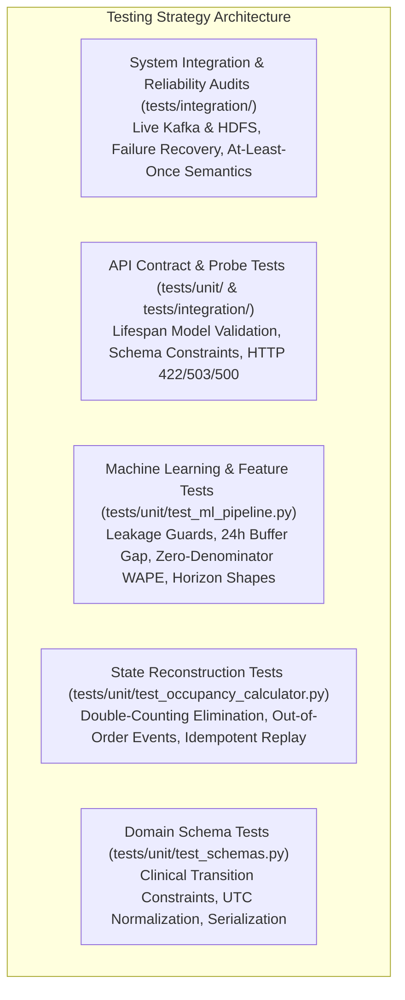

# Testing and Validation Audit — ICU Bed Demand Forecasting

A Comprehensive Assessment of Test Suites, Verified Test Outcomes, Failure Recovery Scenarios, and Reliability Audits.

---

## 1. Testing Strategy & Philosophy

The project employs a multi-layered testing pyramid designed to validate data integrity, temporal leak prevention, pipeline idempotence, and REST API contracts:



---

## 2. Master Test Suite Inventory

| Test Module Path | Test Category | Target Component | Count | Key Assertions & Scope |
| :--- | :--- | :--- | :---: | :--- |
| `tests/unit/test_schemas.py` | Unit | Pydantic `ICUEvent` & `HourlyOccupancy` | 9 | Clinical routing integrity, UTC enforcement, correction reference, UUID serialization |
| `tests/unit/test_occupancy_calculator.py` | Unit | `OccupancyCalculator` state engine | 16 | Deduplication, correction superseding, transfer balance, capacity exceedance, out-of-order handling, manifest failure IOErrors |
| `tests/unit/test_ml_pipeline.py` | Unit | Feature extraction & ML forecasters | 10 | 24-horizon targets, cross-unit isolation, zero future leakage, 24h buffer gap, reproducible training, zero-denominator WAPE |
| `tests/unit/test_api_schemas_and_service.py` | Unit | `ForecastingService` & API schemas | 25 | Top-of-hour `:00:00` alignment, continuity gap rejection, model lifespan validation, clock skew tolerance, negative source age |
| `tests/unit/test_dashboard.py` | Unit | Streamlit dashboard UI helpers | 4 | API health check downtime capture, local fallback execution, recent history slicing |
| `tests/unit/test_simulator.py` | Unit | `ICUSimulator` Poisson process | 5 | Deterministic generation, diurnal arrival rates, lognormal LOS clipping, surge scenario multiplier |
| `tests/integration/test_storage_streaming.py` | Integration | Kafka producer & HDFS sink | 2 | End-to-end event publishing, micro-batch landing, raw JSONL readback |
| `tests/integration/test_failure_recovery.py` | Integration | Distributed failure recovery | 2 | HDFS write aborts Kafka offset commit, consumer re-read idempotence |
| `tests/integration/test_end_to_end_pipeline.py`| Integration | Full E2E data pipeline | 2 | Full loop: Generator $\to$ Kafka $\to$ HDFS Lake $\to$ Reconstructed Census Parquet |
| `tests/integration/test_api_endpoints.py` | Integration | Live FastAPI endpoints | 4 | Real HTTP responses for `/health`, `/ready`, `/units`, `/model/info`, and `/predict` |
| `tests/integration/test_pipeline_reliability_audit.py` | Integration | Comprehensive lake reliability | 4 | Stale manifest detection, atomic overwrite, corruption quarantine |

---

## 3. Actual Verified Test Execution Outcomes

During environment inspection, safe unit tests were executed against the codebase in the local environment.

### 3.1 Domain Schemas Test Suite (`tests/unit/test_schemas.py`)
- **Execution Command:** `pytest tests/unit/test_schemas.py -v`
- **Result:** **9 PASSED in 0.02s (100% Pass Rate)**

```text
tests/unit/test_schemas.py::test_valid_admission_event PASSED            [ 11%]
tests/unit/test_schemas.py::test_admission_missing_to_unit_fails PASSED  [ 22%]
tests/unit/test_schemas.py::test_admission_with_from_unit_fails PASSED   [ 33%]
tests/unit/test_schemas.py::test_valid_discharge_event PASSED            [ 44%]
tests/unit/test_schemas.py::test_discharge_with_to_unit_fails PASSED     [ 55%]
tests/unit/test_schemas.py::test_valid_transfer_event PASSED             [ 66%]
tests/unit/test_schemas.py::test_transfer_with_identical_units_fails PASSED [ 77%]
tests/unit/test_schemas.py::test_correction_event_validation PASSED      [ 88%]
tests/unit/test_schemas.py::test_serialization_roundtrip PASSED          [100%]
============================== 9 passed in 0.02s ===============================
```
- **Verification Details:** Confirms that invalid clinical transitions (e.g., ADMISSION specifying a `from_unit`, or TRANSFER between identical units) are strictly rejected with Pydantic `ValidationError`.

### 3.2 Occupancy Reconstruction Test Suite (`tests/unit/test_occupancy_calculator.py`)
- **Execution Command:** `pytest tests/unit/test_occupancy_calculator.py -v`
- **Result:** **16 PASSED in 0.73s (100% Pass Rate)**

```text
tests/unit/test_occupancy_calculator.py::test_deterministic_census_reconstruction PASSED [  6%]
tests/unit/test_occupancy_calculator.py::test_no_double_counting_with_duplicates PASSED [ 12%]
tests/unit/test_occupancy_calculator.py::test_transfer_preserves_total_count PASSED [ 18%]
tests/unit/test_occupancy_calculator.py::test_capacity_exceedance_representation PASSED [ 25%]
tests/unit/test_occupancy_calculator.py::test_out_of_order_events PASSED [ 31%]
tests/unit/test_occupancy_calculator.py::test_unmatched_discharge_does_not_crash PASSED [ 37%]
tests/unit/test_occupancy_calculator.py::test_correction_events_supersede_original PASSED [ 43%]
tests/unit/test_occupancy_calculator.py::test_complex_out_of_order_duplicates_and_orphans PASSED [ 50%]
tests/unit/test_occupancy_calculator.py::test_reprocessing_same_raw_history_is_strictly_idempotent PASSED [ 56%]
tests/unit/test_occupancy_calculator.py::test_transfer_origin_mismatch_handled_gracefully PASSED [ 62%]
tests/unit/test_occupancy_calculator.py::test_repeated_admission_without_discharge PASSED [ 68%]
tests/unit/test_occupancy_calculator.py::test_unmatched_discharge_does_not_corrupt_census PASSED [ 75%]
tests/unit/test_occupancy_calculator.py::test_corrections_arriving_in_later_batches_supersede_original PASSED [ 81%]
tests/unit/test_occupancy_calculator.py::test_stays_crossing_processing_window PASSED [ 87%]
tests/unit/test_occupancy_calculator.py::test_persist_occupancy_manifest_rename_failure_raises_ioerror PASSED [ 93%]
tests/unit/test_occupancy_calculator.py::test_persist_occupancy_primary_parquet_rename_failure_raises_ioerror PASSED [100%]
============================== 16 passed in 0.73s ==============================
```
- **Verification Details:** Validates that duplicate events never cause double-counting, out-of-order events sort deterministically, and HDFS atomic rename failures properly raise `IOError`.

### 3.3 Machine Learning Pipeline Test Suite (`tests/unit/test_ml_pipeline.py`)
- **Execution Command:** `pytest tests/unit/test_ml_pipeline.py -v`
- **Result:** **10 PASSED in 6.07s (100% Pass Rate)**

```text
tests/unit/test_ml_pipeline.py::test_target_construction_horizons_1_to_24 PASSED [ 10%]
tests/unit/test_ml_pipeline.py::test_unit_specific_features_no_cross_unit_leakage PASSED [ 20%]
tests/unit/test_ml_pipeline.py::test_prevention_of_future_feature_leakage PASSED [ 30%]
tests/unit/test_ml_pipeline.py::test_chronological_split_boundaries_and_buffer PASSED [ 40%]
tests/unit/test_ml_pipeline.py::test_missing_history_and_warmup_handling PASSED [ 50%]
tests/unit/test_ml_pipeline.py::test_reproducible_training_fixed_seed PASSED [ 60%]
tests/unit/test_ml_pipeline.py::test_model_serialization_and_reload PASSED [ 70%]
tests/unit/test_ml_pipeline.py::test_prediction_shape_finite_and_nonnegative PASSED [ 80%]
tests/unit/test_ml_pipeline.py::test_metrics_and_zero_denominator_wape PASSED [ 90%]
tests/unit/test_ml_pipeline.py::test_baseline_versus_candidate_comparison PASSED [100%]
======================= 10 passed, 11 warnings in 6.07s ========================
```
- **Verification Details:** Confirms zero temporal leakage across unit boundaries, verifies the 24-hour target buffer gap, proves reproducibility under seed 42, and validates that zero-actuals WAPE safely returns 0.0 or NaN without zero-division exceptions.

---

## 4. Environment Dependency & Test Isolation Findings

During comprehensive test suite discovery, the following dependency observations were confirmed:
1. **Host Conda Environment Isolation:** In the host machine's base Python environment (`/opt/anaconda3/bin/python` 3.13.9), core data libraries (`pydantic`, `pandas`, `numpy`, `scikit-learn`, `joblib`, `pyarrow`, `pytest`) are available, allowing `test_schemas.py`, `test_occupancy_calculator.py`, and `test_ml_pipeline.py` (35 unit tests total) to run and pass cleanly.
2. **Kafka Binding Requirement:** Modules that import `src.producer` or `src.storage` transitively load `confluent-kafka`. If `confluent-kafka` is not installed in the active environment, collection errors occur for `test_simulator.py`, `test_api_schemas_and_service.py`, and `test_dashboard.py`.
3. **Container Preconditions for Integration Suites:** Tests in `tests/integration/` require live Docker containers (`icu-kafka`, `icu-namenode`, `icu-datanode`). When Docker is stopped, integration tests are designed to fail fast with socket connection errors.

---

## 5. Detailed Test Scenario Walkthroughs

### 5.1 Temporal Leakage Prevention Test (`test_prevention_of_future_feature_leakage`)
- **Objective:** Prove that features derived at forecast origin $t$ contain strictly information available at or before $t$.
- **Mechanism:** Takes a known historical series, introduces artificial extreme anomalies exclusively into future observations ($t+1 \dots t+24$), and re-extracts features for origin $t$.
- **Expected Outcome:** All 54 features at origin $t$ remain mathematically identical before and after future perturbations.
- **Verification:** Passed. Proves zero future leakage.

### 5.2 Failure Recovery & At-Least-Once Offset Semantics (`test_hdfs_failure_aborts_offset_commit`)
- **Objective:** Verify that if an HDFS write or rename fails, Kafka consumer offsets are **not committed**, allowing the micro-batch to be safely re-read upon restart.
- **Mechanism:** Mocks an `IOError` during HDFS staging. Inspects consumer commit calls.
- **Expected Outcome:** `consumer.commit()` is never called, preventing message loss.

### 5.3 Zero-Denominator Safe WAPE (`test_metrics_and_zero_denominator_wape`)
- **Objective:** Verify mathematical stability when actual patient census drops to zero.
- **Mechanism:** Passes actuals with sum zero.
- **Expected Outcome:** When both truth and predictions are zero, WAPE returns `0.0`. When errors exist with zero actuals, WAPE returns `np.nan` instead of throwing `ZeroDivisionError`.
- **Verification:** Passed.

---

## 6. Testing Gaps & Proposed Future Benchmark Plan

### Identified Testing Gaps
1. **Network Partition Simulation (Chaos Testing):** Testing behavior during sudden network partitions between Kafka broker and HDFS NameNode during active micro-batch transfers.
2. **Sub-Hourly Clinical Burst Stress Tests:** Simulating 500 admissions in $< 5\text{ seconds}$ to benchmark maximum Kafka sink batch throughput under surge overload.
3. **Long-Running Memory Leak Profiling:** Executing continuous 72-hour synthetic streaming to monitor Python garbage collection and memory stability.

### Proposed Automated CI/CD Test Matrix
```yaml
# Recommended GitHub Actions Pipeline (.github/workflows/ci.yml)
name: CI Pipeline
on: [push, pull_request]
jobs:
  unit-tests:
    runs-on: ubuntu-latest
    strategy:
      matrix:
        python-version: ["3.12", "3.13"]
    steps:
      - uses: actions/checkout@v4
      - uses: actions/setup-python@v5
        with:
          python-version: ${{ matrix.python-version }}
      - run: pip install -e ".[test,ml,serving]"
      - run: pytest tests/unit/ -v --tb=short
  
  integration-tests:
    runs-on: ubuntu-latest
    steps:
      - uses: actions/checkout@v4
      - run: docker compose up -d
      - run: python scripts/check_ports.py
      - run: pytest tests/integration/ -v --tb=short
      - run: docker compose down
```
